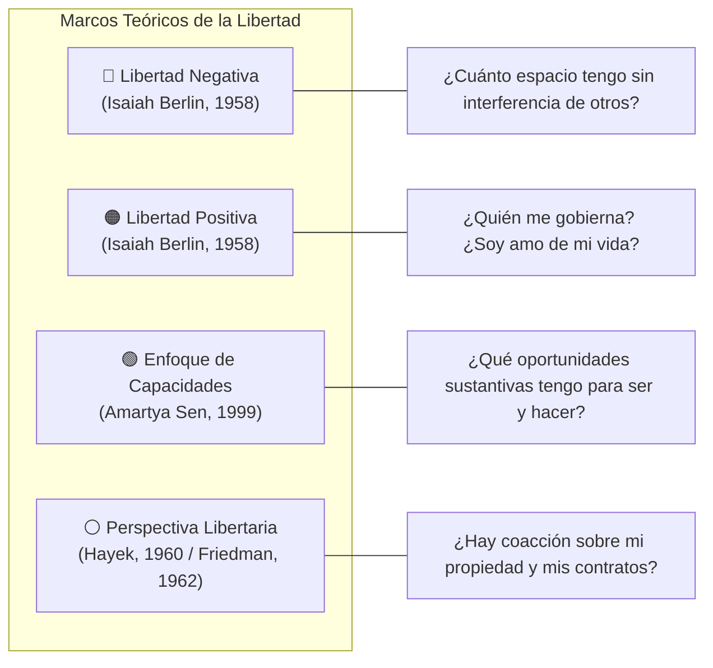
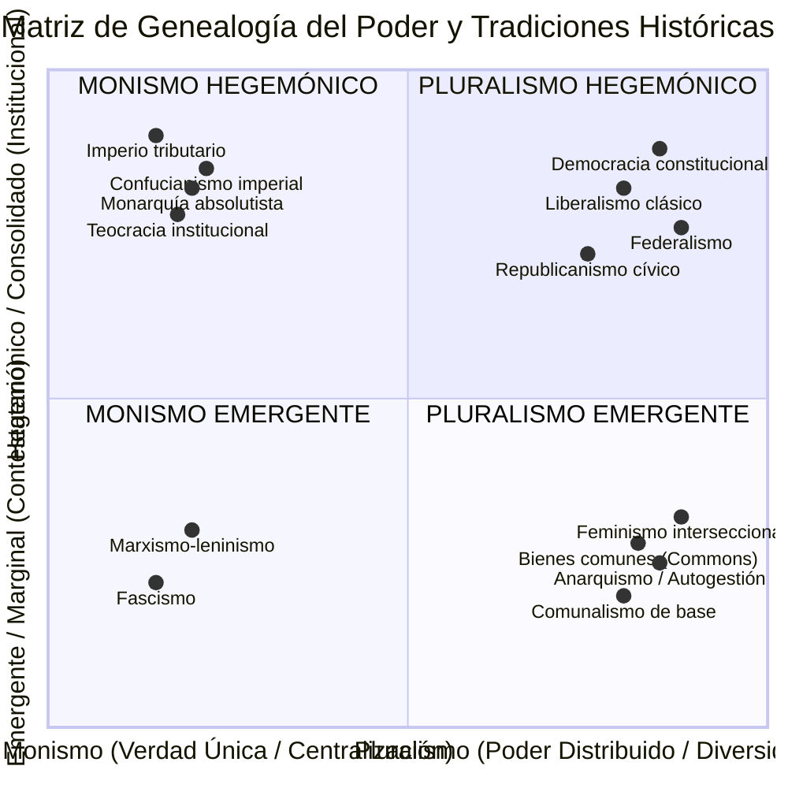
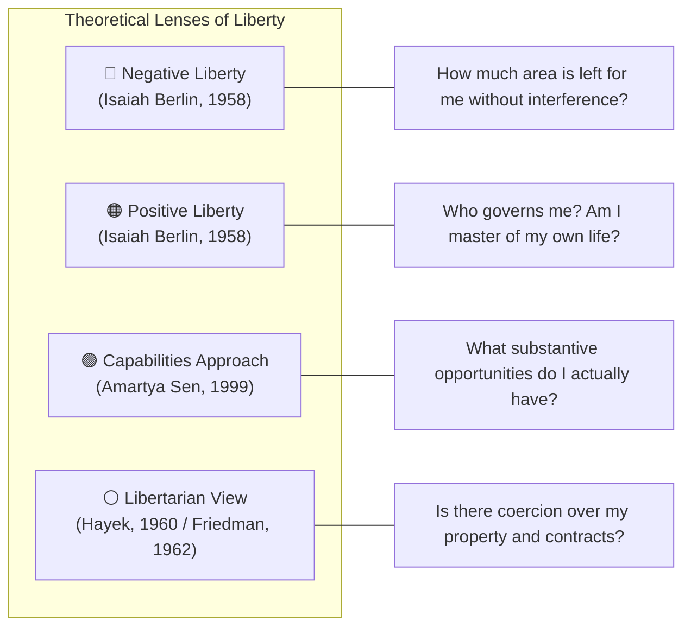
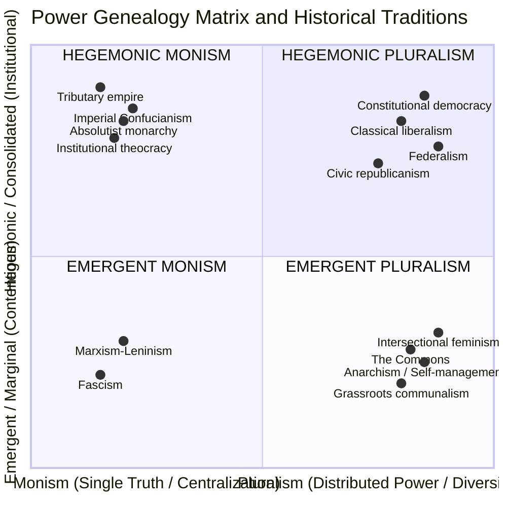

# Anatomía de la Libertad / Anatomy of Liberty

> **Una infografía interactiva, laboratorio analítico y ensayo hipertextual sobre los marcos teóricos de la libertad política, la genealogía del poder y su tensión empírica en Colombia.**  
> *An interactive infographic, analytical lab, and hypertextual essay on the theoretical frameworks of political liberty, the genealogy of power, and their empirical tension in Colombia.*

[](https://willkwolf.github.io/isaiah-berlin-liberty-infographic/)
[](https://creativecommons.org/licenses/by-nc-sa/4.0/deed.es)
[](./openwiki/02-tecnologia-y-arquitectura/01-arquitectura-zero-build.md)
[](./openwiki/02-tecnologia-y-arquitectura/03-sistema-diseno-y-responsividad.md)
[](./openwiki/03-contratos-y-tests/02-infraestructura-y-metodologia-de-tests.md)
[](./openwiki/README.md)

---

## 🌐 Índice / Table of Contents

* 🇪🇸 **[Versión en Español](#-español)**
  * [1. ¿Qué es Anatomía de la Libertad?](#1-qué-es-anatomía-de-la-libertad)
  * [2. Los Cuatro Marcos Teóricos (Lentes de Interpretación)](#2-los-cuatro-marcos-teóricos-lentes-de-interpretación)
  * [3. Estructura y Recorrido de las 11 Secciones](#3-estructura-y-recorrido-de-las-11-secciones)
  * [4. Genealogía del Poder y Arquitecturas de la Libertad (Sección X)](#4-genealogía-del-poder-y-arquitecturas-de-la-libertad-sección-x)
  * [5. El Dilema Empírico: Los Mismos Datos, Cuatro Juicios Morales](#5-el-dilema-empírico-los-mismos-datos-cuatro-juicios-morales)
  * [6. Experiencia Interactiva y Scrollytelling](#6-experiencia-interactiva-y-scrollytelling)
  * [7. Arquitectura Técnica Zero-Build](#7-arquitectura-técnica-zero-build)
  * [8. OpenWiki: Centro Documental y Gobernanza por Dominios](#8-openwiki-centro-documental-y-gobernanza-por-dominios)
  * [9. Suites de Pruebas y Aseguramiento de Calidad](#9-suites-de-pruebas-y-aseguramiento-de-calidad)
  * [10. Cómo Citar y Ecosistema de Fuentes](#10-cómo-citar-y-ecosistema-de-fuentes)
* 🇬🇧 **[English Version](#-english)**
  * [1. What is Anatomy of Liberty?](#1-what-is-anatomy-of-liberty)
  * [2. The Four Theoretical Lenses](#2-the-four-theoretical-lenses)
  * [3. Architecture and Narrative of the 11 Sections](#3-architecture-and-narrative-of-the-11-sections)
  * [4. Genealogy of Power & Institutional Architectures (Section X)](#4-genealogy-of-power--institutional-architectures-section-x)
  * [5. The Empirical Dilemma: Same Data, Four Moral Verdicts](#5-the-empirical-dilemma-same-data-four-moral-verdicts)
  * [6. Interactive Architecture & Scrollytelling](#6-interactive-architecture--scrollytelling)
  * [7. Zero-Build Technical Philosophy](#7-zero-build-technical-philosophy)
  * [8. OpenWiki: Living Knowledge Base by Domains](#8-openwiki-living-knowledge-base-by-domains)
  * [9. Test Infrastructure & Quality Assurance](#9-test-infrastructure--quality-assurance)
  * [10. How to Cite & Academic Ecosystem](#10-how-to-cite--academic-ecosystem)

---

# 🇪🇸 Español

## 1. ¿Qué es Anatomía de la Libertad?

En el debate político contemporáneo, la palabra **«libertad»** suele reducirse a una consigna propagandística, a un eslogan electoral simplificado o a un dogma incuestionable. Quienes la invocan asumen con frecuencia que su significado es unívoco, transparente y evidente por sí mismo.

**Anatomía de la Libertad** interrumpe deliberadamente esa ilusión. Diseñada como un artefacto pedagógico computacional y ensayo visual interactivo, la plataforma guía al lector a través de las tensiones irreductibles que atraviesan la filosofía política occidental:

* ¿Es la libertad simplemente la ausencia de cadenas y leyes que me prohíban actuar (**libertad negativa**)?
* ¿O exige el autogobierno consciente, la madurez cívica y la capacidad real de moldear mi propio destino (**libertad positiva**)?
* ¿De qué sirve el permiso legal de comprar pan o viajar a quien carece de recursos materiales, educación y salud para hacerlo (**enfoque de capacidades**)?
* ¿Cómo se articula la libertad con el orden espontáneo del mercado, el derecho de propiedad y la limitación estricta del poder estatal (**lectura libertaria**)?
* ¿Cómo han organizado históricamente las civilizaciones la tensión entre monismo y pluralismo para negociar la libertad y la coacción (**genealogía del poder**)?

---

## 2. Los Cuatro Marcos Teóricos (Lentes de Interpretación)

La interfaz permite al usuario alternar en cualquier momento entre cuatro perspectivas filosóficas fundamentales:



1. **Libertad Negativa (Isaiah Berlin):** La inmunidad frente a la interferencia deliberada de otros seres humanos o del Estado. Berlin enfatiza que la incapacidad física o la escasez natural no equivalen a coacción política. Su máxima virtud es blindar una frontera inviolable de autonomía individual.
2. **Libertad Positiva (Isaiah Berlin):** El anhelo de autodeterminación, soberanía democrática y autogobierno cívico. Berlin advierte aquí sobre la **pendiente resbaladiza del «yo superior»**: el riesgo histórico de que el Estado o un partido iluminado asuma encarnar la «verdadera razón» del ciudadano, justificando la tiranía bajo la fórmula rousseauniana de *«obligar al hombre a ser libre»*.
3. **Enfoque de Capacidades (Amartya Sen & Martha Nussbaum):** Supera la trampa de la libertad puramente formal. Evalúa no sólo si la ley prohíbe algo, sino si el individuo cuenta con los **factores de conversión** (educación, salud, infraestructura, ausencia de discriminación) que le permiten transformar bienes materiales en realizaciones efectivas.
4. **Perspectiva Libertaria y de Mercado (Friedrich Hayek & Milton Friedman):** Concibe el mercado y el sistema de precios libres como un **orden espontáneo (*catalaxia*)** que procesa el conocimiento disperso de millones de individuos. Defiende que la libertad económica es la base y el escudo protector insustituible de la libertad política.

---

## 3. Estructura y Recorrido de las 11 Secciones

El ensayo visual se articula en **once estaciones temáticas e interactivas**:

1. **Sección I — Problema (Punto de Partida):** Distinción analítica fundamental entre *problemas técnicos* (consenso sobre fines, optimización de medios) y *problemas políticos* (conflicto irreducible de valores). La política como administración del desacuerdo civilizado.
2. **Sección II — Isaiah Berlin y los Dos Conceptos:** Confrontación dialéctica entre «libre de» (negativa) y «libre para» (positiva), sus dilemas prácticos (expresión, mercado, educación) y tensiones conceptuales.
3. **Sección III — El Conflicto No Resuelto:** La incompatibilidad estructural entre libertad e igualdad. Simulador interactivo de la curva de transformación y cálculo en tiempo real de la pérdida recíproca.
4. **Sección IV — Poder y Obediencia:** La pregunta política fundamental: *«¿Por qué debo obedecer?»* (Hobbes, Locke, Rousseau, Berlin). Diagrama vectorial relacional de cuatro nodos: Individuo, Estado, Mercado y Sociedad.
5. **Sección V — Incapacidad versus Coerción:** La frontera epistemológica de la interferencia humana deliberada. *Laboratorio Conceptual de Fronteras* con 4 casos reales interactivos (pasaje de autobús, cierre dominical, licencias costosas, rampas de accesibilidad) y veredictos cruzados de Berlin, Sen y Hayek.
6. **Sección VI — Hayek & Friedman (Economía y Libertad):** La coordinación cataláctica descentralizada, el debate interactivo entre la defensa liberal (dispersión del poder) y la crítica intervencionista (asimetrías fácticas), y visualización de mercado ideal vs. evidencia empírica.
7. **Sección VII — Amartya Sen (Capacidades Reales):** De los recursos a los funcionamientos. Grilla interactiva de 5 capacidades, simulador de trade-offs entre capacidades y no-interferencia, y examen de los límites del IDH y el IPM.
8. **Sección VIII — Colombia bajo Tres Índices:** El laboratorio empírico. Una misma matriz de datos oficiales analizada bajo las cuatro lentes teóricas para evidenciar cómo el diagnóstico moral cambia radicalmente según el marco activo.
9. **Sección IX — Monismo versus Pluralismo:** La crítica de Berlin al historicismo teleológico y a la ilusión de la armonía final. Modelado de sistemas cerrados vs. sistemas plurales, y las dos derivas autoritarias: el «Yo Superior» (positiva) y la «Dominación Privada» (negativa).
10. **Sección X — Genealogía del Poder (Cómo Organizamos la Libertad):** Matriz histórica de 4 cuadrantes que clasifica **23 tradiciones políticas históricas** según su concepción monista o pluralista y su posición hegemónica o emergente.
11. **Sección XI — Cierre (Epílogo Epistémico):** La metáfora de la «madera torcida» de Kant, las 4 tesis del pluralismo de valores, *«Esta tensión no se resuelve: se habita»*, y la conexión con la *Ruta del Pensamiento Crítico* (5 proyectos interconectados).

---

## 4. Genealogía del Poder y Arquitecturas de la Libertad (Sección X)

La Sección X desciende de la abstracción teórica a la historia institucional, demostrando cómo civilizaciones y movimientos han organizado y negociado la libertad a lo largo de los siglos. Las 23 tradiciones se ordenan en una **matriz tipológica de cuatro cuadrantes**:



* **Q1: Monismo Hegemónico (Dominio Uniforme):** Imperio tributario, Teocracia institucional, Monarquía absolutista, Califato histórico, Confucianismo imperial, Nacionalismo autoritario.
* **Q2: Pluralismo Hegemónico (Contrapesos Institucionalizados):** Republicanismo cívico, Liberalismo clásico, Democracia constitucional, Federalismo, Ciudad-estado, Tradiciones feudales estamentales.
* **Q3: Monismo Emergente (Vanguardias y Ruptura Doctrinal):** Fascismo, Marxismo-leninismo, Teocracia radical insurgente, Conservadurismo autoritario/híbrido, Nacionalismo étnico.
* **Q4: Pluralismo Emergente (Autonomías Comunitarias y Bienes Comunes):** Anarquismo/socialismo libertario, Feminismo interseccional, Ecologismo radical/Commons, Multiculturalismo, Movimientos indígenas y derecho propio, Comunalismo.

Cada tradición cuenta con una ficha estructurada accesible mediante ventana modal con trampa de foco y navegación por teclado, que detalla: **periodo y contexto, estructura de autoridad, mecanismos coercitivos, relato de legitimación, beneficiarios (*gainers*), quiénes pagan el costo (*cost-bearers*), contrapesos institucionales o fácticos, diagnóstico bajo los marcos teóricos y fuentes bibliográficas canónicas**.

---

## 5. El Dilema Empírico: Los Mismos Datos, Cuatro Juicios Morales

Para evitar que el análisis permanezca en la estratosfera teórica, la plataforma somete estos marcos a un examen riguroso con **datos empíricos oficiales de Colombia**:

| Dimensión Empírica (Colombia) | Lectura Negativa (Berlin) | Lectura Positiva (Berlin) | Lectura Capacidades (Sen) | Lectura Libertaria (Hayek/Friedman) |
| :--- | :--- | :--- | :--- | :--- |
| **Pobreza Multidimensional (IPM: ~12.1%)** | Mientras no provenga de leyes prohibitivas, es escasez material, no opresión política. | Privación grave de libertad: quien carece de agua y techo no es soberano de su vida. | Falla crítica de factores de conversión en regiones periféricas desatendidas. | Consecuencia predecible de trabas regulatorias y falta de titulación de tierras. |
| **Informalidad Laboral (>55%)** | Las personas tienen libertad legal para emprender o trabajar en la calle sin ser encarceladas. | La informalidad expulsa a millones de la ciudadanía plena y de la protección colectiva. | Amputación de la agencia al carecer de seguridad social protectora y ahorro formal. | Respuesta defensiva del mercado ante un salario mínimo y sobrecostos parafiscales asfixiantes. |
| **Índice de Desarrollo Humano (IDH: ~0.758)** | Indica estabilidad institucional básica que preserva la vida y los derechos negativos. | Insuficiente: profundas asimetrías territoriales impiden el autogobierno equitativo. | Avances en promedio, pero con graves fracturas en libertades instrumentales periféricas. | Demuestra que la iniciativa privada y la integración comercial expanden el bienestar. |

> **Lección Epistemológica Central:** Los números en pantalla no cambian; cambia la interpretación valorativa. Esa discrepancia no es un error de medición, sino el corazón irresoluble de la deliberación política democrática.

---

## 6. Experiencia Interactiva y Scrollytelling

La aplicación está diseñada para una inmersión cognitiva fluida tanto en computadores de escritorio como en dispositivos móviles:

* **Top Navigation Inteligente:** Barra superior con anclas en numeración romana (I a XI) que se colapsa automáticamente al desplazarse hacia abajo para maximizar el área de lectura, y reaparece al subir.
* **Ruleta Horizontal de Lentes (Móvil):** En pantallas pequeñas, el selector se convierte en una ruleta táctil docked en la parte inferior con gradientes de difusión en los extremos, enfoque automático sin toques reiterados (*zero-tap focus*) y un ancho de $260\text{ px}$ que elimina truncamientos de texto.
* **Chip Lateral Permanente (Escritorio):** En pantallas $> 768\text{ px}$, el panel lateral derecho (`220 px`) ofrece acceso constante a las cuatro lentes y al botón colapsable.
* **Modo Claro / Oscuro Sincrónico:** Conmutación automática según la luz solar (07:00 a 20:00) o manual con persistencia en `localStorage`, respaldada por un script sincrónico en `<head>` que previene el destello blanco/oscuro (FOUC).
* **Internacionalización Instantánea:** Alternancia en caliente entre Español e Inglés sin recargar la página mediante el motor `files/i18n.js`.
* **Explorador Modal de Tradiciones:** Sistema modal dialog accesible (WCAG 2.1 AA) con navegación por pestañas (*Overview* vs *Traditions*), historial de foco, navegación por teclado (`←`, `→`, `Esc`) y blindaje visual en todas las resoluciones.

---

## 7. Arquitectura Técnica Zero-Build

Frente a la fragilidad de los bundlers y dependencias que caducan, el proyecto adopta la filosofía **Zero-Build**:

* **Estándares Web Puros:** HTML5 semántico, CSS3 con custom properties y JavaScript ES6+ vanilla.
* **Sin Servidor en Producción:** Despliegue 100% estático en GitHub Pages administrado por GitHub Actions (`.github/workflows/deploy.yml`).
* **Rutas Relativas Universales:** Enlaces relativos estrictos que garantizan que el sitio funcione en cualquier subdominio o directorio local.
* **Rendimiento:** Tiempos de carga ultra-rápidos y puntajes de 100/100 en Google Lighthouse.

---

## 8. OpenWiki: Centro Documental y Gobernanza por Dominios

El proyecto cuenta con un sistema documental estructurado bajo el directorio [`openwiki/`](./openwiki/README.md), organizado por dominios:

* 📚 **[Dominio I: Marco Teórico y Filosofía Política](./openwiki/01-marco-teorico/)**: 10 módulos académicos rigurosos:
  1. *Fundamentos Filosóficos (Berlin)*
  2. *Enfoque de Capacidades (Sen & Nussbaum)*
  3. *Perspectiva Libertaria de Mercado (Hayek & Friedman)*
  4. *El Dilema Empírico Colombiano*
  5. *Metodología, Fuentes y Citas*
  6. *Genealogía del Poder y Arquitecturas de la Libertad*
  7. *Monismo vs. Pluralismo y Crítica al Historicismo*
  8. *Poder, Obediencia y Coerción (Incapacidad vs. Coerción)*
  9. *El Conflicto Trágico de Valores e Inconmensurabilidad*
  10. *Síntesis Epistémica y Ruta del Pensamiento Crítico*
* 💻 **[Dominio II: Tecnología y Arquitectura Web](./openwiki/02-tecnologia-y-arquitectura/)**: Zero-build, componentes DOM, CSS responsive, motor de traducción i18n y gráficos Canvas/SVG.
* 🛡️ **[Dominio III: Contratos, Tests y Agentes](./openwiki/03-contratos-y-tests/)**: Contratos de interfaz y DOM, metodología de tests, matriz de verificación de features (F1 a F15) y políticas del sistema.

### Visualizador Interactivo de Documentación
Para explorar la documentación como una wiki web completa con búsqueda y modo oscuro:
* Abra directamente en su navegador: [`openwiki/index.html`](./openwiki/index.html)
* O ejecute mediante CLI:
  ```bash
  npm run wiki:visualize
  ```

---

## 9. Suites de Pruebas y Aseguramiento de Calidad

El proyecto implementa una rigurosa metodología de pruebas de caja opaca en 4 niveles:

```bash
# Ejecutar pruebas unitarias, de accesibilidad (axe-core) y de propiedades (fast-check)
npm test

# Ejecutar auditoría E2E multi-viewport en Chromium (Playwright)
npm run test:playwright

# Ejecutar pruebas de defensa visual de layout (Vibium)
npm run test:vibium

# Ejecutar la matriz completa de pruebas (100% pass)
npm run test:all
```

---

## 10. Cómo Citar y Ecosistema de Fuentes

### Cuaderno de Fuentes y Contenido Sonoro
* **Cuaderno Semántico en NotebookLM:** [Notas de investigación y análisis documental](https://notebooklm.google.com/notebook/5ce143e6-2b6f-41e3-a96d-eb58c6fbb2a1)
* **Podcast en Spotify:** [Anatomía de la Libertad: Isaiah Berlin en Colombia](https://open.spotify.com/show/4hRC6rIFVIozooGV6OdWOI?si=e500cb9f38684cc2)

### Citación Académica (APA 7.ª edición)
> Artunduaga Viana, W. C. (2026). *Anatomía de la Libertad: Una infografía interactiva sobre marcos teóricos de la libertad política, la genealogía del poder y su tensión empírica en Colombia* [Visualización web interactiva y ensayo hipertextual]. GitHub. https://willkwolf.github.io/isaiah-berlin-liberty-infographic/

### Formato BibTeX
```bibtex
@software{artunduaga2026libertad,
  author    = {Artunduaga Viana, William Camilo},
  title     = {Anatomía de la Libertad},
  year      = {2026},
  publisher = {GitHub},
  url       = {https://willkwolf.github.io/isaiah-berlin-liberty-infographic/},
  note      = {Ensayo hipertextual bilingüe sobre filosofía política, genealogía del poder y teoría de la libertad}
}
```

---

# 🇬🇧 English

## 1. What is Anatomy of Liberty?

In contemporary political discourse, the word **"freedom"** (or **"liberty"**) is routinely degraded into a partisan slogan, an election soundbite, or an unquestioned moral dogma. Political actors invoke it while presupposing that its meaning is uniform, transparent, and self-evident.

**Anatomy of Liberty** (*Anatomía de la Libertad*) deliberately interrupts that illusion. Engineered as an interactive computational pedagogical artefact and hypertextual essay, this platform guides readers through the profound and irreconcilable fault lines of Western political philosophy:

* Is liberty merely the absence of external chains, physical coercion, and prohibitive legislation (**negative liberty**)?
* Or does it demand conscious self-mastery, civic maturity, and the substantive power to author one's own destiny (**positive liberty**)?
* What is the practical value of legal permission to purchase bread or travel abroad if an individual lacks the physical health, literacy, or material resources to do so (**capabilities approach**)?
* How does individual freedom coordinate with spontaneous market orders, private property rights, and strict constitutional limits on state planning (**libertarian perspective**)?
* How have civilizations and historical movements negotiated freedom through the tensions between monism and pluralism (**genealogy of power**)?

---

## 2. The Four Theoretical Lenses

The application interface allows users to switch fluidly between four seminal philosophical lenses:



1. **Negative Liberty (Isaiah Berlin):** Non-interference by other human beings or by the state. Berlin rigorously argues that natural human frailty or physical incapacity is not political un-freedom unless intentionally caused by human arrangements. Its paramount objective is safeguarding an inviolable minimum sphere of private personal autonomy.
2. **Positive Liberty (Isaiah Berlin):** The aspiration towards collective self-determination, democratic autonomy, and personal self-realization. Here Berlin identifies the dangerous **slippery slope of the "higher self"**: the historic propensity of churches, ideological vanguards, or totalitarian states to claim to embody the citizen's "real rational will", justifying violent coercion under Rousseau's paradox of *"forcing men to be free"*.
3. **Capabilities Approach (Amartya Sen & Martha Nussbaum):** Resolves the limitation of purely formal negative freedom. It evaluates whether individuals possess the actual **conversion factors** (healthcare, quality schooling, public infrastructure, non-discrimination) needed to convert primary goods into substantive human functionings.
4. **Libertarian & Free-Market Perspective (Friedrich Hayek & Milton Friedman):** Conceives the free-price system and competitive markets as a decentralized **spontaneous order (*catallaxy*)** that aggregates tacit, local knowledge that no central planning board could ever compute. It asserts that economic freedom is both an end in itself and an indispensable institutional bulwark for civil and political liberty.

---

## 3. Architecture and Narrative of the 11 Sections

The interactive essay unfolds across **eleven thematic and functional stations**:

1. **Section I — Problem (Starting Point):** Fundamental distinction between *technical problems* (agreement on ends, optimization of means) and *political problems* (irreducible value conflict). Politics as the governance of civilized disagreement.
2. **Section II — Isaiah Berlin & The Two Concepts:** Dialectical confrontation between "free from" (negative) and "free to" (positive), real-world dilemmas, and conceptual tensions.
3. **Section III — The Unresolved Conflict:** The structural incompatibility between liberty and equality. Interactive trade-off curve simulator with live computation of reciprocal loss.
4. **Section IV — Power and Obedience:** The foundational political question: *"Why should I obey?"* (Hobbes, Locke, Rousseau, Berlin). 4-node relational vector diagram: Individual, State, Market, and Society.
5. **Section V — Incapacity versus Coercion:** The epistemic boundary of intentional human interference. *Conceptual Boundary Lab* with 4 interactive cases (bus fare, Sunday store closures, costly licenses, universal accessibility ramps) and cross-verdicts from Berlin, Sen, and Hayek.
6. **Section VI — Hayek & Friedman (Economy & Freedom):** Decentralized catallactic coordination, interactive dialogue between liberal defenses and interventionist critiques, and ideal market models vs. empirical reality.
7. **Section VII — Amartya Sen (Substantive Capabilities):** From commodities to functionings. Interactive 5-capability matrix, trade-off simulator between capabilities and non-interference, and limits of HDI and MPI.
8. **Section VIII — Colombia Under Three Indices:** The empirical test ground. Identical official Colombian datasets evaluated across the four lenses to demonstrate how moral diagnoses diverge radically depending on the chosen lens.
9. **Section IX — Monism versus Pluralism:** Berlin's critique of teleological historicism and final harmonic syntheses. Comparative modeling of closed vs. open plural systems, and the two dogmatic traps: the "Higher Self" (positive) and "Private Domination" (negative).
10. **Section X — Genealogy of Power (How We Organize Liberty):** 4-quadrant historical matrix classifying **23 historical political architectures** across monism, pluralism, hegemonic rule, and emergent counter-powers.
11. **Section XI — Conclusion (Epistemic Coda):** Kant's "crooked timber" metaphor, the 4 theses of value pluralism, *"This tension is not solved: it is inhabited"*, and connection with the 5-step *Critical Thinking Path*.

---

## 4. Genealogy of Power & Institutional Architectures (Section X)

Section X transitions from abstract philosophy to institutional history, mapping how societies have negotiated freedom and coercion over millennia. The 23 traditions are categorized within a **two-dimensional four-quadrant typology**:



* **Q1: Hegemonic Monism (Uniform Dominion):** Tributary Empire, Institutional Theocracy, Absolutist Monarchy, Historical Caliphate, Imperial Confucianism, Authoritarian Nationalism.
* **Q2: Hegemonic Pluralism (Institutionalized Checks & Balances):** Civic Republicanism, Classical Liberalism, Constitutional Democracy, Federalism, City-State, Feudal Estates Constitutionalism.
* **Q3: Emergent Monism (Radical Vanguards & Doctrinal Rupture):** Fascism, Marxism-Leninism, Insurgent Radical Theocracy, Authoritarian/Hybrid Conservatism, Ethnic Nationalism.
* **Q4: Emergent Pluralism (Grassroots Autonomies & The Commons):** Anarchism/Libertarian Socialism, Intersectional Feminism, Radical Ecology/Commons, Multiculturalism, Indigenous Autonomies & Customary Law, Communalism.

Every architecture features a fully accessible modal card (WCAG 2.1 AA) detailing: **historical period and context, authority structures, coercive mechanisms, legitimacy narratives, gainers, cost-bearers, institutional counterweights, theoretical lens readings, and primary academic citations**.

---

## 5. The Empirical Dilemma: Same Data, Four Moral Verdicts

Rather than staying in abstract philosophical discourse, the project confronts these four lenses with **calibrated official empirical datasets from Colombia**:

| Empirical Dimension (Colombia) | Negative Lens (Berlin) | Positive Lens (Berlin) | Capabilities Lens (Sen) | Libertarian Lens (Hayek/Friedman) |
| :--- | :--- | :--- | :--- | :--- |
| **Multidimensional Poverty (MPI: ~12.1%)** | Unless caused by deliberate legal prohibitions, it represents material scarcity, not political coercion. | Severe deprivation of liberty: those without clean water or shelter cannot govern their own lives. | Direct failure of conversion factors and substantive freedoms in remote territorial departments. | Predictable outcome of bureaucratic barriers, state monopolies, and informal land titles. |
| **Labor Informality (>55%)** | Workers retain full legal freedom to trade or work in street markets without state incarceration. | Informality casts millions outside substantive democratic citizenship and social solidarity. | Cripples agency by depriving workers of formal credit, safety nets, and institutional dignity. | Natural market defense against an inflated statutory minimum wage and onerous payroll taxes. |
| **Human Development Index (HDI: ~0.758)** | Reflects legal stability enabling longer life expectancies without fatal human interference. | Insufficient: extreme territorial disparities (Chocó vs Bogotá) negate equal civic autonomy. | Positive baseline gains, but severely fractured across peripheral instrumental freedoms. | Proof that private enterprise, property rights, and trade integration elevate living standards. |

> **Key Epistemic Lesson:** The empirical figures on the screen remain mathematically identical. What changes is the normative, ethical interpretation. That divergence is not a measurement error; it is the permanent, irreconcilable reality of democratic politics.

---

## 6. Interactive Architecture & Scrollytelling

Engineered for seamless, high-performance cognitive exploration across mobile and desktop environments:

* **Smart Top Navigation:** Roman numeral anchors (I through XI) with scroll-aware collapse on downward movement (maximizing screen real estate) and instant auto-expansion on upward scroll.
* **Horizontal Mobile Lens Wheel:** Bottom-docked horizontal drum carousel with edge diffusion gradients, zero-tap programmatic focus, inertia snap, and a $260\text{ px}$ expanded container ensuring zero text truncation on 320px/375px screens.
* **Permanent Desktop Side Chip:** Persistent $220\text{ px}$ side panel on viewports $> 768\text{ px}$ with ARIA-compliant collapse button and instant lens controls.
* **Synchronous Dark/Light Theme:** Daylight-aware auto-toggle (07:00 to 20:00) with manual override stored in `localStorage`, backed by a synchronous `<head>` script that eliminates Flash of Unstyled Content (FOUC).
* **Instant Bilinguality:** In-place bilingual toggling between Spanish and English without page reload, powered by the reactive DOM patcher in `files/i18n.js`.
* **Accessible Tradition Modals:** WCAG 2.1 AA dialog system with tabbed views (*Overview* vs *Traditions*), focus trapping, keyboard navigation (`←`, `→`, `Esc`), and zero horizontal overflow.

---

## 7. Zero-Build Technical Philosophy

Rejecting fragile toolchains and vulnerable dependencies, the project embraces **Zero-Build Web Standards**:

* **Native Platform Technologies:** Semantic HTML5, native CSS3 with custom properties, and vanilla modern ES6+ JavaScript.
* **No Server Processes:** 100% static client-side execution hosted on GitHub Pages via GitHub Actions (`.github/workflows/deploy.yml`).
* **Strict Relative Links:** Fully portable relative resource references across scripts, styles, and anchors.
* **Longevity & Speed:** Zero vulnerability surface, instant First Contentful Paint, and 100/100 Lighthouse performance metrics.

---

## 8. OpenWiki: Living Knowledge Base by Domains

The project maintains an authoritative, source-grounded documentation wiki structured in [`openwiki/`](./openwiki/README.md) across three distinct domains:

* 📚 **[Domain I: Theoretical Framework & Political Philosophy](./openwiki/01-marco-teorico/)**: 10 rigorous academic modules:
  1. *Philosophical Foundations (Berlin)*
  2. *Capabilities Approach (Sen & Nussbaum)*
  3. *Libertarian Free-Market Model (Hayek & Friedman)*
  4. *The Colombian Empirical Dilemma*
  5. *Methodology, Sources & Citations*
  6. *Genealogy of Power & Institutional Architectures*
  7. *Monism vs. Pluralism & Historicist Critique*
  8. *Power, Obedience & Coercion (Incapacity vs. Coercion)*
  9. *The Tragic Conflict of Values & Incommensurability*
  10. *Epistemic Synthesis & The Critical Thinking Path*
* 💻 **[Domain II: Web Technology & Frontend Architecture](./openwiki/02-tecnologia-y-arquitectura/)**: Zero-build design, DOM components, responsive CSS cascade, i18n translation engine, and Canvas/SVG graphics.
* 🛡️ **[Domain III: Contracts, Testing & Agent Governance](./openwiki/03-contratos-y-tests/)**: Interface & DOM contracts, 4-tier testing hierarchy, feature verification catalog (F1-F15), and system guardrails.

### Interactive Web Documentation Viewer
To browse the documentation as an interactive documentation website with full-text search and dark mode:
* Open directly in any web browser: [`openwiki/index.html`](./openwiki/index.html)
* Or launch via the OpenWiki CLI:
  ```bash
  npm run wiki:visualize
  ```

---

## 9. Test Infrastructure & Quality Assurance

Quality assurance is governed by a requirement-driven, opaque-box 4-tier testing hierarchy:

```bash
# Run unit tests, WCAG 2.1 AA accessibility audit (axe-core), and property-based tests (fast-check)
npm test

# Run cross-viewport E2E mobile audit in real Chromium (Playwright)
npm run test:playwright

# Run layout visual defense tests (Vibium)
npm run test:vibium

# Run the complete test matrix (100% pass guarantee)
npm run test:all
```

---

## 10. How to Cite & Academic Ecosystem

### Research Notebook & Audio Podcast
* **NotebookLM Research Workspace:** [Research notebook & bibliographic cross-references](https://notebooklm.google.com/notebook/5ce143e6-2b6f-41e3-a96d-eb58c6fbb2a1)
* **Spotify Podcast Series:** [Anatomy of Liberty: Isaiah Berlin in Colombia](https://open.spotify.com/show/4hRC6rIFVIozooGV6OdWOI?si=e500cb9f38684cc2)

### Academic Citation (APA 7th Edition)
> Artunduaga Viana, W. C. (2026). *Anatomy of Liberty: An interactive infographic on theoretical frameworks of political liberty, the genealogy of power, and their empirical tension in Colombia* [Interactive web visualization and hypertextual essay]. GitHub. https://willkwolf.github.io/isaiah-berlin-liberty-infographic/

### BibTeX Format
```bibtex
@software{artunduaga2026libertad,
  author    = {Artunduaga Viana, William Camilo},
  title     = {Anatomy of Liberty},
  year      = {2026},
  publisher = {GitHub},
  url       = {https://willkwolf.github.io/isaiah-berlin-liberty-infographic/},
  note      = {Bilingual interactive hypertext essay on political philosophy, genealogy of power, and liberty theory}
}
```

### License
Distributed under the **Creative Commons Attribution-NonCommercial-ShareAlike 4.0 International (CC BY-NC-SA 4.0)** license.
