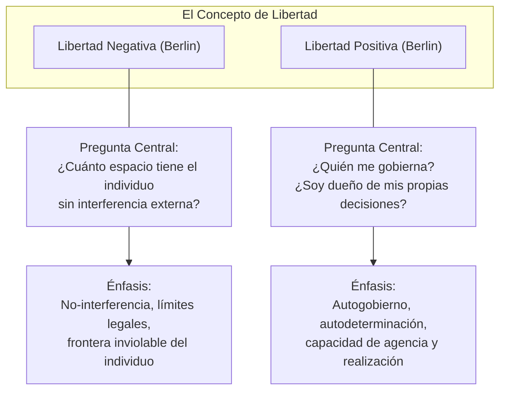
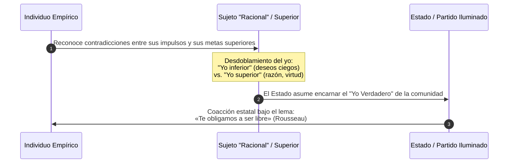

# Dominio I: Marco Teórico — Fundamentos Filosóficos

## 1. Introducción y Contexto Histórico

El proyecto **Anatomía de la Libertad** toma como eje epistemológico el pensamiento del filósofo e historiador de las ideas británico-letón **Sir Isaiah Berlin** (1909–1997). El 31 de octubre de 1958, en su lección inaugural como catedrático Chichele de Teoría Social y Política en la Universidad de Oxford, Berlin expuso la conferencia magistral titulada *Dos conceptos de libertad* (*Two Concepts of Liberty*), posteriormente incluida en su célebre volumen *Cuatro ensayos sobre la libertad* (*Four Essays on Liberty*, 1969).

En un siglo XX polarizado por el enfrentamiento entre democracias liberales y regímenes totalitarios (comunismo soviético y fascismo), Berlin no se limitó a contrastar sistemas de gobierno, sino que descendió al núcleo conceptual del término más disputado de la modernidad: **la libertad**.

---

## 2. La Dualidad Conceptual: Libertad Negativa vs. Libertad Positiva

Berlin demostró que bajo una misma palabra («libertad») coexisten dos respuestas a preguntas políticas radicalmente distintas:

### 2.1. Libertad Negativa: La Ausencia de Coacción Externa

La libertad negativa responde a la pregunta:
> *«¿Cuál es el ámbito en el que al sujeto —una persona o un grupo de personas— se le deja o se le debe dejar hacer o ser lo que es capaz de hacer o ser, sin que en ello interfieran otras personas?»*

#### Criterios y Propiedades Clave:
1. **Coacción deliberada vs. Incapacidad natural:** Berlin traza una distinción epistemológica tajante: la falta de libertad política existe **únicamente** cuando hay interferencia deliberada u obstrucción por parte de otros seres humanos (leyes prohibitivas, encarcelamiento arbitrario, censura, violencia física). Si un individuo no puede volar como un pájaro, o padece una enfermedad congénita, esto constituye una incapacidad o limitación natural, no una falta de libertad política en sentido estricto.
2. **La frontera de inmunidad individual:** Heredero de John Locke, Benjamin Constant y John Stuart Mill, Berlin defiende que debe existir un área mínima inviolable de libertad personal que ningún poder colectivo, rey ni parlamento democrático deba invadir.
3. **Peligro de la reducción al absurdo:** En su versión ultraconservadora, la libertad negativa puede tolerar situaciones de extrema desigualdad o desamparo material con el argumento de que «nadie está prohibiendo legalmente al indigente comprar una mansión».

### 2.2. Libertad Positiva: Autodeterminación y Autogobierno

La libertad positiva responde a la pregunta:
> *«¿Qué o quién es la causa del control o de la interferencia que puede determinar que alguien haga, o sea, una cosa u otra?»*

#### Criterios y Propiedades Clave:
1. **El anhelo de ser el propio dueño:** Se origina en el deseo del individuo de ser su propio amo, de guiar su destino según fines reflexivos propios, y no ser un mero instrumento manipulado por fuerzas ajenas, pasiones irracionales o servidumbres económicas.
2. **Participación democrática:** En la esfera pública, la libertad positiva se manifiesta como soberanía ciudadana y derecho al autogobierno colectivo (¿quién promulga las leyes bajo las que vivo?).

---

## 3. La Pendiente Resbaladiza de la Libertad Positiva

El aporte más controvertido y lúcido de Berlin consiste en describir el mecanismo conceptual mediante el cual la búsqueda de la libertad positiva puede deslizarse hacia el paternalismo y el despotismo totalitario:

1. **La escisión del Yo:** Se divide a la persona en un «yo empírico o inferior» (esclavo de deseos inmediatos, ignorante o alienado) y un «yo ideal o superior» (racional, guiado por el bien común o la moral autónoma).
2. **La sustitución del sujeto:** Si el individuo real no actúa según su «yo superior», una vanguardia (el filósofo-rey, la Iglesia, el Partido o el Estado tecnocrático) se arroga el derecho de decidir por él.
3. **«Obligar a ser libres»:** Berlin advierte con horror la paradoja rousseauniana: en nombre de liberar a la persona de su propia ignorancia, se justifica la represión de su libertad negativa, transformando la emancipación en coerción monolítica.

---

## 4. El Pluralismo de Valores: La Tesis Fundamental de Berlin

Frente al monismo moral dominante en la filosofía occidental desde Platón hasta el marxismo —la premisa de que todas las virtudes y verdades morales pueden coexistir en una síntesis perfecta y sin contradicción—, Isaiah Berlin formula el **Pluralismo de Valores**:

| Premisa Monista Tradicional | Realidad del Pluralismo de Valores (Berlin) |
| :--- | :--- |
| Todos los bienes morales (libertad, igualdad, justicia, orden, compasión) son compatibles en el estado ideal. | Los valores humanos últimos son **múltiples, objetivos, inconmensurables y entran en colisión inevitable**. |
| Si dos valores chocan, uno de ellos debe ser falso o una mala interpretación del verdadero fin. | Dos valores auténticos y nobles pueden colisionar trágicamente sin que ninguno sea espurio. |
| La política es un problema de optimización matemática para alcanzar la armonía total. | La política consiste en deliberar, ponderar pérdidas y negociar compromisos imperfectos entre bienes rivales. |

### Inconmensurabilidad y Elección Trágica
* **Inconmensurabilidad:** No existe una escala universal o «moneda común» que permita calcular cuántas unidades de libertad individual equivalen a cuántas unidades de igualdad redistributiva o seguridad nacional.
* **El costo inevitable:** Maximizar la igualdad material requiere necesariamente coartar la libertad negativa de algunos agentes; garantizar una libertad negativa irrestricta generará desigualdades que lesionen la libertad positiva de otros. Reconocer esta tensión insoslayable es el fundamento de una sociedad libre, pluralista y democrática.
