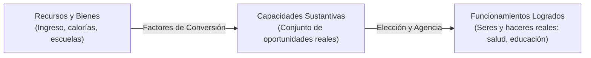

# Dominio I: Marco Teórico — El Enfoque de Capacidades (Amartya Sen)

## 1. De la Libertad Formal a la Libertad Sustantiva

El economista y filósofo indio **Amartya Sen** (Premio Nobel de Economía 1998), en estrecha colaboración con la filósofa Martha Nussbaum, revolucionó la teoría del desarrollo y la filosofía política contemporánea a través de obras fundamentales como *Commodities and Capabilities* (1985) y *Development as Freedom* (*Desarrollo y libertad*, 1999).

Sen interviene en el debate entre libertad negativa y positiva señalando una limitación estructural del enfoque estrictamente negativo de Berlin: **la trampa de la libertad puramente formal**.

> *«La libertad real de una persona para hacer lo que valora no puede medirse únicamente por la ausencia de prohibiciones legales impuestas por el Estado, sino por la gama de oportunidades efectivas y reales que esa persona tiene para elegir y llevar el tipo de vida que tiene razones para valorar».*

---

## 2. La Distinción Estructural: Recursos, Funcionamientos y Capacidades

El Enfoque de Capacidades propone un marco analítico de tres niveles para evaluar el bienestar humano y la justicia distributiva:

### 2.1. Recursos (Commodities / Primary Goods)
Son los medios materiales y financieros: ingresos monetarios, alimentos, libros o medicinas. Sen critica el fetichismo de los recursos propio de la economía tradicional: tener dos personas con el mismo ingreso de \$100 dólares no significa que tengan la misma libertad si una de ellas padece una enfermedad crónica severa que consume el 80% de sus recursos en diálisis.

### 2.2. Factores de Conversión (Conversion Factors)
La capacidad de transformar bienes primarios en libertades reales depende de tres factores de conversión:
* **Factores Personales:** Metabolismo, discapacidades físicas, edad, género.
* **Factores Sociales:** Discriminación étnica, normas de género, seguridad ciudadana, estado de derecho.
* **Factores Ambientales / Geográficos:** Clima, aislamiento vial, topografía, contaminación.

### 2.3. Funcionamientos (Functionings)
Representan los **seres y haceres** que una persona efectivamente realiza: estar nutrido, no morir de enfermedades prevenibles, participar activamente en la vida comunitaria, gozar de auto-respeto y alfabetización.

### 2.4. Capacidades (Capabilities)
Constituyen el **vector o espacio de opciones reales** entre las que la persona puede elegir:
* Si una persona ayuna por convicción religiosa (como Mahatma Gandhi), tiene un funcionamiento de desnutrición temporal, pero posee la **capacidad** de comer cuando lo decida.
* Si un habitante de una zona rural en La Guajira no tiene acceso a agua potable ni a alimentos, carece de la **capacidad** de nutrición, sufriendo una privación directa de su libertad sustantiva.

---

## 3. Las Cinco Libertades Instrumentales

Para Sen, el desarrollo económico no es el mero crecimiento del Producto Interno Bruto (PIB), sino un proceso integral de expansión de las libertades humanas. Estas libertades operan de manera interconectada e interdependiente:

| Libertad Instrumental | Alcance y Contenido | Rol en la Expansión de Agencia |
| :--- | :--- | :--- |
| **1. Libertades Políticas** | Derechos civiles, voto libre, libertad de prensa y expresión, escrutinio de gobernantes. | Permiten a los ciudadanos exigir cuentas al poder y priorizar necesidades comunitarias. |
| **2. Facilidades Económicas** | Oportunidades de participar en el comercio, acceder a crédito, empleo formal y mercados. | Generan riqueza y autonomía personal sin servidumbres feudales o monopolísticas. |
| **3. Oportunidades Sociales** | Servicios públicos de salud, educación de calidad, saneamiento básico e infraestructura. | Aumentan el capital humano y permiten transformar la energía física en realizaciones culturales. |
| **4. Garantías de Transparencia** | Apertura de información gubernamental, prevención de la corrupción y confianza institucional. | Aseguran certidumbre jurídica y reducen la asimetría de poder entre ciudadanos y funcionarios. |
| **5. Redes de Seguridad Protectora** | Subsidios de desempleo, atención en catástrofes, protección social para los más vulnerables. | Evitan que crisis económicas o desastres naturales precipiten a las personas a la indigencia irreversible. |

---

## 4. Reconciliación con la Tesis de Berlin

El Enfoque de Capacidades no invalida la libertad negativa de Berlin; la presupone como condición necesaria pero insuficiente:
1. Sin libertad negativa (sin protección contra la arbitrariedad policial, la censura y la expoliación), las capacidades no pueden ejercerse libremente.
2. Sin embargo, una sociedad con perfecta inmunidad jurídica negativa pero con millones de ciudadanos analfabetos, desnutridos y sin movilidad espacial ofrece una libertad ilusoria. En la infografía interactiva, la **Lente de Capacidades** evalúa precisamente este contraste: no sólo si la ley prohíbe o autoriza, sino si el entorno social y económico habilita a la persona para actuar.
