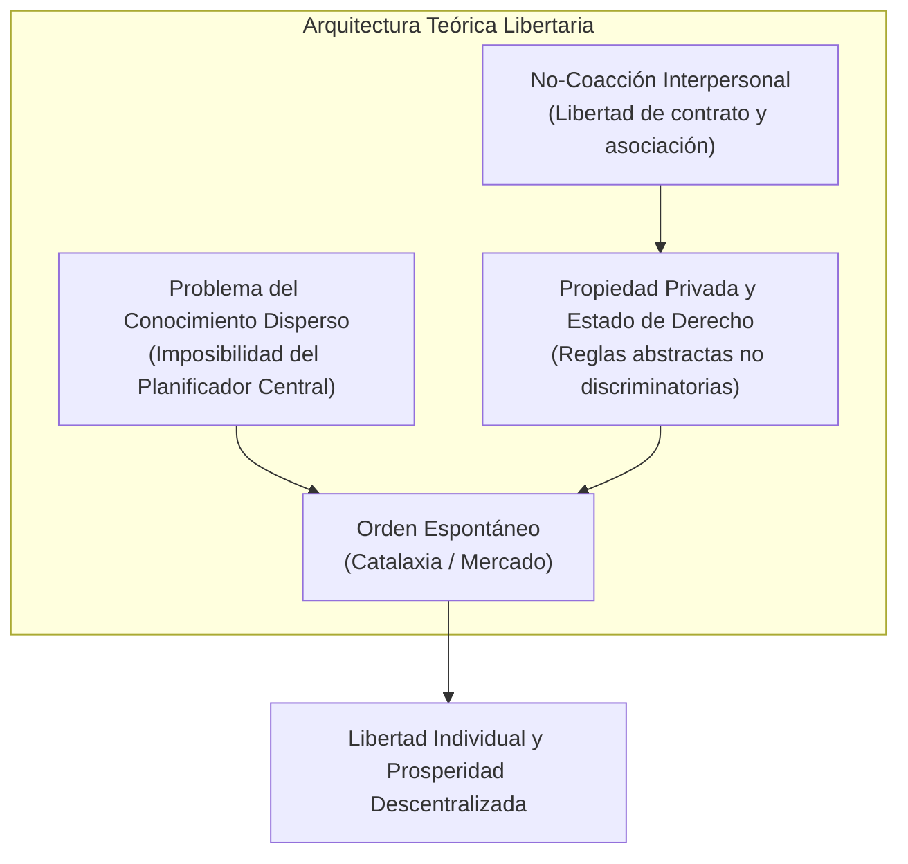

# Dominio I: Marco Teórico — Perspectiva Económico-Libertaria y de Mercado

## 1. Fundamentos del Liberalismo Clásico y Libertario

La cuarta perspectiva teórica examinada en la infografía corresponde a la tradición económica libertaria y liberal clásica, articulada principalmente por **Friedrich A. Hayek** (1899–1992, Premio Nobel de Economía 1974) y **Milton Friedman** (1912–2006, Premio Nobel de Economía 1976).

Esta escuela concibe la libertad como un principio indivisible: la **libertad económica** no es un apéndice técnico secundario, sino la condición indispensable y el guardián más eficaz de todas las libertades civiles y políticas.

---

## 2. Los Pilares Teóricos de Hayek y Friedman

### 2.1. La Definición Hayekiana de Libertad: Ausencia de Coacción Arbitraria
En *The Constitution of Liberty* (*Los fundamentos de la libertad*, 1960), Hayek define la libertad como:
> *«Aquel estado en el cual la coacción que unos hombres ejercen sobre otros queda reducida al mínimo posible en la sociedad»*.

Para Hayek, la coacción ocurre cuando una persona o institución (especialmente el Estado monopolizador de la fuerza) controla deliberadamente las condiciones del entorno de otro individuo, obligándolo a actuar no según sus propios planes, sino al servicio de los fines del coaccionador.

### 2.2. El Problema del Conocimiento y la Imposibilidad del Planificador Central
En su ensayo seminal *The Use of Knowledge in Society* (1945), Hayek desmonta la pretensión del estatismo planificador:
1. El conocimiento necesario para coordinar una economía compleja no existe concentrado en una mente o comité burocrático; está disperso en forma de **conocimiento tácito, local y circunstancial** entre millones de individuos.
2. **El Sistema de Precios como Red de Información:** Los precios libres actúan como un sistema global de señales de telecomunicación descentralizado. Un aumento en el precio del cobre informa instantáneamente a millones de personas que el recurso es escaso y que deben economizarlo o sustituirlo, sin que una autoridad central tenga que ordenar una sola restricción administrativa.

### 2.3. La Catalaxia y el Orden Espontáneo
Hayek distingue entre:
* **Taxis (Orden Creado u Organización):** Un ejército o una fábrica, dirigidos jerárquicamente hacia un fin único preconcebido.
* **Kosmos (Orden Espontáneo o Catalaxia):** El lenguaje, el derecho consuetudinario y el mercado competitivo, surgidos de la interacción libre y evolutiva de seres humanos que persiguen sus propios propósitos sin una dirección jerárquica obligatoria.

Intentar organizar una sociedad libre como si fuera una organización militar (*taxis*) destruye la libertad individual y conduce inevitablemente a lo que Hayek llamó *Camino de servidumbre* (*The Road to Serfdom*, 1944).

---

## 3. Milton Friedman: Libertad Económica y Libertad Política

En *Capitalism and Freedom* (*Capitalismo y libertad*, 1962), Milton Friedman establece la correlación directa entre libre mercado y democracia:

> *«La libertad económica es un fin en sí misma; además, es un medio indispensable hacia la consecución de la libertad política».*

### El Argumento de la Separación de Poderes Económicos
1. Si el Estado es el único empleador, el dueño de todas las imprentas, de los servidores de internet, de los canales de televisión y del papel periódico, ¿cómo puede existir libertad de prensa u oposición política?
2. Un disidente político en una economía estatizada no puede publicar sus ideas porque el comité estatal censurará los insumos y lo despedirá de su empleo sin posibilidad de sustento alternativo.
3. El mercado capitalista descentralizado protege al disidente: le permite comprar tinta, papel y alojamiento a miles de proveedores privados que no responden a la agenda ideológica del gobierno de turno.

---

## 4. El Diagnóstico Libertario en la Infografía

En el panel interactivo de la infografía web, al activar la **Lente Libertaria**, el diagnóstico del sistema socioeconómico se reconfigura:

| Dimensión Analítica | Lectura Convencional Estatista | Diagnóstico de la Lente Libertaria |
| :--- | :--- | :--- |
| **Impuestos y Cargas Fiscales** | Contribución cívica para el bien común. | Expropiación coercitiva del fruto del trabajo individual que distorsiona incentivos productivos. |
| **Regulaciones Laborales** | Protección de derechos del trabajador. | Barreras de entrada artificiales que excluyen a los jóvenes y marginados, arrojándolos a la informalidad. |
| **Gasto Público y Subsidios** | Reparación de injusticias históricas. | Mecanismo clientelar que incentiva la dependencia estatal, la corrupción burocrática y el déficit fiscal. |
| **Monopolios Estatales** | Preservación de sectores estratégicos. | Concesiones corporativistas que impiden la libre concurrencia, encarecen los servicios y perjudican a los consumidores. |
