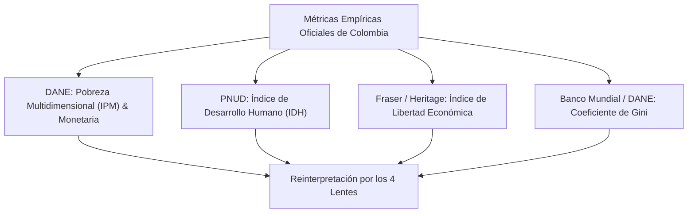

# Dominio I: Marco Teórico — El Dilema Empírico Colombiano

## 1. Por qué Colombia como Laboratorio Teórico

La infografía interactiva **Anatomía de la Libertad** traslada el debate filosófico abstracto a un territorio empírico concreto y altamente contrastante: **Colombia**.

Colombia representa un caso de estudio paradigmático para la filosofía política comparada por sus características constitucionales, sociológicas y económicas:
1. **El Estado Social de Derecho (Constitución de 1991):** Un orden constitucional explícitamente diseñado para maximizar la **libertad positiva** y los derechos prestacionales (salud, educación, tutela judicial efectiva, vivienda digna).
2. **Historia de Coacción Ilegal:** Décadas de conflicto armado interno donde grupos guerrilleros, paramilitares y bandas criminales violaron sistemáticamente la **libertad negativa** más básica (secuestro, extorsión, desplazamiento forzado, confinamiento territorial).
3. **Dualidad Estructural e Informalidad:** Una economía de mercado con sólidas instituciones macroeconómicas y bancarias, pero con tasas de informalidad laboral que superan el 55%, lo que plantea preguntas críticas tanto para el **enfoque de capacidades** como para la **lectura libertaria**.

---

## 2. Los Cuatro Indicadores Empíricos Calibrados

La aplicación web integra cuatro conjuntos de datos oficiales y de centros de investigación internacional:

### 2.1. Índice de Pobreza Multidimensional (IPM — DANE)
Evalúa privaciones en 5 dimensiones fundamentales: condiciones educativas del hogar, condiciones de la niñez y juventud, trabajo, salud, y condiciones de la vivienda y servicios públicos domiciliarios.

### 2.2. Índice de Desarrollo Humano (IDH — PNUD)
Evalúa tres dimensiones clave: salud (esperanza de vida al nacer), educación (años promedio y esperados de escolaridad) e ingreso digno (Ingreso Nacional Bruto per cápita en paridad de poder adquisitivo).

### 2.3. Índice de Libertad Económica (Fraser Institute / Heritage Foundation)
Mide el grado en que las instituciones y políticas públicas de Colombia promueven la libertad económica a través de 5 áreas: tamaño del gobierno, sistema legal y derechos de propiedad, solidez de la moneda, libertad de comercio internacional y regulaciones de crédito, trabajo y empresa.

### 2.4. Coeficiente de Gini
Mide la concentración del ingreso en una escala de 0 (igualdad perfecta) a 1 (desigualdad máxima), oscilando históricamente en Colombia entre 0.51 y 0.54.

---

## 3. El Corazón Epistemológico: Los Mismos Datos, Cuatro Diagnósticos Incompatibles

El propósito central de la infografía es confrontar al usuario con la **naturaleza interpretativa y valorativa de la política**. Los datos numéricos no cambian al alternar de lente en la interfaz; lo que cambia radicalmente es el **diagnóstico ético** y la **propuesta normativa**:

| Indicador Empírico | Lectura Lente Negativa (Berlin) | Lectura Lente Positiva (Berlin) | Lectura Lente Capacidades (Sen) | Lectura Lente Libertaria (Hayek/Friedman) |
| :--- | :--- | :--- | :--- | :--- |
| **Pobreza Multidimensional (~12.1%)** | Mientras no sea producto de leyes que prohíban progresar, no es falta de libertad política sino escasez material. | Es una privación flagrante de libertad: quien no tiene agua ni techo no es soberano de su destino. | Es una privación directa de libertades sustantivas y de factores de conversión en regiones periféricas. | Es el resultado predecible del intervencionismo y la falta de titulación formal de tierras y propiedad. |
| **Informalidad Laboral (>55%)** | Nadie prohíbe formalmente a las personas buscar empleo o abrir un puesto ambulante en la calle. | La informalidad expulsa a millones de la ciudadanía plena y de la protección social comunitaria. | Afecta la agencia de los trabajadores al negarles seguridad social protectora y crédito institucional. | Es la respuesta espontánea del mercado contra un salario mínimo desconectado de la productividad y costos parafiscales. |
| **Índice de Desarrollo Humano (~0.758)** | Muestra que el marco institucional ha permitido a las personas vivir más años sin interferencia letal. | Insuficiente: grandes brechas territoriales (Chocó vs Bogotá) demuestran falta de autogobierno efectivo. | Progreso en educación y salud promedio, pero con graves asimetrías de conversión entre el centro andino y la periferia. | Refleja que la apertura comercial y la iniciativa privada han sacado a millones de la pobreza absoluta. |
| **Presión Tributaria y Gasto Público** | La sobre-regulación fiscal y los impuestos distorsionantes constituyen una invasión a la esfera individual. | El gasto estatal en transferencias y subsidios es el medio indispensable para dotar de libertad real a los vulnerables. | Los impuestos se justifican en tanto financien escuelas y hospitales que expandan capacidades humanas. | El gasto público desmedido alimenta la ineficiencia burocrática y el déficit fiscal, destruyendo la moneda. |

---

## 4. Conexión con el Ecosistema de Investigación y Divulgación

Este análisis empírico forma parte del proyecto pedagógico e investigativo de **William Camilo Artunduaga Viana**, el cual se articula a través de tres componentes complementarios:

1. **La Infografía Interactiva Web:** Herramienta visual exploratoria con selectores reactivos y scrollytelling en tiempo real.
2. **El Cuaderno de Fuentes e Inteligencia Documental (NotebookLM):** Repositorio semántico con transcripciones, tablas estadísticas y notas de investigación disponible en [NotebookLM](https://notebooklm.google.com/notebook/5ce143e6-2b6f-41e3-a96d-eb58c6fbb2a1).
3. **El Podcast Temático:** Serie sonora que debate estos dilemas en clave de la realidad histórica y política colombiana, accesible en [Spotify](https://open.spotify.com/show/4hRC6rIFVIozooGV6OdWOI?si=e500cb9f38684cc2).
