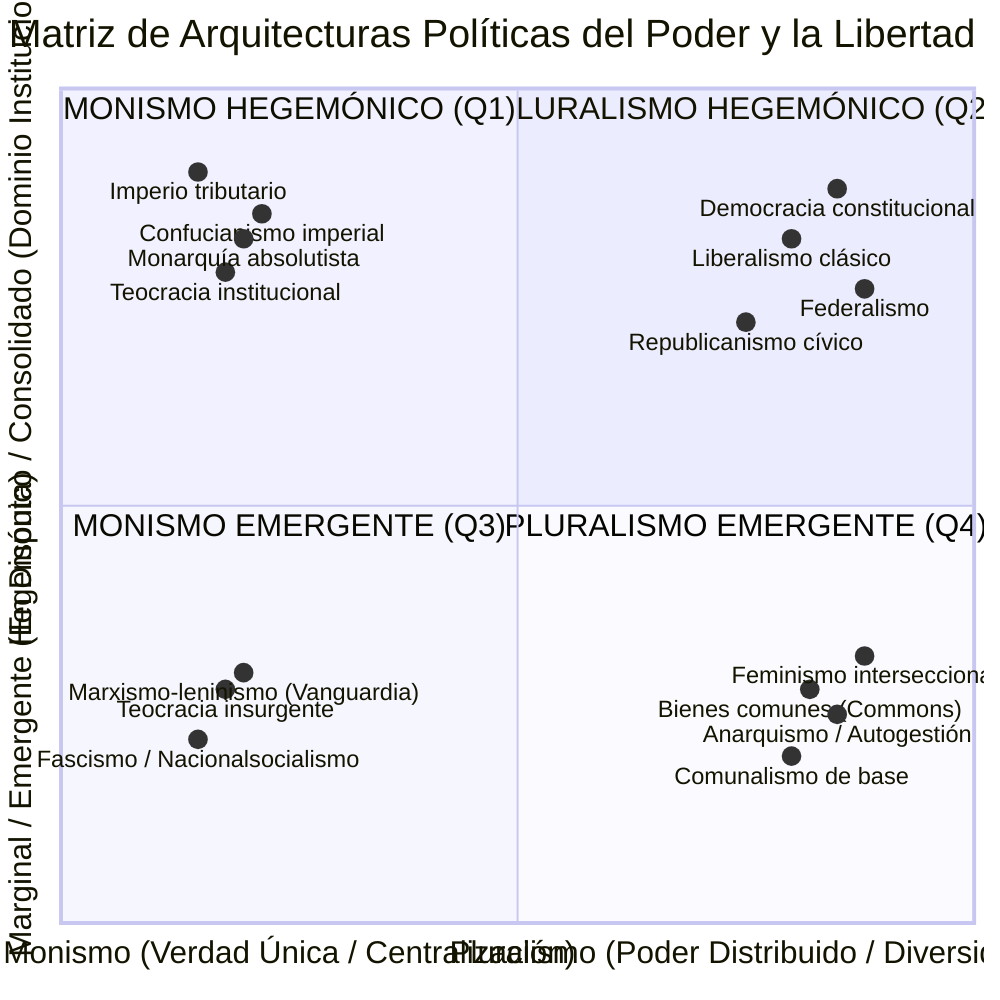
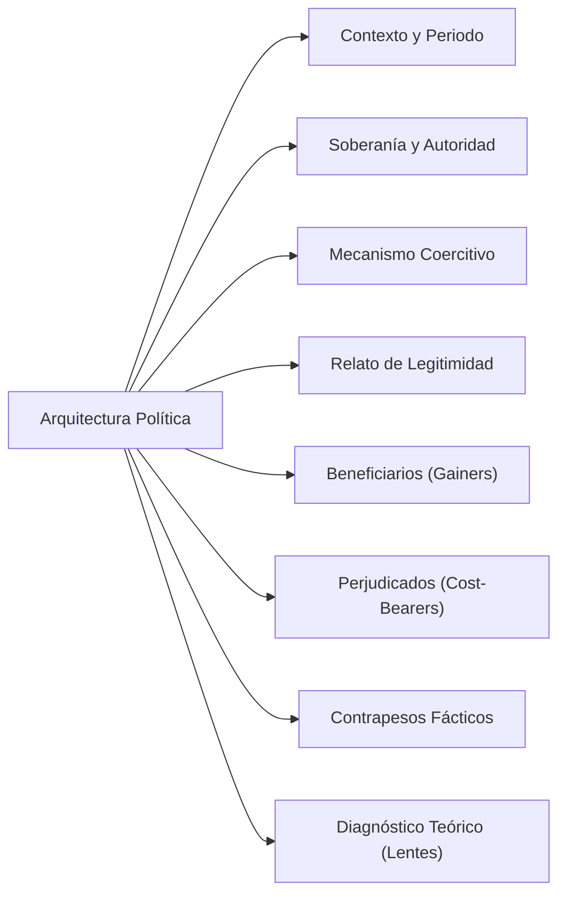
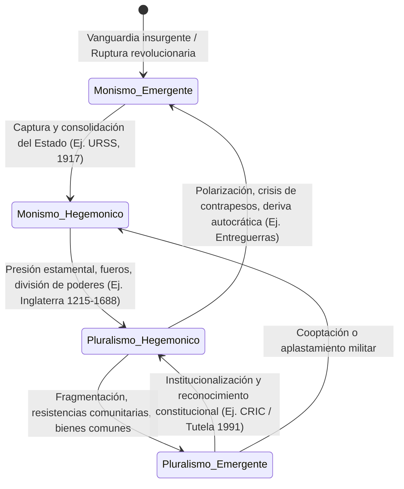

# Dominio I: Marco Teórico — Genealogía del Poder y Arquitecturas de la Libertad

## 1. Introducción: De la Abstracción Filosófica a la Institucionalización Histórica

La libertad política rara vez se experimenta como una fórmula abstracta o un silogismo ético. En el mundo histórico y material, la libertad se manifiesta siempre a través de **arquitecturas institucionales concretas**: entramados jurídicos, burocracias de control, jerarquías estamentales, monopolios fiscales y pactos de convivencia que determinan quién tiene el poder de obligar, quién está forzado a obedecer, qué esferas de la vida privada permanecen inmunes a la interferencia estatal y qué contrapesos fácticos impiden que el gobernante devenga tirano.

Como demostró **Isaiah Berlin**, los conflictos sobre la libertad no se reducen a un desacuerdo técnico sobre los medios más eficientes para alcanzar un fin consensuado; constituyen choques irreductibles entre visiones del mundo que priorizan bienes genuinamente incompatibles. Sin embargo, para comprender cómo opera esta tensión en la historia humana, es indispensable trazar una **genealogía del poder**: una investigación sobre las diversas configuraciones institucionales que las sociedades han edificado para organizar, negociar, restringir o expandir la libertad.

Lejos de una evolución lineal hacia un estado final ideal, la historia revela un paisaje dinámico de órdenes políticos que oscilan entre dos impulsos elementales:
1. **La pulsión monista:** La subordinación de toda divergencia moral y social a un único principio ordenador, verdad revelada, destino histórico o centro indiscutido de soberanía.
2. **La pulsión pluralista:** La distribución de la autoridad entre múltiples centros autónomos de decisión, reconociendo la legitimidad del disenso y limitando el alcance de la coacción mediante el imperio de la ley y contrapesos institucionales.

---

## 2. La Matriz Bidimensional del Poder Político

Para cartografiar con rigor analítico las diversas tradiciones políticas de la historia humana, el proyecto **Anatomía de la Libertad** (Sección X: *Genealogía del poder: cómo organizamos la libertad*) articula una **matriz tipológica bidimensional** definida por dos ejes ortogonales:

### 2.1. Eje Horizontal: Concepción del Fin Social (Monismo vs. Pluralismo)
- **Polo Monista:** Postula que existe un fin supremo o una jerarquía armónica y objetiva de valores (la salvación del alma, la gloria imperial, la pureza biológica, el Mandato del Cielo o la construcción del Hombre Nuevo). El disenso no es un derecho legítimo, sino un error epistémico, una traición moral o un obstáculo al bien común. La autoridad debe concentrarse para garantizar certidumbre y cohesión indivisible.
- **Polo Pluralista:** Asume como premisa la inconmensurabilidad y multiplicidad irreductible de los valores humanos. Reconoce que fines igualmente nobles (libertad negativa, igualdad económica, devoción religiosa, autonomía individual) chocan inevitablemente. Por ende, la política debe diseñar instituciones y reglas procesales que permitan la coexistencia pacífica sin imponer una verdad oficial.

### 2.2. Eje Vertical: Posición Institucional (Hegemónico vs. Emergente)
- **Nivel Hegemónico / Consolidado:** Fuerzas, regímenes o tradiciones que ejercen o ejercieron el monopolio efectivo de los medios de coacción, la administración de la justicia territorial y la producción del derecho en un espacio geopolítico determinado.
- **Nivel Emergente / Marginal:** Movimientos, vanguardias o colectivos que operan en los márgenes de la estatalidad consolidada, impugnan el orden vigente o buscan construir formas alternativas de autoorganización comunitaria sin capturar o someterse a la maquinaria coercitiva del Estado central.

> [!IMPORTANT]
> **Advertencia Heurística y Metodológica:**
> Las categorías de esta matriz no constituyen clasificaciones ontológicas rígidas ni juicios morales transhistóricos. Una misma tradición puede mutar de cuadrante a lo largo del tiempo: vanguardias revolucionarias marginales del siglo XIX devinieron monismos hegemónicos totalitarios en el siglo XX; fueros y pactos feudales medievales sentaron las bases precondicionales para el constitucionalismo liberal moderno; y proyectos comunales autónomos se ven constantemente sometidos a la presión homogeneizadora de la estatalidad dominante.

---

## 3. Los Cuatro Cuadrantes del Poder

### Cuadrante 1: Monismo Hegemónico (Dominio Uniforme y Soberanía Unificada)
- **Definición:** Concepciones institucionales consolidadas que subordinan toda discrepancia interna a una sola instancia rectora o fin trascendente (la corona, la fe revelada, la dinastía sagrada o la razón de Estado). Concentran el poder coercitivo para garantizar la cohesión territorial y el orden indivisible.
- **Mecanismo Operativo de Coerción:** Monopolio punitivo, aparato burocrático centralizado, levas forzosas y codificación dogmática de la ley sin consentimiento deliberativo estamental.
- **Compromiso / Trade-off Inevitable:** Maximiza la estabilidad territorial, la predictibilidad jurídica de mando y la capacidad de movilización colectiva; a costa de anular la autonomía individual, suprimir el pluralismo ético y subordinar a poblaciones periféricas o disidentes.

### Cuadrante 2: Pluralismo Hegemónico (Institucionalización de Contrapesos)
- **Definición:** Tradiciones políticas consolidadas que asumen la irreductibilidad de valores incompatibles y distribuyen la autoridad soberana entre jurisdicciones autónomas, tribunales independientes, elecciones competitivas y cartas constitucionales de derechos inviolables.
- **Mecanismo Operativo de Coerción:** Coerción reglada estrictamente por garantías de debido proceso, división de poderes (*checks and balances*), imperio de la ley (*Rule of Law*) y deliberación parlamentaria representativa.
- **Compromiso / Trade-off Inevitable:** Maximiza la protección frente al despotismo, salvaguarda la libertad negativa individual y ampara a las minorías jurídicas; a costa de lentitud decisional, fricción deliberativa constante, riesgo de bloqueo legislativo y posible captura elitista.

### Cuadrante 3: Monismo Emergente (Vanguardias Radicales y Contenciosas)
- **Definición:** Corrientes contestatarias, vanguardias revolucionarias, nacionalismos radicales o movimientos insurgentes que impugnan el orden político vigente en nombre de una verdad definitiva o destino histórico redentor, rechazando el compromiso pluralista por considerarlo complicidad con la opresión o debilidad burguesa.
- **Mecanismo Operativo de Coerción:** Disciplina conspirativa férrea o partido de cuadros, movilización popular de masas, propaganda redentora y pretensión dogmática de encarnar la voluntad auténtica del «Pueblo», la «Raza» o la «Clase Obrera».
- **Compromiso / Trade-off Inevitable:** Maximiza la cohesión combativa, la audacia de transformación estructural y la capacidad de choque contra injusticias enquistadas; a costa de purgar la disidencia interna, silenciar la crítica y sembrar los cimientos para futuras autocracias estatales.

### Cuadrante 4: Pluralismo Emergente (Autonomías Comunitarias y Bienes Comunes)
- **Definición:** Movimientos sociales y prácticas consuetudinarias que defienden la coexistencia horizontal, descentralizada y autogestionada de proyectos de vida autónomos, rechazando tanto la sumisión al monopolio coactivo del Estado como la absorción mercantil depredadora del capital.
- **Mecanismo Operativo de Coerción:** Asambleas deliberativas directas, mandatos comunitarios imperativos y revocables, pactos federativos voluntarios, acción comunitaria solidaria y cogestión comunal de recursos biofísicos.
- **Compromiso / Trade-off Inevitable:** Maximiza la libertad positiva como participación directa, la inclusión interseccional y la inmunidad frente a la concentración burocrática; a costa de serias dificultades de coordinación a gran escala y alta vulnerabilidad militar o económica frente a agresiones estatales o corporativas.

---

## 4. Catálogo Canónico de Tradiciones Históricas

La Sección X del artefacto interactivo codifica **23 arquitecturas institucionales históricas**, analizadas a la luz de ocho dimensiones analíticas:

### 4.1. Tradiciones del Monismo Hegemónico (Q1)

#### 1. Imperio Tributario
- **Periodo y Ámbito:** Antigüedad a la Modernidad temprana (Imperio Romano, Imperio Aqueménida persa, Dinastía Han en China, Imperio Otomano).
- **Estructura de Autoridad:** Monarquía dinástica metropolitana, burocracia palaciega y aristocracia militar extractiva.
- **Mecanismo Coercitivo:** Extracción forzosa de tributos en especie o metálico, leva militar obligatoria para expansión territorial, monopolio punitivo imperial y subordinación militar de las provincias conquistadas.
- **Justificación de Legitimidad:** La preservación de la paz universal (*Pax Romana*, *Pax Sinica*), mandato sagrado divino y protección frente al caos de la barbarie exterior.
- **Beneficiarios:** La corte dinástica imperial, la casta militar central y las élites mercantiles de la metrópoli.
- **Quienes Pagan el Costo:** El campesinado pechero periférico, los pueblos conquistados sometidos a esclavitud o servidumbre y las provincias despojadas de autogobierno.
- **Contrapesos:** Rebeliones campesinas locales, insurrecciones de gobernadores provinciales por lejanía geográfica y crisis logísticas de comunicación y abastecimiento.
- **Lectura bajo los Marcos Teóricos:** Berlin advertiría que la pretendida «paz imperial» destruye por completo la libertad negativa individual. Para Amartya Sen, la servidumbre fiscal y tributaria priva a las poblaciones periféricas de las capacidades humanas más elementales (nutrición, salud, educación).
- **Referencias:** Tilly, C. (1990). *Coercion, Capital, and European States*; Burbank, J. & Cooper, F. (2010). *Empires in World History*.

#### 2. Teocracia Institucional
- **Periodo y Ámbito:** Estados sacerdotales del Creciente Fértil, Califatos clásicos, Papado medieval pontificio, Ginebra de Juan Calvino.
- **Estructura de Autoridad:** Jerarquías eclesiásticas, ulemas y concilios sacerdotales que concentran la potestad temporal eclesiástica bajo la supremacía de la ley divina revelada.
- **Mecanismo Coercitivo:** Inquisición, interdicción de herejías, censura dogmática obligatoria, tribunales de fuero canónico o shariático y castigos corporales o capitales por apostasía.
- **Justificación de Legitimidad:** La salvación colectiva y trascendente de las almas, el cumplimiento inquebrantable de la voluntad divina y la preservación de la pureza espiritual de la comunidad.
- **Beneficiarios:** La casta sacerdotal, los teólogos oficiales y los monarcas ungidos como protectores sagrados de la fe.
- **Quienes Pagan el Costo:** Librepensadores, disidentes doctrinales, minorías religiosas calificadas de idólatras y mujeres sometidas a códigos patriarcales de custodia moral.
- **Contrapesos:** Cismas eclesiales, herejías populares clandestinas y conflictos de jurisdicción entre el poder temporal de los príncipes y la autoridad espiritual del clero.
- **Lectura bajo los Marcos Teóricos:** Representa la encarnación más pura del peligro del «yo superior» advertido por Berlin: la coacción más despiadada se justifica falazmente como la verdadera «liberación» del alma del pecador frente a sus pasiones inferiores.
- **Referencias:** Berman, H. J. (1983). *Law and Revolution: The Formation of the Western Legal Tradition*; Weber, M. (1922). *Economía y sociedad*.

#### 3. Monarquía Absolutista
- **Periodo y Ámbito:** Europa de los siglos XVI a XVIII (Francia de Luis XIV, España de los Austrias y Borbones, Prusia de los Hohenzollern).
- **Estructura de Autoridad:** Monarca investido de soberanía absoluta por derecho divino, concentrando de manera indivisible las potestades legislativa, judicial y ejecutiva.
- **Mecanismo Coercitivo:** Ejército regular permanente pagado por el erario real, burocracia intendencial uniforme, monopolio fiscal metropolitano, cédulas reales de encarcelamiento sin juicio (*lettres de cachet*) y supresión de fueros locales.
- **Justificación de Legitimidad:** Derecho divino de los reyes, razón de Estado y la necesidad inapelable de superar la guerra civil religiosa y el caos estamental (tesis del *Leviatán* hobbesiano).
- **Beneficiarios:** El rey y su corte palaciega, la nobleza cortesana subsidiada con rentas reales y la alta burocracia administrativa.
- **Quienes Pagan el Costo:** El estado llano (campesinado pechero, artesanos), la burguesía mercantil carente de derechos políticos y las regiones históricas despojadas de sus fueros tradicionales.
- **Contrapesos:** Parlamentos judiciales que retrasaban el registro de edictos (*droit de remontrance*), crisis sistemáticas de deuda soberana y revueltas campesinas antifiscales (*jacqueries*).
- **Lectura bajo los Marcos Teóricos:** La no-interferencia privada existe únicamente como concesión graciosa y precaria de la voluntad del monarca; hay una ausencia estructural de libertad política e inmunidad de derechos.
- **Referencias:** Bodin, J. (1576). *Les Six Livres de la République*; Anderson, P. (1974). *Lineages of the Absolutist State*.

#### 4. Califato Histórico
- **Periodo y Ámbito:** Califatos Rashidun, Omeya, Abasí y Otomano (siglos VII a XX).
- **Estructura de Autoridad:** El Califa como sucesor político del Profeta y protector de la umma, auxiliado por cadíes (jueces coránicos) y visires.
- **Mecanismo Coercitivo:** Pacto de *dhimma* con pago obligatorio de impuesto especial (*jizya*) para comunidades cristianas y judías, monopolio militar y aplicación unificada de la ley islámica (*sharía*).
- **Justificación de Legitimidad:** Aplicación estricta de la justicia revelada de Dios sobre la tierra, defensa militar de la comunidad creyente y preservación del orden moral y mercantil.
- **Beneficiarios:** La aristocracia patricia islámica, las élites letradas de las cuatro escuelas jurídicas (*madhabs*) y las rutas comerciales caravaneras protegidas por el imperio.
- **Quienes Pagan el Costo:** Poblaciones tributarias no musulmanas con derechos políticos reducidos, siervos o esclavos y sectas heterodoxas perseguidas.
- **Contrapesos:** Autonomía interpretativa descentralizada de los juristas locales (*faqih*), revueltas de tribus beduinas y rebeliones de las marcas fronterizas.
- **Lectura bajo los Marcos Teóricos:** Convivencia estamental reglamentada: ofrece seguridad de vida y culto condicional, pero subordina la libertad negativa a un estatuto civil asimétrico y desigual.
- **Referencias:** Crone, P. (2004). *God's Rule: Government and Islam*; Hourani, A. (1991). *A History of the Arab Peoples*.

#### 5. Confucianismo Imperial
- **Periodo y Ámbito:** China imperial durante las dinastías Han, Tang, Song, Ming y Qing (206 a.C. – 1912).
- **Estructura de Autoridad:** Emperador como «Hijo del Cielo» (*Tianzi*), asistido por una élite burocrática meritocrática de mandarines letrados (*shi*) seleccionados mediante rigurosos exámenes imperiales (*keju*).
- **Mecanismo Coercitivo:** Código penal confuciano severo, imposición obligatoria de la piedad filial (*xiao*), sistema de vigilancia vecinal mutua (*baojia*) y censura de textos heterodoxos.
- **Justificación de Legitimidad:** El Mandato del Cielo (*Tianming*), el mantenimiento de la armonía cósmica entre el Cielo, la Tierra y la Humanidad, y el gobierno moral mediante el ejemplo y el rito (*li*).
- **Beneficiarios:** La casta funcionarial de mandarines letrados, los linajes terratenientes tradicionales y la familia imperial reinante.
- **Quienes Pagan el Costo:** El campesinado obligado a prestaciones laborales (*corveas*) y reclutamiento forzoso, las mujeres enclaustradas bajo el patriarcado confuciano y los comerciantes, situados en el escalón moral inferior de la jerarquía.
- **Contrapesos:** La doctrina moral del derecho a la rebelión popular si el soberano pierde el Mandato del Cielo por catástrofes o hambrunas, y el tribunal de censores (*Yushitai*) facultado para reprender al emperador.
- **Lectura bajo los Marcos Teóricos:** Arquetipo de monismo moral perfecto: la libertad individual no se concibe fuera del cumplimiento abnegado del deber y el rol social asignado por la jerarquía armónica del cosmos.
- **Referencias:** Fairbank, J. K. (1992). *China: A New History*; Schwartz, B. (1985). *The World of Thought in Ancient China*.

#### 6. Nacionalismo Autoritario
- **Periodo y Ámbito:** Siglos XIX y XX (Prusia de Bismarck, Estado Novo en Portugal, Franquismo en España, dictaduras de seguridad nacional en América Latina).
- **Estructura de Autoridad:** Poder ejecutivo fuerte y centralizado respaldado por las fuerzas armadas, la alta administración estatal y oligarquías industriales consolidadas.
- **Mecanismo Coercitivo:** Proscripción de sindicatos libres, censura de prensa, tribunales de orden público, estados de excepción permanentes y persecución de partidos de izquierda.
- **Justificación de Legitimidad:** La unidad e integridad sagrada de la patria, el mantenimiento de la paz social contra el peligro comunista o anarquista y el desarrollo económico nacional.
- **Beneficiarios:** Grandes consorcios industriales, estamentos militares, corporaciones protegidas del conflicto laboral y la alta burocracia estatal.
- **Quienes Pagan el Costo:** Organizaciones obreras, minorías culturales o lingüísticas no asimiladas y sectores democráticos e intelectuales opositores.
- **Contrapesos:** Conflictividad laboral clandestina, tensiones entre facciones castrenses y tecnocráticas, y aislamiento y sanciones diplomáticas internacionales.
- **Lectura bajo los Marcos Teóricos:** El Estado devora el espacio de la libertad negativa individual en nombre de una identidad colectiva obligatoria. Para Hayek, constituye la ruta hacia la supresión de la libertad económica y civil en aras de un plan corporativo forzado.
- **Referencias:** Linz, J. J. (2000). *Totalitarian and Authoritarian Regimes*; Gellner, E. (1983). *Nations and Nationalism*.

---

### 4.2. Tradiciones del Pluralismo Hegemónico (Q2)

#### 7. Republicanismo Clásico y Cívico
- **Periodo y Ámbito:** República Romana, Florencia renacentista (Maquiavelo), Pensamiento revolucionario atlántico (Harrington, Milton, Madison, Pettit, Skinner).
- **Estructura de Autoridad:** Comunidad política de ciudadanos libres e iguales ante la ley (*isonomía*), gobernada mediante magistraturas colegiadas, rotativas y sujetas a estricta rendición de cuentas.
- **Mecanismo Coercitivo:** Deberes cívicos obligatorios (servicio militar ciudadano, jurados populares), proscripción de la dominación privada, leyes suntuarias y mecanismos institucionales contra la oligopolización del poder.
- **Justificación de Legitimidad:** La libertad definida como **no-dominación** (*libertas* frente al *dominus* o amo arbitrario): un individuo solo es libre si vive en una república dotada de leyes que impiden que nadie —ni el gobernante ni un magnate privado— pueda ejercer poder arbitrario sobre su vida.
- **Beneficiarios:** El cuerpo ciudadano activo, resguardado de abusos oligárquicos y tiranías individuales.
- **Quienes Pagan el Costo:** Sectores históricamente excluidos de la condición de ciudadanía en las repúblicas antiguas (esclavos, libertos, mujeres, extranjeros residentes).
- **Contrapesos:** Tribunos de la plebe con poder de veto sobre las magistraturas patricias, rotación obligatoria de cargos, juicios públicos de residencia y equilibrio mixto de poderes.
- **Lectura bajo los Marcos Teóricos:** Complementa decisivamente la distinción de Berlin: para Quentin Skinner y Philip Pettit, la libertad no es simplemente que nadie interfiera en mis acciones hoy (libertad negativa contingente), sino la certeza estructural e institucional de que nadie tiene el poder de interferir arbitrariamente a voluntad (inmunidad frente a la dominación).
- **Referencias:** Pettit, P. (1997). *Republicanism: A Theory of Freedom and Government*; Skinner, Q. (1998). *Liberty Before Liberalism*; Pocock, J. G. A. (1975). *The Machiavellian Moment*.

#### 8. Liberalismo Clásico
- **Periodo y Ámbito:** Siglos XVII a XXI (John Locke, Montesquieu, Benjamin Constant, John Stuart Mill, Isaiah Berlin, John Rawls).
- **Estructura de Autoridad:** Gobierno representativo limitado fundado en la soberanía popular y circunscrito de manera infranqueable por los derechos naturales o fundamentales del individuo.
- **Mecanismo Coercitivo:** Imperio de la ley (*Rule of Law*), garantías procesales de *habeas corpus*, separación tripartita de poderes, libertad religiosa, libertad de contratación y libre mercado.
- **Justificación de Legitimidad:** La persona individual es un fin en sí misma (imperativo kantiano), dotada de un fuero íntimo y moral inviolable; el único propósito del Estado legítimo es proteger los derechos a la vida, la libertad y la propiedad.
- **Beneficiarios:** Ciudadanos protegidos en su privacidad frente al celo del Estado, minorías religiosas e ideológicas, y emprendedores económicos amparados por el derecho mercantil.
- **Quienes Pagan el Costo:** Colectivos vulnerables cuando la igualdad meramente formal ante la ley enmascara privaciones materiales que impiden el ejercicio real de la libertad (crítica central de Amartya Sen).
- **Contrapesos:** Control judicial de constitucionalidad de las leyes, elecciones periódicas competitivas, libertad absoluta de prensa y opinión pública deliberativa.
- **Lectura bajo los Marcos Teóricos:** El hogar conceptual de la **libertad negativa** formulada por Berlin: el trazado riguroso de una frontera alrededor de cada persona dentro de la cual nadie, ni siquiera la mayoría democrática, puede entrometerse legítimamente.
- **Referencias:** Locke, J. (1689). *Second Treatise of Government*; Mill, J. S. (1859). *On Liberty*; Constant, B. (1819). *De la liberté des Anciens comparée à celle des Modernes*; Berlin, I. (1958). *Two Concepts of Liberty*.

#### 9. Democracia Constitucional
- **Periodo y Ámbito:** Periodo posterior a la Segunda Guerra Mundial hasta el presente (Sistemas democráticos occidentales, constituciones de la posguerra europea, Constitución colombiana de 1991).
- **Estructura de Autoridad:** Síntesis institucional de soberanía popular electoral mayoritaria y límites constitucionales contramayoritarios rígidos administrados por tribunales constitucionales independientes.
- **Mecanismo Coercitivo:** Coerción sometida estrictamente a los mandatos de la carta de derechos fundamentales, sufragio universal, alternancia pacífica del poder, acción de tutela o recurso de amparo y control judicial de los actos del ejecutivo.
- **Justificación de Legitimidad:** El principio democrático del autogobierno ciudadano reconciliado con el principio liberal de que las mayorías electorales no pueden vulnerar los derechos inalienables de las minorías.
- **Beneficiarios:** La ciudadanía universal dotada de garantías procesales efectivas, movimientos cívicos plurales y minorías políticas amparadas judicialmente.
- **Quienes Pagan el Costo:** Gobiernos que buscan transformaciones radicales sin respetar las reglas del juego deliberativo, frenados por los contrapesos judiciales y procedimentales.
- **Contrapesos:** Cortes constitucionales, fiscalías y contralorías autónomas, defensorías del pueblo, medios de comunicación independientes y sociedad civil movilizada.
- **Lectura bajo los Marcos Teóricos:** La consagración institucional del **pluralismo de valores de Berlin**: asume que los ciudadanos sostienen proyectos éticos divergentes e inconmensurables, y proporciona las reglas del juego para dirimir las disputas pacíficamente sin aniquilar al adversario.
- **Referencias:** Dahl, R. (1989). *Democracy and Its Critics*; Habermas, J. (1992). *Faktizität und Geltung*; Ely, J. H. (1980). *Democracy and Distrust*.

#### 10. Federalismo
- **Periodo y Ámbito:** Siglos XVIII a XXI (Estados Unidos, Confederación Suiza, República Federal de Alemania, Canadá, Australia).
- **Estructura de Autoridad:** Poder político compartido y fragmentado territorialmente mediante un pacto constitucional rígido entre un gobierno general federal y gobiernos subnacionales autónomos (estados federados o cantones).
- **Mecanismo Coercitivo:** Doble orden de jurisdicción y competencias exclusivas no delegadas, legislaturas bicamerales con representación territorial paritaria y tribunal constitucional o supremo que arbitra conflictos de soberanía.
- **Justificación de Legitimidad:** Evitar la concentración despótica del poder dividiéndolo no solo funcionalmente (ejecutivo, legislativo, judicial), sino espacial y territorialmente (*The Federalist No. 51*).
- **Beneficiarios:** Identidades locales y regionales, minorías geográficas que son mayoría en sus territorios propios, y ciudadanos que pueden elegir marcos regulatorios según sus preferencias («votar con los pies»).
- **Quienes Pagan el Costo:** Asimetrías y disparidades fiscales o de derechos entre regiones ricas y regiones pobres si no operan mecanismos federales de redistribución solidaria.
- **Contrapesos:** Doble soberanía constitucional, vetos cruzados entre estados y federación, y necesidad de mayorías cualificadas en múltiples niveles territoriales para reformas estructurales.
- **Lectura bajo los Marcos Teóricos:** Para Friedrich Hayek y Berlin, la descentralización federal del monopolio estatal de la fuerza constituye una de las defensas más eficaces jamás ideadas contra el monismo centralista unificador.
- **Referencias:** Madison, J., Hamilton, A. & Jay, J. (1788). *The Federalist Papers*; Elazar, D. J. (1987). *Exploring Federalism*.

#### 11. Ciudad-Estado
- **Periodo y Ámbito:** La *polis* griega clásica (Atenas, Esparta), las repúblicas mercantiles medievales y renacentistas (Venecia, Florencia, Génova), la Liga Hanseática y ciudades autónomas contemporáneas (Singapur, Mónaco).
- **Estructura de Autoridad:** Comunidad urbana autogobernada donde las decisiones políticas se deliberan en asambleas cívicas directas o consejos mercantiles de patricios en una escala espacial reducida.
- **Mecanismo Coercitivo:** Milicias cívicas urbanas, fueros comunales (*charters*), tribunales mercantiles de proximidad y juramentos cívicos de lealtad comunal.
- **Justificación de Legitimidad:** «El aire de la ciudad hace libres a los hombres» (*Stadtluft macht frei*): el autogobierno directo frente a las tiranías imperiales y la soberanía de los vecinos reunidos.
- **Beneficiarios:** El patriciado urbano, los maestros artesanos agremiados y los comerciantes libres de cargas señoriales feudo-agrarias.
- **Quienes Pagan el Costo:** Trabajadores sin estatus de ciudadanía, siervos rurales de los contornos agrícolas inmediatos y extranjeros residentes desprovistos de derechos políticos.
- **Contrapesos:** Sorteo de magistraturas, rendición de cuentas estricta e inmediata de los magistrados (*dokimasia*) y rivalidad competitiva entre familias y gremios.
- **Lectura bajo los Marcos Teóricos:** Encarna el ideal antiguo de la **libertad positiva** descrito por Benjamin Constant: la participación directa y apasionada de los ciudadanos en los destinos del colectivo soberano.
- **Referencias:** Hansen, M. H. (1991). *The Athenian Democracy in the Age of Demosthenes*; Lane, F. C. (1973). *Venice: A Maritime Republic*.

#### 12. Tradiciones Feudales y Constitucionalismo Estamental
- **Periodo y Ámbito:** Europa medieval y bajomedieval (siglos XII a XVI: *Magna Carta* de 1215 en Inglaterra, Fueros de Aragón y Navarra en España, Cortes estamentales europeas).
- **Estructura de Autoridad:** Orden policéntrico y descentralizado donde monarcas precarios, barones feudales, dignidades eclesiásticas y villas con carta puebla pactaban derechos y límites normativos recíprocos.
- **Mecanismo Coercitivo:** Contratos solemnes de vasallaje, juramentos feudales, tribunales de pares estamentales y cartas de fueros territoriales vinculantes.
- **Justificación de Legitimidad:** El principio medieval de que el rey está subordinado a la ley inmemorial de la tierra (*rex sub lege*) y de que lo que atañe a todos debe ser aprobado por todos (*quod omnes tangit ab omnibus comprobetur*).
- **Beneficiarios:** Los barones de la nobleza feudal, los cabildos eclesiásticos y las corporaciones y villas con fueros privilegiados propios.
- **Quienes Pagan el Costo:** La inmensa masa del campesinado siervo, adscrito a la gleba feudal, carente de libertad de movimiento y desprovisto de apelación ante la justicia regia.
- **Contrapesos:** El derecho de resistencia armada legítima del vasallo ante el monarca que rompe el juramento feudal (*derecho de desnaturalización* o rebelión de los barones).
- **Lectura bajo los Marcos Teóricos:** Pluralismo jurisdiccional fragmentado: si bien limitó el surgimiento temprano del monismo absolutista, esta dispersión feudal sirvió para consolidar privilegios oligárquicos estamentales a costa de la subordinación servil del pueblo común.
- **Referencias:** Bloch, M. (1961). *Feudal Society*; Strayer, J. (1970). *On the Medieval Origins of the Modern State*.

---

### 4.3. Tradiciones del Monismo Emergente / Marginal (Q3)

#### 13. Fascismo y Nacionalsocialismo
- **Periodo y Ámbito:** Periodo de entreguerras del siglo XX (Fascismo italiano 1922–1943, Nacionalsocialismo alemán 1933–1945, Guardia de Hierro rumana).
- **Estructura de Autoridad:** Caudillo carismático e infalible (*Duce*, *Führer*) fusionado con un partido de masas paramilitar que destruye el Estado de derecho e instaura el terror totalitario.
- **Mecanismo Coercitivo:** Terror estatal sistemático, policía secreta política (Gestapo, OVRA), campos de concentración y exterminio, militarización de la sociedad y disolución forzosa de toda asociación civil independiente.
- **Justificación de Legitimidad:** El renacimiento mítico de la nación ultrajada (*palingenesia ultranacionalista*), la pureza racial o biológica y el axioma de que el Estado o la Raza lo es todo y el individuo no es nada fuera de él.
- **Beneficiarios:** La cúpula partidista, las jerarquías de seguridad paramilitar y grandes consorcios industriales bélicos cartelizados por el régimen.
- **Quienes Pagan el Costo:** Minorías étnicas y religiosas perseguidas hasta el genocidio, opositores democráticos, movimientos obreros y la población en general, privada de toda esfera de privacidad.
- **Contrapesos:** Prácticamente inexistentes en el ordenamiento jurídico interno; reducidos a derrotas militares bélicas exteriores o sabotajes clandestinos de la resistencia armada.
- **Lectura bajo los Marcos Teóricos:** El clímax más aberrante del monismo totalitario en la historia humana: aniquilación simultánea de toda libertad negativa, de toda libertad positiva democrática y de toda capacidad humana real.
- **Referencias:** Paxton, R. O. (2004). *The Anatomy of Fascism*; Arendt, H. (1951). *The Origins of Totalitarianism*.

#### 14. Marxismo-Leninismo y Socialismo Real
- **Periodo y Ámbito:** Siglo XX (URSS 1917–1991, Bloque del Este europeo, República Popular China durante la era maoísta, Cuba, Vietnam).
- **Estructura de Autoridad:** Partido comunista de vanguardia autoproclamado como intérprete científico de las leyes de la historia y representante de la clase obrera, gobernando mediante un Comité Central y una burocracia planificadora (*Gosplán*).
- **Mecanismo Coercitivo:** Planificación económica centralizada obligatoria, colectivización forzosa de la tierra, monopolio de los medios de producción y comunicación, purgas penales (*Gulag*) y proscripción de toda oposición partidaria.
- **Justificación de Legitimidad:** La dictadura del proletariado, la erradicación definitiva de la explotación del hombre por el hombre y la construcción revolucionaria de una sociedad comunista sin clases.
- **Beneficiarios:** La *nomenklatura* y burocracia funcionarial del partido, los cuadros técnicos leales y los sectores de base obrera promovidos a través del aparato estatal.
- **Quienes Pagan el Costo:** El campesinado expropiado, los disidentes intelectuales y artísticos, los creyentes religiosos y las clases propietarias despojadas de sus medios de vida.
- **Contrapesos:** La economía informal sumergida (*mercado negro*), la resistencia laboral pasiva ante cuotas de producción irreales y las fracturas y purgas intestinas dentro de la cúpula partidaria.
- **Lectura bajo los Marcos Teóricos:** La mayor advertencia teórica de Isaiah Berlin: la demostración histórica de cómo la promesa de **libertad positiva** y emancipación universal degenera en la tiranía atroz de una vanguardia iluminada que asume que ella sabe mejor que el individuo real lo que a este «verdaderamente le conviene».
- **Referencias:** Berlin, I. (1969). *Four Essays on Liberty*; Fitzpatrick, S. (1999). *Everyday Stalinism*; Kolakowski, L. (1978). *Main Currents of Marxism*.

#### 15. Teocracia Radical Insurgente
- **Periodo y Ámbito:** Fines del siglo XX y siglo XXI (Revolución Islámica de Irán de 1979, el Emirato Talibán en Afganistán, movimientos yihadistas contemporáneos).
- **Estructura de Autoridad:** Jerarquía de clérigos fundamentalistas (*velayat-e faqih*) o consejos de caudillos teológicos que se atribuyen la potestad de vetar o subordinar cualquier institución política representativa.
- **Mecanismo Coercitivo:** Policía de costumbres y vigilancia moral en el espacio público, veto de candidaturas por criterios de pureza religiosa, tribunales revolucionarios sumarios y supresión de libertades de prensa y reunión.
- **Justificación de Legitimidad:** La soberanía absoluta de Dios (*hakimiyya*) por encima de la soberanía popular humana, la purificación cultural contra la corrupción de la modernidad secular y la obligatoriedad de la virtud colectiva.
- **Beneficiarios:** El clero gobernante, los cuerpos de guardianes de la revolución y las fundaciones religiosas exentas de fiscalización pública.
- **Quienes Pagan el Costo:** Las mujeres (despojadas de autonomía corporal, laboral y educativa), las minorías religiosas y sexuales, los librepensadores y los sectores laicos.
- **Contrapesos:** Movilizaciones populares masivas de desobediencia cívica en las calles, huelgas generales y fracturas entre facciones conservadoras y reformistas.
- **Lectura bajo los Marcos Teóricos:** Una coacción moral omnipresente que invade el dormitorio, la vestimenta y la conciencia individual, cancelando por completo la frontera mínima de no-interferencia privada postulada por Locke y Berlin.
- **Referencias:** Arjomand, S. A. (1988). *The Turban for the Crown: The Islamic Revolution in Iran*; Roy, O. (1994). *The Failure of Political Islam*.

#### 16. Conservadurismo Autoritario y Regímenes Híbridos
- **Periodo y Ámbito:** Siglos XIX a XXI (Zarismo tardío ruso, el régimen de Vladímir Putin en Rusia, la Hungría de Viktor Orbán, Turquía bajo Erdoğan).
- **Estructura de Autoridad:** Liderazgo personalista fuerte que instrumentaliza la ley y captura las instituciones electorales para blindar su permanencia en el poder sin abolir formalmente la fachada constitucional.
- **Mecanismo Coercitivo:** Leyes de «agentes extranjeros», asfixia financiera o confiscación judicial de medios de comunicación opositores, inhabilitación de candidatos competitivos y uso selectivo del aparato fiscal y penal.
- **Justificación de Legitimidad:** La defensa de los valores civilizatorios tradicionales de la patria frente a la decadencia cosmopolita foránea, la estabilidad sociopolítica y el orgullo nacional.
- **Beneficiarios:** Oligarquías empresariales adscritas al mandatario (*capitalismo de compadrazgo*), los cuerpos de seguridad del Estado y jerarquías eclesiásticas oficiales asociadas al poder.
- **Quienes Pagan el Costo:** Los defensores de derechos humanos, periodistas independientes, partidos de oposición democrática y colectivos sociales disidentes.
- **Contrapesos:** El voto de protesta en elecciones locales, las redes sociales independientes descentralizadas, la fuga de cerebros y el capital humano, y sanciones diplomáticas internacionales.
- **Lectura bajo los Marcos Teóricos:** La erosión sutil pero sistemática de la libertad negativa: formalmente votar no está prohibido, pero la cancha electoral está deliberadamente inclinada para que el ciudadano carezca de una opción real y equitativa.
- **Referencias:** Levitsky, S. & Ziblatt, D. (2018). *How Democracies Die*; Diamond, L. (2002). *Thinking About Hybrid Regimes*.

#### 17. Nacionalismo Étnico
- **Periodo y Ámbito:** Siglos XIX a XXI (Las guerras yugoslavas de la década de 1990 en los Balcanes, el genocidio de Ruanda de 1994, la persecución de la minoría rohingya en Birmania).
- **Estructura de Autoridad:** Caudillos militares y élites políticas que subordinan los derechos de ciudadanía y la legitimidad estatal a la pertenencia biológica, lingüística o religiosa a un grupo etnonacional predominante.
- **Mecanismo Coercitivo:** Expulsiones forzosas de población (*limpieza étnica*), revocación de nacionalidad y derechos civiles, bandas armadas paramilitares y segregación institucional forzada.
- **Justificación de Legitimidad:** El destino ancestral sagrado de la etnia mayoritaria, la preservación de la pureza de la sangre y la venganza de agravios históricos míticos sufridos a manos de otros pueblos.
- **Beneficiarios:** Las élites armadas del grupo etnonacional hegemónico, los especuladores de tierras despojadas y los demagogos identitarios.
- **Quienes Pagan el Costo:** Las poblaciones de minorías étnicas perseguidas, las comunidades mixtas o desplazadas forzosamente y los ciudadanos partidarios de la convivencia multicultural.
- **Contrapesos:** La justicia penal internacional (Corte Penal Internacional, Tribunales de La Haya), intervenciones militares humanitarias foráneas y movimientos cívicos de reconciliación comunitaria.
- **Lectura bajo los Marcos Teóricos:** La identidad particular elevada a dogma absoluto y excluyente (monismo identitario radical): pertenecer a la etnia designada es el único requisito para tener derechos, despojando al resto de su condición de personas morales.
- **Referencias:** Mann, M. (2005). *The Dark Side of Democracy: Explaining Ethnic Cleansing*; Ignatieff, M. (1993). *Blood and Belonging: Journeys into the New Nationalism*.

---

### 4.4. Tradiciones del Pluralismo Emergente / Marginal (Q4)

#### 18. Anarquismo y Socialismo Libertario
- **Periodo y Ámbito:** Siglos XIX a XXI (Mijaíl Bakunin, Piotr Kropotkin, la Comuna de París de 1871, la Revolución Social española en Cataluña y Aragón en 1936, las comunas de Rojava en el Kurdistán sirio).
- **Estructura de Autoridad:** Autoorganización horizontal de base que niega por completo la legitimidad moral y política del monopolio de la violencia ejercido por el Estado y de la explotación ejercida por el capital.
- **Mecanismo Coercitivo:** Acción directa, asambleas soberanas por consenso o mayoría cualificada, federación libre de municipios y delegados con mandato imperativo revocable en todo momento.
- **Justificación de Legitimidad:** «La libertad de los demás, lejos de ser un límite o la negación de mi libertad, es por el contrario su condición necesaria y su confirmación» (Bakunin); el Estado es intrínsecamente coercitivo e irreformable.
- **Beneficiarios:** Colectivos autogestionados de trabajadores, campesinos comuneros y ciudadanos liberados de la tutela de burocracias estatales centralizadas.
- **Quienes Pagan el Costo:** La extrema vulnerabilidad militar y logística frente a ejércitos estatales regulares extranjeros o nacionales, y dificultades complejas de coordinación productiva en grandes escalas industriales.
- **Contrapesos:** La revocabilidad instantánea de delegados, la disolución deliberada de jerarquías permanentes y la deliberación asamblearia abierta.
- **Lectura bajo los Marcos Teóricos:** La aspiración simultánea de maximizar la **libertad positiva** (autogobierno colectivo directo) y la **libertad negativa** (cero interferencia coercitiva del Estado). En la práctica histórica, choca trágicamente con la necesidad de autodefensa frente a agresores autoritarios externos.
- **Referencias:** Kropotkin, P. (1902). *Mutual Aid: A Factor of Evolution*; Graeber, D. (2004). *Fragments of an Anarchist Anthropology*; Guérin, D. (1970). *Anarchism: From Theory to Practice*.

#### 19. Feminismo Interseccional
- **Periodo y Ámbito:** Fines del siglo XX y siglo XXI (Kimberlé Crenshaw, bell hooks, Angela Davis, Silvia Federici, movimientos feministas comunitarios latinoamericanos).
- **Estructura de Autoridad:** Redes horizontales de cuidado comunitario, asambleas de mujeres y disidencias, y prácticas de justicia restaurativa y transformativa comunitaria no punitiva.
- **Mecanismo Coercitivo:** Visibilización y desnaturalización de la opresión estructural, desobediencia civil colectiva, paridad asamblearia y combate frontal al trabajo de cuidados no remunerado impuesto a las mujeres.
- **Justificación de Legitimidad:** Ninguna sociedad puede proclamarse libre si la mitad de su población está sometida a la dominación patriarcal privada en el hogar; las opresiones de género, raza y clase se entrelazan de manera inseparable (*interseccionalidad*).
- **Beneficiarios:** Mujeres diversas, identidades de género disidentes y sectores históricamente invisibilizados y despojados en la economía de la reproducción social.
- **Quienes Pagan el Costo:** Las jerarquías androcéntricas tradicionales y las corporaciones que se benefician de la explotación invisible y gratuita del trabajo doméstico.
- **Contrapesos:** Asambleas deliberativas de base, redes de autodefensa comunitaria y contraloría social constante sobre las instituciones públicas.
- **Lectura bajo los Marcos Teóricos:** Conexión directa y profunda con Amartya Sen y la crítica a la libertad negativa formal: demuestra que la «no-interferencia» estatal en el ámbito doméstico encubría la coacción más despiadada y la anulación radical de las capacidades reales de millones de mujeres.
- **Referencias:** Crenshaw, K. (1989). *Demarginalizing the Intersection of Race and Sex*; hooks, b. (2000). *Feminism Is for Everybody*; Federici, S. (2004). *Caliban and the Witch*.

#### 20. Ecologismo Radical y Gobernanza de los Bienes Comunes (Commons)
- **Periodo y Ámbito:** Siglos XX y XXI (Elinor Ostrom, Murray Bookchin, Vandana Shiva, movimientos por la justicia climática y derechos de la naturaleza).
- **Estructura de Autoridad:** Instituciones de autogobierno comunitario descentralizado, asambleas ecosistémicas territoriales y personería jurídica reconocida a ríos, bosques y páramos.
- **Mecanismo Coercitivo:** Reglas consuetudinarias de apropiación y provisión de recursos, sistemas comunitarios de monitoreo mutuo, sanciones graduadas consensuadas y defensa jurídica de los bienes comunes.
- **Justificación de Legitimidad:** La libertad humana no puede concebirse al margen de los límites biofísicos de la biosfera terrestre; la pretensión ilimitada de apropiación mercantil destruye las bases materiales que hacen posible la libertad de las generaciones presentes y futuras.
- **Beneficiarios:** Las comunidades locales protectoras de ecosistemas, las generaciones humanas futuras y las especies no humanas.
- **Quienes Pagan el Costo:** Las industrias extractivistas basadas en combustibles fósiles, los especuladores financieros de tierras y los patrones de hiperconsumo ecológicamente insostenibles.
- **Contrapesos:** Asambleas comunitarias de cuenca, tribunales ambientales independientes y el límite inexorable impuesto por los puntos de no retorno de los sistemas biofísicos terrestres.
- **Lectura bajo los Marcos Teóricos:** Introduce una frontera ineludible al concepto clásico de libertad negativa: la «libertad» no regulada de contaminar un río o agotar un acuífero constituye una forma directa y violenta de coacción material que cancela las capacidades elementales de supervivencia de los demás.
- **Referencias:** Ostrom, E. (1990). *Governing the Commons: The Evolution of Institutions for Collective Action*; Bookchin, M. (1982). *The Ecology of Freedom*.

#### 21. Multiculturalismo y Pluralismo Cultural
- **Periodo y Ámbito:** Fines del siglo XX y siglo XXI (Will Kymlicka, Charles Taylor, Bhikhu Parekh, marcos constitucionales de reconocimiento multicultural en Canadá, Australia y América Latina).
- **Estructura de Autoridad:** Instituciones estatales e interculturales plurales que reconocen derechos diferenciados en función del grupo y autonomía jurisdiccional a minorías etnoculturales.
- **Mecanismo Coercitivo:** Políticas de acción afirmativa, cuotas de representación parlamentaria, educación bilingüe intercultural y exenciones normativas justificadas en tradiciones culturales o religiosas.
- **Justificación de Legitimidad:** La cultura societaria propia es el marco de referencia indispensable donde los individuos pueden darle sentido a sus elecciones de vida; la supuesta «neutralidad ciega» del Estado liberal asimila e invisibiliza a las culturas subordinadas.
- **Beneficiarios:** Las minorías etnoculturales, las comunidades indígenas y afrodescendientes y las poblaciones migrantes.
- **Quienes Pagan el Costo:** Sectores nacionalistas asimilacionistas tradicionales, y posibles tensiones internas cuando ciertas prácticas comunitarias tradicionales colisionan con derechos individuales liberales de sus miembros.
- **Contrapesos:** Diálogo deliberativo intercultural, tribunales constitucionales de derechos humanos y la garantía innegociable de «derecho de salida voluntaria» para el individuo que desee abandonar la comunidad.
- **Lectura bajo los Marcos Teóricos:** La institucionalización pura del **pluralismo de valores de Isaiah Berlin**: demuestra que no existe una única cosmovisión cultural superior con derecho a imponer su modelo de vida buena a las demás.
- **Referencias:** Kymlicka, W. (1995). *Multicultural Citizenship*; Taylor, C. (1992). *Multiculturalism and "The Politics of Recognition"*; Parekh, B. (2000). *Rethinking Multiculturalism*.

#### 22. Movimientos Indígenas y Derecho Propio
- **Periodo y Ámbito:** Resistencia histórica de más de 500 años en América Latina (Pueblos indígenas del Cauca/CRIC en Colombia, Movimiento Zapatista en Chiapas, México, Primeras Naciones en Canadá y los Andes).
- **Estructura de Autoridad:** Cabildos ancestrales tradicionales, asambleas comunitarias indígenas, autoridades espirituales (*taitas*, *mamos*) y guardias indígenas comunitarias no armadas.
- **Mecanismo Coercitivo:** Jurisdicción Especial Indígena reconocida constitucionalmente (como en el Art. 246 de la Constitución colombiana de 1991), derecho propio consuetudinario, trabajo comunitario de remedio social (*armonización*) y mingas territoriales.
- **Justificación de Legitimidad:** La preexistencia histórica milenaria y territorial previa a la conformación de los Estados-nación republicanos; la cosmovisión del *Buen Vivir* (*Sumak Kawsay*) y el cuidado sagrado de la Madre Tierra.
- **Beneficiarios:** Los pueblos originarios, la preservación ecológica de selvas y páramos comunitarios, y la defensa de la dignidad identitaria ancestral frente al despojo.
- **Quienes Pagan el Costo:** Proyectos extractivos multinacionales no consultados, latifundistas acaparadores de tierras y el monismo jurídico centralista del Estado.
- **Contrapesos:** El mandato soberano supremo de la asamblea comunitaria, la consulta previa libre e informada vinculante y la armonización constitucional con el estándar internacional de derechos humanos.
- **Lectura bajo los Marcos Teóricos:** Un ejemplo empírico y vivo de **pluralismo jurídico**: rompe el dogma monista de que un Estado soberano solo puede albergar un único sistema judicial, demostrando que la coexistencia de múltiples sistemas normativos enriquece las libertades reales de las comunidades.
- **Referencias:** Rivera Cusicanqui, S. (2010). *Ch'ixinakax utxiwa: una reflexión sobre prácticas y discursos descolonizadores*; Bonfil Batalla, G. (1987). *México Profundo: una civilización negada*.

#### 23. Comunalismo
- **Periodo y Ámbito:** Siglos XX y XXI (Sistemas de cargos y *comunalidad* en los pueblos indígenas de Oaxaca, México; el Confederalismo Democrático kurdo formulado por Abdullah Öcalan y Murray Bookchin en Rojava).
- **Estructura de Autoridad:** La asamblea general comunitaria viva como el órgano supremo de toma de decisiones deliberativas por consenso directo o mandato estricto.
- **Mecanismo Coercitivo:** El trabajo comunitario recíproco obligatorio y no remunerado (*tequio*, *fagina*), el cumplimiento riguroso del sistema de cargos civiles y religiosos escalonados, y la soberanía alimentaria comunal.
- **Justificación de Legitimidad:** La persona no es un átomo aislado autosuficiente, sino que existe en y a través de la comunidad; superación simultánea del individualismo consumista capitalista y de la tutela opresiva del Estado burocrático.
- **Beneficiarios:** El colectivo comunitario estrechamente cohesionado, las familias amparadas por una red indestructible de solidaridad mutua y la autogestión de bienes esenciales.
- **Quienes Pagan el Costo:** Individuos con anhelos o planes de vida fuertemente divergentes de las pautas comunitarias tradicionales, que experimentan una densa presión social de conformidad.
- **Contrapesos:** La participación directa y constante de todas las familias en las deliberaciones asamblearias, el control vecinal transparente y la rendición inmediata de cuentas de quienes ejercen cargos de servicio.
- **Lectura bajo los Marcos Teóricos:** La tensión clásica berliniana en su grado máximo de nitidez: una **libertad positiva comunitaria colectiva** de autogobierno extraordinariamente vigorosa que, no obstante, puede reducir drásticamente el espacio de **libertad negativa privada** para aquel miembro individual que decida discrepar o apartarse de la norma colectiva.
- **Referencias:** Díaz, Floriberto (2001). *Comunidad y Comunalidad*; Bookchin, M. (2015). *The Next Revolution: Popular Assemblies and the Promise of Direct Democracy*.

---

## 5. La Metamorfosis Histórica del Poder

El examen genealógico demuestra que las arquitecturas políticas no son esencias inmutables, sino **configuraciones históricas dinámicas sujetas a tensiones, decadencias y mutaciones constantes**:

1. **La Paradoja de la Vanguardia Triunfante:**
   El siglo XX corroboró una y otra vez que cuando un monismo emergente radical (una vanguardia armada o un partido revolucionario de cuadros) captura con éxito el aparato estatal, casi invariablemente se metamorfosea en un monismo hegemónico extraordinariamente represivo. La pretensión de poseer la verdad histórica absoluta convierte cualquier disenso posterior en traición a la revolución.
2. **De los Privilegios Feudales al Estado Constitucional:**
   El pluralismo institucionalizado contemporáneo (las democracias constitucionales) no nació de un diseño abstracto benevolente, sino de las pugnas amargas entre monarcas absolutistas y barones feudales o burguesías emergentes. Los fueros y cartas de libertades medievales —creados originalmente para blindar privilegios de casta— sentaron el precedente normativo de que el poder soberano tiene límites infranqueables fijados por la ley.
3. **La Resistencia Incesante del Pluralismo Emergente:**
   En todos los periodos históricos, las comunidades de base, las mujeres y los pueblos marginados han construido trincheras de autonomía y apoyo mutuo frente a la homogeneización del poder hegemónico. Aunque vulnerables ante la fuerza militar del Estado, estas experiencias demuestran empíricamente que la cooperación social pacífica es viable sin necesidad de un soberano despótico omnímodo.

---

## 6. La Pregunta Rectora de la Genealogía

Al examinar la historia de las instituciones humanas, la libertad deja de ser un eslogan abstracto para revelarse como una **configuración precaria y contingente del poder relacional**. Cada arquitectura política, ya sea un imperio teocrático, una república liberal o una asamblea comunitaria, edifica un relato de legitimación para naturalizar sus restricciones coercitivas.

Por ello, la lección central de la genealogía del poder se condensa en la **pregunta rectora** que la Sección X de *Anatomía de la Libertad* propone a todo investigador y ciudadano:

> ### «¿Qué libertad específica se restringe, para proteger cuál otra, quién tiene la potestad de decidirlo y cómo puede impugnarse institucionalmente esa decisión?»

Si un sistema político impide formular esta pregunta, proscribe a quienes la plantean o anula todo tribunal y contrapeso capaz de revisar la respuesta, no estamos ante una arquitectura de negociación de la libertad, sino ante una maquinaria de dominación monista.

---

## 7. Referencias Bibliográficas y Fuentes Canónicas

- Anderson, P. (1974). *Lineages of the Absolutist State*. London: New Left Books.
- Arendt, H. (1951). *The Origins of Totalitarianism*. New York: Schocken Books.
- Arjomand, S. A. (1988). *The Turban for the Crown: The Islamic Revolution in Iran*. Oxford: Oxford University Press.
- Berlin, I. (1958). *Two Concepts of Liberty*. Oxford: Clarendon Press.
- Berlin, I. (1969). *Four Essays on Liberty*. Oxford: Oxford University Press.
- Berman, H. J. (1983). *Law and Revolution: The Formation of the Western Legal Tradition*. Cambridge, MA: Harvard University Press.
- Bloch, M. (1961). *Feudal Society*. Chicago: University of Chicago Press.
- Bodin, J. (1576). *Les Six Livres de la République*. Paris: Jacques du Puys.
- Bonfil Batalla, G. (1987). *México Profundo: una civilización negada*. México: CIESAS/SEP.
- Bookchin, M. (1982). *The Ecology of Freedom: The Emergence and Dissolution of Hierarchy*. Palo Alto: Cheshire Books.
- Bookchin, M. (2015). *The Next Revolution: Popular Assemblies and the Promise of Direct Democracy*. London: Verso.
- Burbank, J. & Cooper, F. (2010). *Empires in World History: Power and the Politics of Difference*. Princeton: Princeton University Press.
- Constant, B. (1819). *De la liberté des Anciens comparée à celle des Modernes*. Paris.
- Crenshaw, K. (1989). *Demarginalizing the Intersection of Race and Sex: A Black Feminist Critique of Antidiscrimination Doctrine*. University of Chicago Legal Forum, 1989(1), 139–167.
- Crone, P. (2004). *God's Rule: Government and Islam*. New York: Columbia University Press.
- Dahl, R. (1989). *Democracy and Its Critics*. New Haven: Yale University Press.
- Diamond, L. (2002). *Thinking About Hybrid Regimes*. Journal of Democracy, 13(2), 21–35.
- Díaz, Floriberto (2001). *Comunidad y Comunalidad*. La Jornada Semanal, México.
- Elazar, D. J. (1987). *Exploring Federalism*. Tuscaloosa: University of Alabama Press.
- Ely, J. H. (1980). *Democracy and Distrust: A Theory of Judicial Review*. Cambridge, MA: Harvard University Press.
- Fairbank, J. K. (1992). *China: A New History*. Cambridge, MA: Harvard University Press.
- Federici, S. (2004). *Caliban and the Witch: Women, the Body and Primitive Accumulation*. Brooklyn: Autonomedia.
- Fitzpatrick, S. (1999). *Everyday Stalinism: Ordinary Life in Extraordinary Times*. Oxford: Oxford University Press.
- Gellner, E. (1983). *Nations and Nationalism*. Ithaca: Cornell University Press.
- Graeber, D. (2004). *Fragments of an Anarchist Anthropology*. Chicago: Prickly Paradigm Press.
- Guérin, D. (1970). *Anarchism: From Theory to Practice*. New York: Monthly Review Press.
- Habermas, J. (1992). *Faktizität und Geltung: Beiträge zur Diskurstheorie des Rechts und des demokratischen Rechtsstaats*. Frankfurt am Main: Suhrkamp.
- Hansen, M. H. (1991). *The Athenian Democracy in the Age of Demosthenes*. Oxford: Blackwell.
- hooks, b. (2000). *Feminism Is for Everybody: Passionate Politics*. Cambridge, MA: South End Press.
- Hourani, A. (1991). *A History of the Arab Peoples*. Cambridge, MA: Harvard University Press.
- Ignatieff, M. (1993). *Blood and Belonging: Journeys into the New Nationalism*. New York: Farrar, Straus and Giroux.
- Kolakowski, L. (1978). *Main Currents of Marxism*. Oxford: Oxford University Press.
- Kropotkin, P. (1902). *Mutual Aid: A Factor of Evolution*. London: Heinemann.
- Kymlicka, W. (1995). *Multicultural Citizenship: A Liberal Theory of Minority Rights*. Oxford: Oxford University Press.
- Lane, F. C. (1973). *Venice: A Maritime Republic*. Baltimore: Johns Hopkins University Press.
- Levitsky, S. & Ziblatt, D. (2018). *How Democracies Die*. New York: Crown.
- Linz, J. J. (2000). *Totalitarian and Authoritarian Regimes*. Boulder: Lynne Rienner Publishers.
- Locke, J. (1689). *Second Treatise of Government*. London: Awnsham Churchill.
- Madison, J., Hamilton, A. & Jay, J. (1788). *The Federalist Papers*. New York: J. and A. McLean.
- Mann, M. (2005). *The Dark Side of Democracy: Explaining Ethnic Cleansing*. Cambridge: Cambridge University Press.
- Mill, J. S. (1859). *On Liberty*. London: John W. Parker and Son.
- Ostrom, E. (1990). *Governing the Commons: The Evolution of Institutions for Collective Action*. Cambridge: Cambridge University Press.
- Parekh, B. (2000). *Rethinking Multiculturalism: Cultural Diversity and Political Theory*. Cambridge, MA: Harvard University Press.
- Paxton, R. O. (2004). *The Anatomy of Fascism*. New York: Alfred A. Knopf.
- Pettit, P. (1997). *Republicanism: A Theory of Freedom and Government*. Oxford: Oxford University Press.
- Pocock, J. G. A. (1975). *The Machiavellian Moment: Florentine Political Thought and the Atlantic Republican Tradition*. Princeton: Princeton University Press.
- Rivera Cusicanqui, S. (2010). *Ch'ixinakax utxiwa: una reflexión sobre prácticas y discursos descolonizadores*. Buenos Aires: Tinta Limón.
- Roy, O. (1994). *The Failure of Political Islam*. Cambridge, MA: Harvard University Press.
- Schwartz, B. (1985). *The World of Thought in Ancient China*. Cambridge, MA: Harvard University Press.
- Skinner, Q. (1998). *Liberty Before Liberalism*. Cambridge: Cambridge University Press.
- Strayer, J. (1970). *On the Medieval Origins of the Modern State*. Princeton: Princeton University Press.
- Taylor, C. (1992). *Multiculturalism and "The Politics of Recognition"*. Princeton: Princeton University Press.
- Tilly, C. (1990). *Coercion, Capital, and European States, AD 990–1990*. Cambridge, MA: Blackwell.
- Weber, M. (1922). *Wirtschaft und Gesellschaft*. Tübingen: J.C.B. Mohr.
