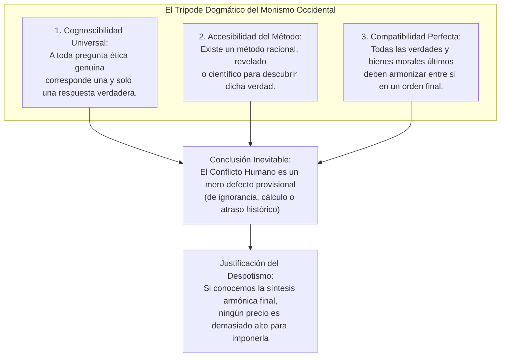
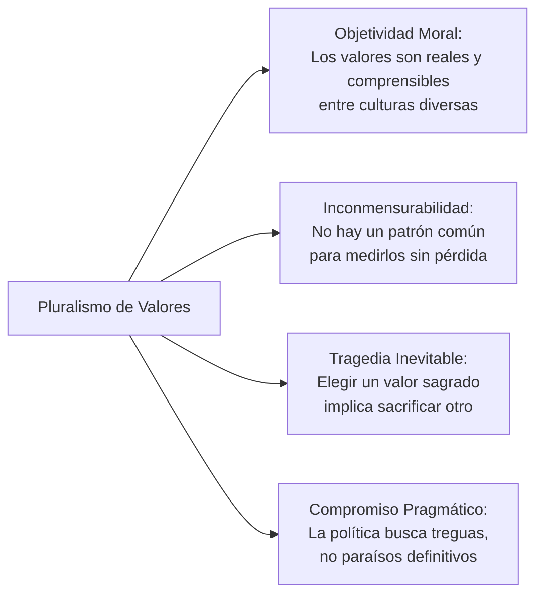

# Dominio I: Marco Teórico — Monismo vs. Pluralismo: Certeza Dogmática e Inconmensurabilidad

## 1. La Gran Disyuntiva Filosófica de Isaiah Berlin

En el corazón de la filosofía política de **Sir Isaiah Berlin** (1909–1997) yace un combate intelectual contra lo que consideró la ilusión más seductora, antigua y destructiva del pensamiento occidental: la premisa del **monismo ético**.

En la Sección IX de la infografía (*Monismo versus pluralismo*), el proyecto sintetiza esta advertencia liminar:
> *«El peligro mayor para la libertad humana no es el error empírico o intelectual ordinario, sino la certeza absoluta e inconmovible de haber encontrado el único valor verdadero y la respuesta final a la condición humana.»*

Berlin dedicó ensayos fundacionales —tales como *La inevitabilidad histórica* (*Historical Inevitability*, 1954), *Dos conceptos de libertad* (*Two Concepts of Liberty*, 1958) y *La búsqueda del ideal* (*The Pursuit of the Ideal*, 1988)— a desentrañar cómo la creencia en una solución única y armoniosa para los dilemas humanos conduce inexorablemente al autoritarismo, al fanatismo de Estado y a la destrucción de las libertades reales.

---

## 2. El Monismo y la Ilusión de la Síntesis Única

### 2.1. Las Tres Premisas Dogmáticas del Monismo
Desde los diálogos platónicos hasta las filosofías teleológicas del siglo XIX (Hegel, Marx, Comte), la tradición filosófica dominante en Occidente operó bajo tres postulados axiomáticos que Berlin desmantela con minuciosidad:

1. **A toda pregunta moral genuina le corresponde una respuesta verdadera, y solo una:** Todas las demás respuestas son falsas o heréticas.
2. **Existe una vía garantizada para acceder a esa respuesta:** Ya sea a través de la contemplación platónica de las Formas, la revelación divina interpretada por una casta eclesiástica, la deducción lógica de la Razón ilustrada, o las «leyes científicas del materialismo histórico».
3. **Todas las respuestas verdaderas deben ser enteramente compatibles entre sí:** En el cosmos moral ideal no pueden existir contradicciones genuinas; las virtudes no pueden chocar. Lo que es verdaderamente justo no puede contradecir lo que es verdaderamente libre, ni lo que es verdaderamente bueno puede perjudicar a lo que es verdaderamente sabio.

### 2.2. La Crítica de Berlin al Historicismo Teleológico
Berlin fustiga con particular agudeza el **historicismo teleológico** (representado prototípicamente por Georg Wilhelm Friedrich Hegel y Karl Marx), según el cual la historia humana está regida por leyes objetivas inexorables que avanzan hacia un telos o desenlace redentor (el Estado racional o la sociedad comunista universal sin clases).

Para Berlin, este historicismo comete una doble falacia:
- **Disuelve la responsabilidad moral individual:** Al concebir a los seres humanos como meros peones o expresiones inconscientes de las «fuerzas dialécticas de la historia», se excusan los crímenes del presente como sacrificios necesarios e inevitables en el altar del progreso futuro.
- **La crueldad de la certeza:** Quien cree poseer las llaves científicas del porvenir perfecto no puede admitir el compromiso, la duda ni la transacción política; cualquier opositor deja de ser un conciudadano con desacuerdos legítimos para convertirse en un saboteador del destino humano universal.

---

## 3. Los Dos Extremos Dogmáticos: Las Derivas del Monismo

Uno de los aportes más originales de la Sección IX del artefacto interactivo consiste en demostrar que **el veneno autoritario del monismo no reside exclusivamente en la libertad positiva**, sino en la **estructura del argumento monista en sí**. Cuando cualquier valor político —incluso la libertad negativa más celosa— se eleva a categoría de verdad suprema, absoluta y exclusiva, engendra su propia deriva destructiva:

```mermaid
graph TD
    subgraph DerivaPos["Deriva de la Libertad Positiva: El «Yo Superior»"]
        D1["Valor Supremo: Autodeterminación Colectiva / Razón"]
        D2["Paso 1: Se postula un 'yo racional ideal' distinto del 'yo empírico'"]
        D3["Paso 2: La Vanguardia / Estado afirma encarnar ese 'yo ideal'"]
        D4["Resultado: Coaccionar al individuo se redefine como 'liberarlo'"]
        D5["Consecuencia: Paternalismo, teocracia y totalitarismo"]
        D1 --> D2 --> D3 --> D4 --> D5
    end

    subgraph DerivaNeg["Deriva de la Libertad Negativa: La «Dominación Privada»"]
        N1["Valor Supremo: No-Interferencia Estatal Absoluta"]
        N2["Paso 1: Se declara que solo la coerción estatal viola la libertad"]
        N3["Paso 2: Se ignoran las asimetrías extremas de riqueza y poder fáctico"]
        N4["Resultado: El abandono y desamparo del débil se etiqueta como 'libertad'"]
        N5["Consecuencia: Darwinismo social, explotación y tiranía corporativa"]
        N1 --> N2 --> N3 --> N4 --> N5
    end
```

### 3.1. Deriva de la Libertad Positiva: El «Yo Superior»
- **La Falacia Teórica:** Asume que la verdadera libertad consiste en el dominio de la razón superior sobre los impulsos ciegos o ignorantes. Si una persona real prefiere consumir drogas, profesar una fe tradicional o rechazar la disciplina colectiva, se argumenta que su «yo empírico» está alienado y no sabe lo que realmente desea.
- **La Usurpación Política:** Una vanguardia ilustrada (el soberano rousseauniano, el partido de vanguardia leninista, el clero doctrinario o una élite tecnocrática) se proclama la encarnación fidedigna de los «intereses reales y objetivos» de la comunidad.
- **La Inversión Perversa del Lenguaje:** Berlin denuncia que este mecanismo permite a los déspotas ejercer la violencia más sanguinaria mientras proclaman cínicamente que están «forzando a los hombres a ser libres» (*«on le forcera d’être libre»*, en la célebre y siniestra fórmula de Rousseau en *El Contrato Social*).
- **Manifestaciones Históricas:** La Comuna jacobina del Terror (1793–1794), los experimentos totalitarios soviéticos y maoístas, y los fundamentalismos religiosos que imponen la salvación a punta de fusil.

### 3.2. Deriva de la Libertad Negativa: La «Dominación Privada»
- **La Falacia Teórica:** Asume que la ausencia de interferencia legal o regulatoria del Estado es el único bien político absoluto, desestimando la influencia de las relaciones de poder asimétricas fuera de la ley penal.
- **La Ceguera Estructural:** Ignora deliberadamente que cuando un individuo carece de recursos para comer, un techo donde resguardarse o acceso a educación y salud, la «no-interferencia» estatal no le otorga libertad alguna, sino que lo condena a la subordinación servil ante quienes controlan los medios de subsistencia.
- **La Inversión Perversa del Lenguaje:** Se etiqueta como «libertad sagrada de contrato» la transacción en la cual un trabajador hambriento o endeudado se ve forzado a aceptar condiciones laborales denigrantes o peligrosas bajo la amenaza del desempleo y la miseria.
- **Manifestaciones Históricas:** El darwinismo social spenceriano de fines del siglo XIX, la explotación industrial desregulada durante el auge fabril victoriano, y las visiones anarcocapitalistas que justifican la privatización de todo bien público común sin salvaguardas para los desposeídos.

> [!CAUTION]
> **Conclusión Epistemológica:**
> El peligro de la opresión política no depende de qué valor particular se entronice en el altar (la justicia social, la soberanía popular, la raza, la fe o el libre mercado desregulado). **El peligro radica en el monismo mismo**: en la pretensión dogmática de que una sociedad humana compleja puede subordinarse a un principio unívoco sin mutilar las libertades de seres humanos concretos.

---

## 4. Comparativa de Sistemas: Sistema Cerrado vs. Sistema Plural

En la visualización dinámica interactiva de la Sección IX, el usuario puede contrastar las trayectorias divergentes entre un **sistema político cerrado (monista)** y un **sistema político abierto y plural**:

| Dimensión Analítica | Sistema Cerrado (Monismo Dogmático) | Sistema Plural (Pluralismo de Valores) |
| :--- | :--- | :--- |
| **Premisa sobre los Fines** | Existe una armonía final objetiva de todos los bienes. Los valores no colisionan. | Los fines últimos son múltiples, inconmensurables y entran en conflicto inevitable. |
| **Tratamiento del Disenso** | El disenso es una anomalía, herejía, traición o síntoma de alienación mental. | El disenso es el síntoma natural y saludable de una sociedad libre y diversa. |
| **Arquitectura de Poder** | Jerarquía unificada, concentración de soberanía y eliminación de contrapesos. | Poder fragmentado territorial y funcionalmente, tribunales contramayoritarios y pesos y contrapesos. |
| **Mecanismo de Decisión** | Resolución deductiva autoritaria: aplicación dogmática de la doctrina oficial. | Deliberación reglada, negociación agonística, transacción y compromiso provisional. |
| **Gestión del Conflicto** | Supresión coactiva del conflicto en nombre de la unanimidad. | Institucionalización pacífica del conflicto mediante reglas de juego compartidas. |
| **Riesgo Sistémico Principal** | Totalitarismo, dogmatismo ciego, crueldad doctrinaria e inflexibilidad ante el colapso. | Lentitud burocrática, insatisfacción generalizada con los compromisos y posible parálisis legislativa. |
| **Tolerancia a la Incertidumbre**| Nula: exige certezas absolutas y garantías escatológicas de éxito. | Alta: asume la precariedad de los acuerdos y la provisionalidad del saber humano. |

---

## 5. El Pluralismo como Tecnología Política de la Coexistencia

Frente al monismo, el **Pluralismo de Valores** defendido por Isaiah Berlin no es una mera concesión a la debilidad humana, sino un postulado ontológico sobre la naturaleza de la moralidad y la política:

1. **Pluralismo no es Relativismo Moral:**
   Berlin insiste con vehemencia en que el pluralismo no es subjetivismo ni relativismo cínico (del tipo «cada cual tiene su verdad y todo vale igual»). Los valores humanos fundamentales (la compasión, la justicia, la libertad, el coraje, la verdad) son **objetivos y universales**, reconocibles a través de fronteras lingüísticas y culturales. Precisamente porque son objetivos y reales, su choque es trágico e ineludible.
2. **Inconmensurabilidad Radical:**
   Los valores no pueden reducirse a una divisa matemática común (como pretendía el utilitarismo con el «cálculo de placer y dolor»). La libertad no se puede cambiar por justicia a una tasa de cambio fija y matemática sin que se produzca una pérdida moral irreparable.
3. **La Política como Administración del Desacuerdo Irreducible:**
   Si los valores son inconmensurables, la pretensión de alcanzar un consenso moral total y permanente es una quimera totalitaria. Por tanto, la verdadera vocación de la política democrática no es forzar la unanimidad moral, sino **administrar pacíficamente el desacuerdo perpetuo**, construyendo diques institucionales para que ciudadanos con visiones del mundo incompatibles puedan convivir sin matarse.

Como sintetiza Berlin en *El fuste torcido de la humanidad* (*The Crooked Timber of Humanity*, 1990):
> *«Lo mejor que podemos hacer es mantener un equilibrio precario que impida que ocurran situaciones intolerables: procurar que nadie sea completamente aplastado, que se evite el sufrimiento extremo y que se preserving alternativas reales de elección.»*

---

## 6. Referencias Bibliográficas

- Berlin, I. (1954). *Historical Inevitability*. London: Oxford University Press.
- Berlin, I. (1958). *Two Concepts of Liberty*. Oxford: Clarendon Press.
- Berlin, I. (1969). *Four Essays on Liberty*. Oxford: Oxford University Press.
- Berlin, I. (1988). *The Pursuit of the Ideal*. Discurso de recepción del Premio Agnelli, Turín.
- Berlin, I. (1990). *The Crooked Timber of Humanity: Chapters in the History of Ideas*. London: John Murray.
- Constant, B. (1819). *De la liberté des Anciens comparée à celle des Modernes*.
- Gray, J. (1995). *Isaiah Berlin*. London: HarperCollins.
- Hegel, G. W. F. (1821). *Grundlinien der Philosophie des Rechts*. Berlin.
- Marx, K. & Engels, F. (1848). *Manifest der Kommunistischen Partei*. London.
- Mill, J. S. (1859). *On Liberty*. London: John W. Parker and Son.
- Popper, K. R. (1945). *The Open Society and Its Enemies*. London: Routledge.
- Rousseau, J.-J. (1762). *Du contrat social ou Principes du droit politique*. Amsterdam.
- Spencer, H. (1884). *The Man Versus the State*. London: Williams and Norgate.
- Williams, B. (1981). *Moral Luck: Philosophical Papers 1973–1980*. Cambridge: Cambridge University Press.
