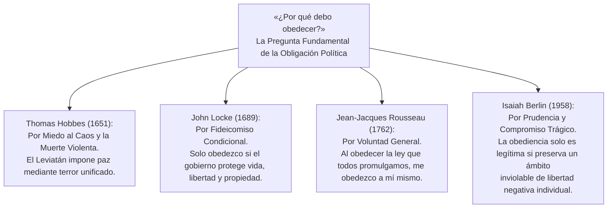
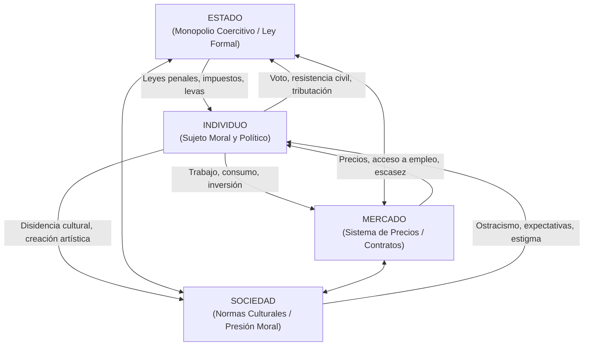
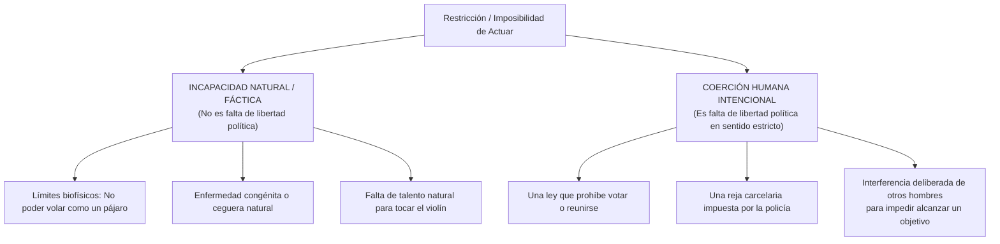
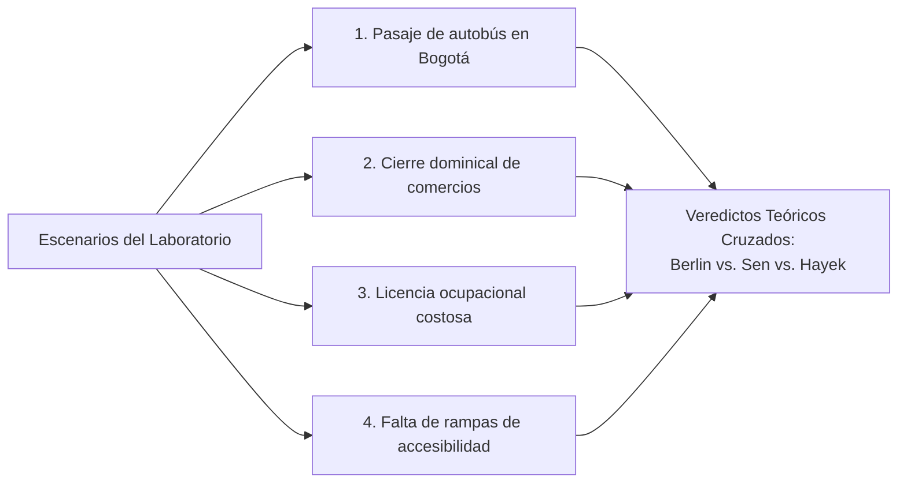

# Dominio I: Marco Teórico — Poder, Obediencia y Coerción: Los Límites de la Interferencia Humana

## 1. La Pregunta Política Fundamental: «¿Por qué debo obedecer?»

Toda teoría política digna de tal nombre debe responder en última instancia a una interrogante que no es de orden técnico ni gerencial, sino estrictamente moral y existencial:
> ### *«¿Por qué debo obedecer? ¿Por qué alguien puede obligarme legítimamente a hacer lo que yo no he elegido hacer?»*

En la Sección IV (*Poder y obediencia*) y en la Sección V (*Incapacidad versus coerción*), el proyecto **Anatomía de la Libertad** sitúa esta pregunta en el centro del debate sobre la legitimidad del Estado y los límites de la coacción.

Como señala **Isaiah Berlin**, la obediencia no es un hecho natural ni una propiedad intrínseca de la especie humana; es una construcción precaria que exige una justificación incesante:
- Si no existe justificación válida para que un gobernante me imponga su voluntad por la fuerza, la coerción no es más que **violencia despótica o bandidaje organizado** (como observaba ya San Agustín en *La Ciudad de Dios*: *«Sin justicia, ¿qué son los reinos sino grandes bandas de ladrones?»*).
- Si, por el contrario, la justificación de la autoridad es tan absoluta que anula toda posibilidad de resistencia o disenso, el individuo deja de ser un sujeto moral libre para convertirse en un mero súbdito domesticado.

### 1.1. Las Cuatro Respuestas Canónicas a la Obligación Política
1. **Thomas Hobbes (*Leviatán*, 1651):** El ser humano obedece para escapar del estado de naturaleza, caracterizado por la guerra de todos contra todos (*bellum omnium contra omnes*), donde la vida es «solitaria, pobre, tosca, embrutecida y breve». La soberanía es indivisible y absoluta; el soberano tiene el derecho irrestricto de coaccionar a sus súbditos para garantizar la supervivencia física elemental.
2. **John Locke (*Segundo Tratado sobre el Gobierno Civil*, 1689):** El individuo nace con derechos naturales inalienables (vida, libertad y propiedad). El poder político se funda en un contrato fiduciario (*trust*); los ciudadanos solo deben obedecer al Estado mientras este proteja dichos derechos. Si el gobernante abusa del poder o invade la propiedad privada de manera arbitraria, rompe el fideicomiso y asiste a los ciudadanos el legítimo **derecho a la rebelión** (*appeal to Heaven*).
3. **Jean-Jacques Rousseau (*El Contrato Social*, 1762):** La obediencia se legitima transformando la libertad natural en libertad civil mediante la subordinación de la voluntad particular a la **Voluntad General**. Al someterse a la ley que él mismo ha contribuido a crear como soberano colectivo, el ciudadano no obedece a un amo externo, sino que «permanece tan libre como antes».
4. **Isaiah Berlin (*Dos conceptos de libertad*, 1958):** Desmitifica las ficciones metafísicas del contrato social y la voluntad general. Para Berlin, la obediencia política es un compromiso pragmático y trágico: reconocemos la necesidad de leyes y monopolio estatal de la fuerza para evitar la ley de la selva, pero exigimos que exista una **frontera mínima inviolable de no-interferencia** que ningún gobierno, ni siquiera una mayoría democrática unánime, tenga el derecho de cruzar.

---

## 2. Los Vectores Relacionales del Poder: Individuo, Estado, Mercado y Sociedad

En la visualización SVG interactiva de la Sección IV, el poder no se modela como una sustancia abstracta que se posee, sino como una **red de restricciones vectoriales recíprocas** entre cuatro actores constitutivos de la vida pública:

### 2.1. El Individuo (Sujeto Moral y Político)
El punto de partida ético de la tradición liberal y del pluralismo de valores. Dotado de facultades racionales y emocionales para formular y perseguir fines propios, el individuo experimenta la libertad como la facultad de elegir sin ser coaccionado por agentes externos.

### 2.2. El Estado (Monopolio de la Fuerza y Ley Positiva)
Ejerce la coacción más directa, institucionalizada y letal mediante el aparato judicial, policial y militar. Restringe la libertad a través de prohibiciones legales, tributos obligatorios, regulaciones administrativas y penas privativas de la libertad. Su justificación descansa en el mantenimiento del orden público y la provisión de bienes públicos.

### 2.3. El Mercado (Coordinación por Precios y Contratos Privados)
Ejerce restricción a través de la escasez de recursos y el poder de negociación asimétrico. Para los economistas liberales (Hayek, Friedman), el mercado es un mecanismo voluntario de no-coerción; para los críticos igualitaristas y socialistas, las asimetrías extremas de riqueza y la dependencia salarial constituyen formas estructurales de dominación fáctica que limitan las opciones reales de subsistencia.

### 2.4. La Sociedad (Norma Cultural, Costumbre y Moral Pública)
Ejerce restricción mediante mecanismos informales pero sumamente eficaces: el ostracismo, la estigmatización social, las expectativas de género y la presión comunitaria a la conformidad. John Stuart Mill advirtió en *On Liberty* que la «tiranía de la opinión mayoritaria» puede ser más asfixiante y penetrante que la tiranía legal de los magistrados.

---

## 3. La Frontera Epistémica: Coerción Intencional vs. Incapacidad Fáctica

En la Sección V de la infografía (*Incapacidad versus coerción*), se aborda una de las distinciones más rigurosas y controvertidas formuladas por Isaiah Berlin:

> *«La naturaleza no nos coacciona; solo los seres humanos pueden coaccionar a otros seres humanos.»*

### 3.1. Los Criterios de la Coerción en Isaiah Berlin
Para que exista una privación de libertad política en sentido estricto, Berlin exige la concurrencia de tres elementos:
1. **Agencia humana:** La obstrucción debe ser causada por la acción (o inacción calculada) de otros seres humanos, no por fenómenos ciegos de la naturaleza.
2. **Deliberación o intencionalidad:** Debe mediar una voluntad humana que cierra deliberadamente un camino que de otro modo estaría expedito.
3. **Imputabilidad moral:** Tiene que ser posible señalar a un agente individual o colectivo responsable del obstáculo.

Si un hombre no puede caminar porque una lesión medular congénita lo paralizó, padece una **incapacidad trágica**, pero no una falta de libertad política. Si ese mismo hombre no puede caminar porque el tirano ordenó atarlo a un poste con cadenas, padece una **pérdida radical de libertad política**.

---

## 4. El Laboratorio Conceptual de Fronteras (Análisis de Escenarios)

La infografía incorpora el **Laboratorio Conceptual de Límites** (Sección V), un dispositivo interactivo donde los usuarios someten cuatro casos reales de la vida contemporánea al escrutinio cruzado de **Berlin**, **Sen** y **Hayek**:

### Escenario 1: El Pasaje de Autobús en Bogotá
- **Hecho:** Un ciudadano de bajos ingresos en la periferia de Bogotá no dispone de dinero para pagar la tarifa del sistema TransMilenio y trasladarse a su lugar de empleo.
- **Veredicto de Isaiah Berlin:** *Incapacidad material de recursos, a menos que se demuestre intención deliberada.* Formalmente, nadie le prohíbe subir al autobús mediante una norma discriminatoria personalizada. Sin embargo, Berlin concede que si las tarifas y la estructura económica son el resultado de políticas deliberadas orientadas a favorecer a ciertos sectores excluyendo a otros, la frontera entre incapacidad y coerción comienza a difuminarse.
- **Veredicto de Amartya Sen:** *Privación flagrante de libertad sustantiva (Capacidades).* La libertad de movimiento y la libertad de acceder a un medio digno de subsistencia son funcionamientos vitales. La ausencia de ingresos efectivos destruye la capacidad real de agencia, independientemente de que no haya un policía apuntándole con un arma.
- **Veredicto de Friedrich Hayek:** *Consecuencia inevitable del sistema de precios (No-coerción estatal).* El transporte público cuesta recursos reales de combustible, mantenimiento y salarios de conductores. Cobrar una tarifa es la señal económica indispensable para coordinar recursos escasos. Solo habría coerción si el Estado prohibiera arbitrariamente que este individuo trabaje o use sus propios medios para movilizarse.

### Escenario 2: El Cierre Dominical Obligatorio de Comercios
- **Hecho:** Una ley municipal prohíbe abrir establecimientos comerciales durante los domingos para garantizar el descanso dominical de los empleados.
- **Veredicto de Isaiah Berlin:** *Coerción legal directa sobre la libertad negativa.* El Estado interviene activamente amenazando con sanciones pecuniarias y clausura policial a los propietarios y consumidores que deseen transar voluntariamente en domingo.
- **Veredicto de Amartya Sen:** *Habilitación de capacidades fundamentales de descanso y vida familiar.* Para los trabajadores dependientes, la norma legal les devuelve la capacidad sustantiva de convivir con sus familias y preservar su salud psicofísica frente a la subordinación patronal.
- **Veredicto de Friedrich Hayek:** *Interferencia arbitraria en el orden de mercado.* Impide transacciones voluntarias mutuamente ventajosas y distorsiona la competencia económica en favor de ciertas corporaciones con mayor musculatura financiera.

### Escenario 3: La Licencia Ocupacional Costosa
- **Hecho:** Para ejercer un oficio (por ejemplo, conducir un taxi o cortar el cabello), el gobierno exige el pago de una licencia prohibitiva de miles de dólares y 500 horas de cursos obligatorios.
- **Veredicto de Isaiah Berlin:** *Coerción estatal sobre la libertad negativa de contratación.* Una barrera legal impuesta por el poder político prohíbe comerciar bajo amenaza de sanción penal.
- **Veredicto de Amartya Sen:** *Barrera que cercena la capacidad de generar ingresos dignos.* Si los cursos y tasas no guardan relación demostrable con la seguridad pública, constituyen una trampa de pobreza diseñada para mantener excluidos a los sectores vulnerables.
- **Veredicto de Friedrich Hayek:** *Captura rentista del aparato regulatorio estatal.* Constituye el ejemplo clásico de grupos de presión consolidados (gremios de taxistas o colegios profesionales) que instrumentalizan el monopolio de la violencia del Estado para bloquear a nuevos competidores eficientes y mantener precios artificialmente altos.

### Escenario 4: La Falta de Rampas de Accesibilidad Universal
- **Hecho:** Un usuario en silla de ruedas no puede ingresar a una biblioteca pública o tribunal judicial porque el edificio solo cuenta con escaleras empinadas.
- **Veredicto de Isaiah Berlin:** *Zona de ambigüedad liminar.* En su formulación más estrecha, la imposibilidad de subir escaleras proviene de una condición biomecánica (incapacidad). Pero al tratarse de un edificio público financiado con impuestos ciudadanos, la omisión consciente de diseñar rampas puede interpretarse como una discriminación institucional deliberada.
- **Veredicto de Amartya Sen:** *Injusticia estructural y anulación de capacidades.* El diseño arquitectónico no es un accidente de la naturaleza; es una decisión humana que convierte una diversidad corporal en una barrera insalvable para el ejercicio de derechos cívicos y culturales.
- **Veredicto de Friedrich Hayek:** *En edificios públicos, falla de provisión institucional; en recintos privados, asunto de incentivos y libertad contractual.* El Estado tiene la obligación de garantizar acceso equitativo a sus propias cortes de justicia, pero imponer multas coercitivas a comercios privados históricos puede atentar contra la preservación de derechos de propiedad adquiridos.

---

## 5. La Grieta que Berlin Deja Abierta: La Escasez Institucionalmente Organizada

El análisis crítico de la Sección V desemboca en la **grieta epistemológica** más debatida de la filosofía política contemporánea:

> *¿Es la pobreza económica un mero límite natural e impersonal de recursos (como la sequía o la gravedad), o constituye una forma acumulada de coerción humana institucionalmente organizada?*

Filósofos analíticos contemporáneos como **G. A. Cohen** (*Self-Ownership, Freedom, and Equality*, 1995) y republicanos como **Philip Pettit** (*Republicanism*, 1997) han profundizado en esta fisura de la doctrina de Berlin:
1. **La Propiedad Privada como Sistema Coercitivo de Prohibiciones:**
   Cohen demostró que el régimen de propiedad privada no es la ausencia de intervención estatal, sino una gigantesca **red de prohibiciones coactivas respaldadas por la policía armada**. Cuando una persona sin recursos intenta cultivar una tierra ociosa o habitar una vivienda desocupada para no morir congelada, no es la naturaleza la que se lo impide: son los agentes policiales del Estado quienes intervienen físicamente para desalojarla y arrestarla.
2. **La Responsabilidad Distributiva:**
   Si las leyes de propiedad, herencia, tributación y emisión monetaria son artefactos humanos deliberados diseñados por parlamentos y gobernantes, entonces las privaciones extremas resultantes de esas reglas no pueden despacharse alegremente como «incapacidades naturales». Constituyen el efecto previsible de una arquitectura coercitiva humana.
3. **La Síntesis Integradora:**
   La distinción de Berlin entre incapacidad y coerción sigue siendo indispensable para evitar que el término «libertad» pierda todo significado y se confunda con «deseo omnipotente». Sin embargo, la teoría política contemporánea reconoce que **la frontera entre ambas no es un dato físico fijo, sino una decisión moral sobre qué injusticias colectivas consideramos intolerables y remediables mediante la acción pública**.

---

## 6. Referencias Bibliográficas

- Agustín de Hipona (426 d.C.). *De Civitate Dei contra Paganos*.
- Berlin, I. (1958). *Two Concepts of Liberty*. Oxford: Clarendon Press.
- Berlin, I. (1969). *Four Essays on Liberty*. Oxford: Oxford University Press.
- Cohen, G. A. (1995). *Self-Ownership, Freedom, and Equality*. Cambridge: Cambridge University Press.
- Hayek, F. A. (1960). *The Constitution of Liberty*. Chicago: University of Chicago Press.
- Hobbes, T. (1651). *Leviathan, or The Matter, Forme and Power of a Commonwealth Ecclesiasticall and Civil*. London: Andrew Crooke.
- Locke, J. (1689). *Second Treatise of Government*. London: Awnsham Churchill.
- Mill, J. S. (1859). *On Liberty*. London: John W. Parker and Son.
- Pettit, P. (1997). *Republicanism: A Theory of Freedom and Government*. Oxford: Oxford University Press.
- Rousseau, J.-J. (1762). *Du contrat social ou Principes du droit politique*. Amsterdam: Marc-Michel Rey.
- Sen, A. (1999). *Development as Freedom*. New York: Alfred A. Knopf.
- Van Parijs, P. (1995). *Real Freedom for All: What (if anything) can justify capitalism?*. Oxford: Oxford University Press.
