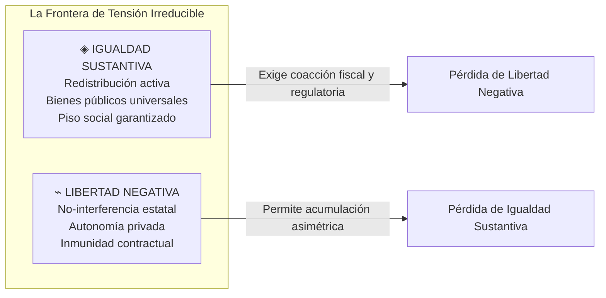
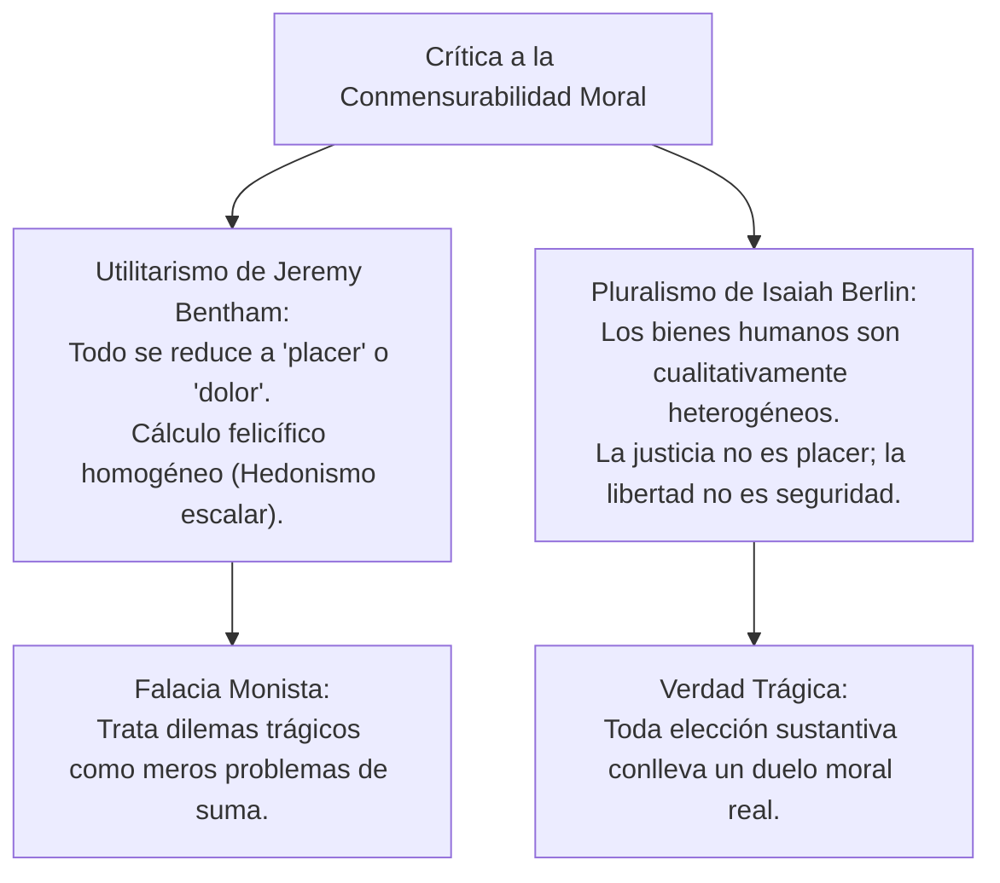
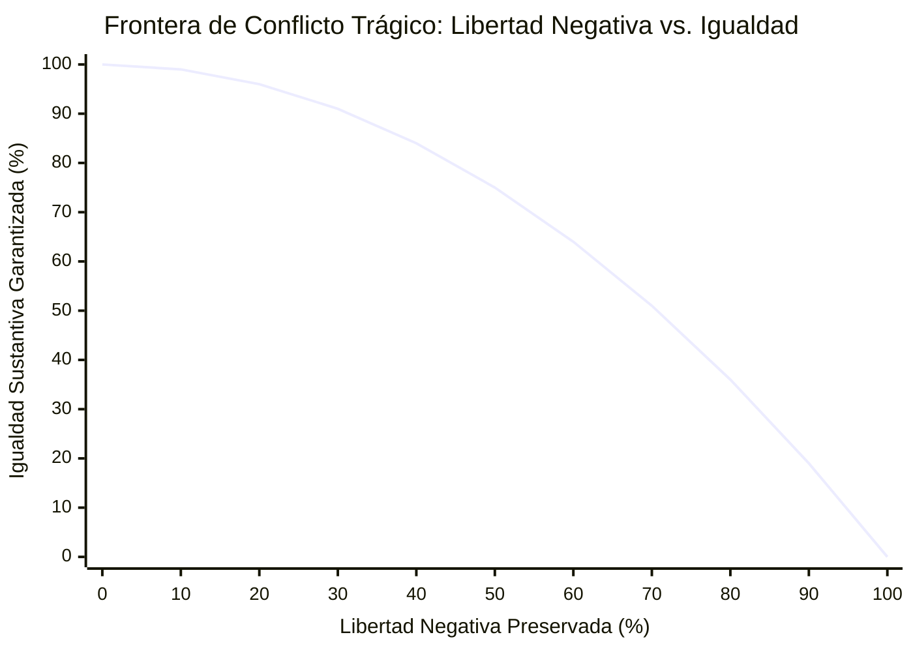
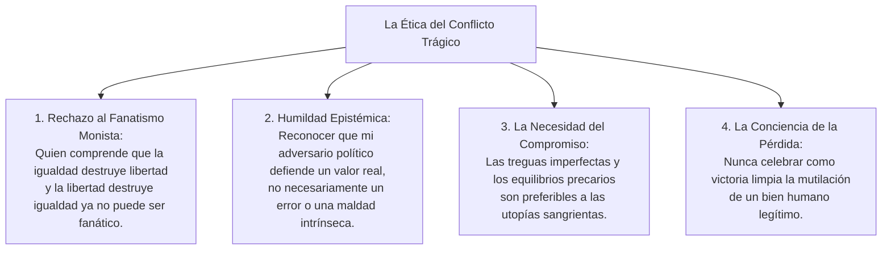

# Dominio I: Marco Teórico — El Conflicto Trágico de Valores y la Inconmensurabilidad

## 1. La Tesis del Conflicto No Resuelto (Sección III)

En la Sección III de la infografía (*El conflicto no resuelto*), se expone con contundencia la afirmación más audaz y desafiante de la filosofía política de **Sir Isaiah Berlin**:

> ### *«La igualdad y la libertad son valores genuinamente incompatibles. Su choque no es un problema de implementación técnica ni un fallo administrativo: es un conflicto trágico e irreducible.»*

Durante siglos, el idealismo político y las filosofías del progreso prometieron que las aspiraciones humanas más nobles podrían alcanzarse simultáneamente en una sociedad justa. Se afirmaba que la verdadera igualdad expandiría la verdadera libertad, y que la libertad plena conduciría espontáneamente a la equidad social.

Berlin demuele esta complacencia:
- Para garantizar una **igualdad sustantiva de condiciones** (que los desposeídos tengan alimento, salud, educación y vivienda digna), el Estado debe intervenir activamente: fijar impuestos redistributivos obligatorios, expropiar latifundios ociosos, regular los salarios y restringir las transacciones financieras especulativas. Cada una de estas medidas restringe de manera directa e innegable la **libertad negativa** de disposición patrimonial y contratación de los ciudadanos más prósperos.
- Por el contrario, si se protege de manera absoluta e irrestricta la **libertad negativa** (cero interferencia estatal, desregulación total del mercado y libre disposición de la propiedad privada heredada), las diferencias iniciales de talento, suerte, salud y herencia patrimonial se amplifican inevitablemente con el tiempo, desembocando en abismos extremos de desigualdad que anulan la igualdad social.

---

## 2. Inconmensurabilidad Radical: El Fracaso del Utilitarismo

Para fundamentar por qué este conflicto es trágico y no meramente problemático, Berlin recurre al concepto de **inconmensurabilidad de valores** (*value incommensurability*), profundizado posteriormente por filósofos como Joseph Raz (*The Morality of Freedom*, 1986) y Bernard Williams (*Moral Luck*, 1981).

### 2.1. ¿Qué Significa que dos Valores Sean Inconmensurables?
Dos valores o bienes morales son inconmensurables cuando:
1. **Carecen de una unidad de medida común:** No existe un «metro ético» ni una «divisa moral universal» mediante la cual podamos tasar con precisión cuántas unidades de libertad equivalen exactamente a cinco unidades de igualdad o a tres unidades de seguridad nacional.
2. **No admiten sustitución sin residuo:** Renunciar a una cuota de libertad para alimentar a una población hambrienta puede ser una decisión política imperiosa y moralmente encomiable; sin embargo, no debemos engañarnos creyendo que «no hemos perdido nada». La libertad sacrificada es una pérdida genuina e irreparable que no queda cancelada ni magicamente subsumida por el pan entregado.

### 2.2. La Refutación del Utilitarismo Escalar
Berlin dirige sus dardos más certeros contra el utilitarismo de Jeremy Bentham y John Stuart Mill. El utilitarismo pretendió resolver todos los conflictos éticos reduciéndolos a una ecuación matemática: *«la mayor felicidad para el mayor número»*.

Para Berlin, esta reducción es una **falacia categorial**:
- Un dolor no es simplemente un placer con signo negativo.
- La dignidad humana, el sentido de justicia de un pueblo o el amor a la libertad no pueden cotizarse en el mercado de la utilidad sin desfigurar su significado esencial.
- Pretender que un algoritmo tecnocrático puede calcular el «óptimo de Pareto» moral de una sociedad es confundir la deliberación política sobre el sentido de la vida con la contabilidad por partida doble de una tienda de ultramarinos.

---

## 3. El Modelo Gráfico y Matemático del Trade-Off (Pérdida Recíproca)

En la interactividad de la Sección III de *Anatomía de la Libertad*, el usuario manipula un deslizador (*conflict-slider*) que recorre un espectro de 0% (Máxima Igualdad Colectiva) a 100% (Máxima Libertad Negativa), observando en tiempo real una **curva cóncava de transformación de valores** (*trade-off frontier*):

### 3.1. Las Leyes del Desplazamiento en la Curva
1. **El Extremo de la Igualdad Forzada (Posición 0%):**
   - *Igualdad Garantizada:* 100%.
   - *Libertad Negativa Restringida:* 100%.
   - *Consecuencia Política:* Para erradicar toda asimetría de riqueza e influencia, el Estado debe controlar de manera totalitaria los medios de producción, asignar cuotas de empleo, prohibir la herencia patrimonial e intervenir en la vida privada. La igualdad alcanzada se sostiene sobre la servidumbre general ante la burocracia estatal.
2. **El Equilibrio Inestable (Posición 50% — El Estado Social de Derecho):**
   - *Libertad Negativa Restringida:* 50%.
   - *Igualdad Sacrificada:* 50%.
   - *Consecuencia Política:* El modelo de la socialdemocracia europea y del Estado Social de Derecho: tributación progresiva moderada para financiar salud, educación y pensiones públicas, manteniendo simultáneamente la libre empresa, la propiedad privada y las libertades civiles. Ningún polo está plenamente satisfecho: los libertarios denuncian expolio fiscal; los socialistas denuncian desigualdad persistente.
3. **El Extremo del Libre Mercado Puro (Posición 100%):**
   - *Libertad Negativa Preservada:* 100%.
   - *Igualdad Sacrificada:* 100%.
   - *Consecuencia Política:* Estado mínimo ultraliberal (*vigilante nocturno*): cero impuestos redistributivos, cero regulación laboral. Quien carece de recursos propios queda a merced de la caridad privada o la indigencia. La libertad formal existe para todos, pero la igualdad real se derrumba a cero.

---

## 4. Problemas Técnicos versus Problemas Políticos

Una de las distinciones metodológicas más valiosas del proyecto —expuesta desde el prólogo en la Sección I (*Problema*)— radica en la diferencia fundamental entre un **problema técnico** y un **problema político**:

| Criterio de Distinción | Problema Técnico | Problema Político (Berliniano) |
| :--- | :--- | :--- |
| **Acuerdo sobre los Fines** | **Existe consenso pleno:** Todos coinciden en la meta que se desea alcanzar (ej. construir un puente seguro, erradicar la malaria, reducir la inflación). | **No existe consenso:** Los fines últimos en disputa son inconmensurables e incompatibles (ej. ¿cuánta libertad individual estamos dispuestos a sacrificar para garantizar salud universal?). |
| **Naturaleza del Desacuerdo** | Desacuerdo sobre la eficiencia de los **medios**: ¿cuál cálculo de ingeniería, qué vacuna o qué tasa de interés es más eficaz? | Desacuerdo sobre la legitimidad de los **fines**: colisión de jerarquías éticas irreductibles. |
| **Tipo de Solución** | **Solución algorítmica / experta:** Se resuelve mediante ciencia, datos cuantitativos, modelos matemáticos y optimización técnica. | **Solución deliberativa / prudencial:** No existe fórmula óptima; se resuelve mediante pactos, transacciones, pesos y contrapesos y treguas políticas provisionales. |
| **Rol del Experto** | El experto (ingeniero, médico, epidemiólogo) es la autoridad legítima decisional. | El experto es un asesor informativo; la decisión corresponde a la comunidad ciudadana deliberativa. |
| **Consecuencia de Confundirlos** | La politización indebida de hechos empíricos comprobables (ej. negar la ley de gravedad o la evidencia biológica). | **Tecnocracia autoritaria:** Presentar decisiones morales y distributivas desgarradoras como «inevitabilidades técnicas incuestionables». |

> [!IMPORTANT]
> **La Trampa de la Tecnocracia:**
> Cuando un gobierno presenta una reforma fiscal o laboral diciendo que *«no hay alternativa técnica»* (*There Is No Alternative* - TINA), está cometiendo una usurpación epistemológica: disfraza una elección valorativa que beneficia a unos y perjudica a otros bajo el ropaje aséptico de una ley física incontrovertible.

---

## 5. Ética de la Tragedia: Habitar la Pérdida sin Cinismo ni Fanatismo

El reconocimiento de que los valores entran en conflicto insoluble no desemboca en el pesimismo nihilista ni en la inacción paralizante; constituye, por el contrario, la base de una **ética cívica de la madurez y la templanza**:

Como concluye Isaiah Berlin con lucidez conmovedora en *La búsqueda del ideal*:
> *«La necesidad de elegir, de sacrificar unos fines a otros últimos, se erige en una condición ineludible de la existencia humana. Si los hombres tuvieran solo un fin, o si todos los fines se armonizaran espontáneamente, la vida moral y la libertad de elección carecerían de sentido. Somos libres precisamente porque estamos condenados a elegir entre bienes incompatibles, y porque ninguna elección está libre de dolor.»*

---

## 6. Referencias Bibliográficas

- Bentham, J. (1789). *An Introduction to the Principles of Morals and Legislation*. London: T. Payne and Son.
- Berlin, I. (1958). *Two Concepts of Liberty*. Oxford: Clarendon Press.
- Berlin, I. (1969). *Four Essays on Liberty*. Oxford: Oxford University Press.
- Berlin, I. (1988). *The Pursuit of the Ideal*. Torino: Agnelli Foundation.
- Gray, J. (1995). *Isaiah Berlin*. London: HarperCollins.
- Mill, J. S. (1861). *Utilitarianism*. London: Parker, Son, and Bourn.
- Rawls, J. (1971). *A Theory of Justice*. Cambridge, MA: Harvard University Press.
- Raz, J. (1986). *The Morality of Freedom*. Oxford: Clarendon Press.
- Sen, A. (1992). *Inequality Reexamined*. Cambridge, MA: Harvard University Press.
- Williams, B. (1981). *Moral Luck: Philosophical Papers 1973–1980*. Cambridge: Cambridge University Press.
