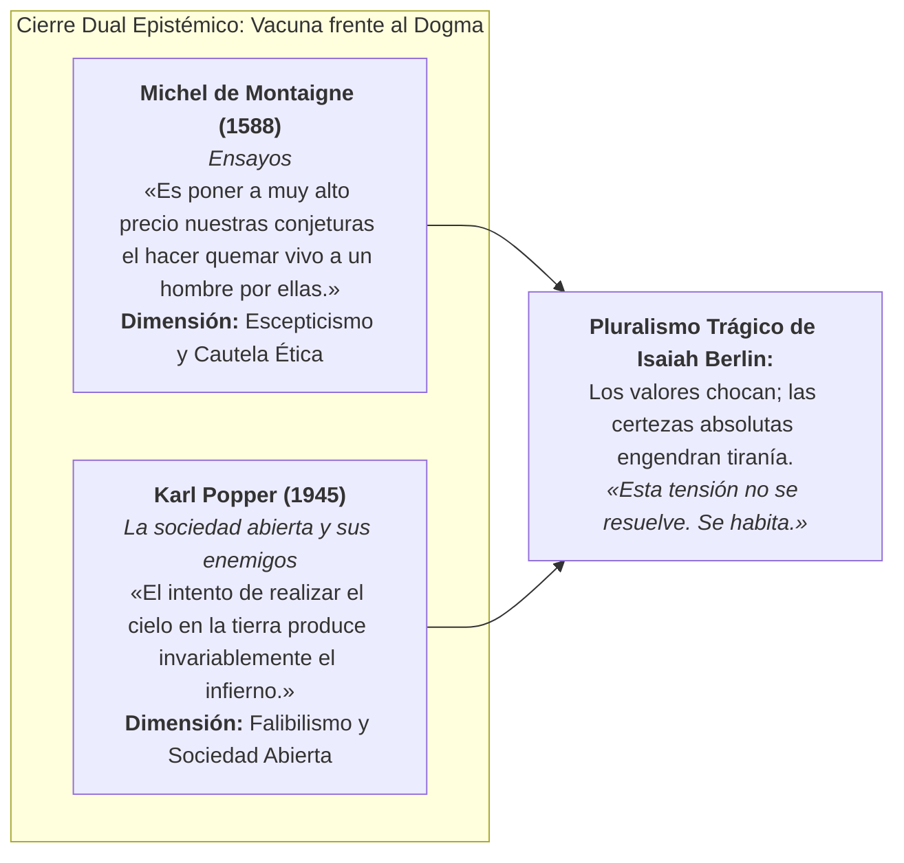
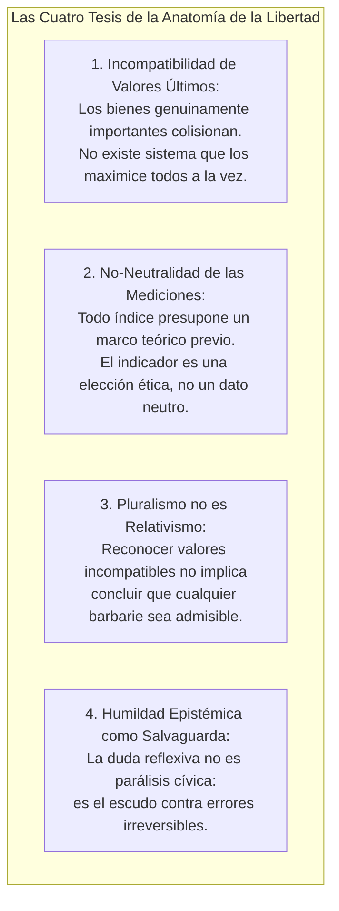
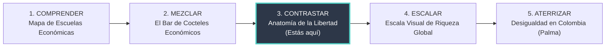

# Dominio I: Marco Teórico — Síntesis Epistémica: El Cierre Dual Montaigne–Popper y la Ruta del Pensamiento Crítico

## 1. El Cierre Dual Epistémico: Montaigne y Popper como Vacuna frente al Dogma

En la Sección XI de la infografía (*Cierre: Epílogo epistémico*), el artefacto pedagógico corona su recorrido con un **dispositivo de cierre dual** protagonizado por **Michel de Montaigne** y **Karl Popper**, superando la clásica clausura monológica de Kant para asentar la vacuna epistemológica más coherente con el pluralismo berliniano:

### 1.1 ¿Por qué superar la exclusividad de Kant?
Aunque Isaiah Berlin tituló célebremente una de sus obras maestras *El fuste torcido de la humanidad* (1990) a partir del aforismo de Kant (*Idea para una historia universal en clave cosmopolita*, 1784), el propio Berlin alertó incansablemente sobre las trampas del racionalismo ilustrado monista. Kant sostenía que existe una única ley moral universal deducible por la razón pura (el imperativo categórico), una visión que roza el monismo ético si se extrapola al diseño del orden político. 

Para vacunar la reflexión pedagógica contra cualquier dogma racionalista, el cierre se refundamenta en dos pensadores cardinales del escepticismo crítico y la sociedad abierta:

### 1.2 Michel de Montaigne: Escepticismo Humanista y Cautela Ética
> ### *«C'est mettre ses conjectures à bien haut prix que d'en faire cuire un homme tout vif.»*
> *(«Es poner a muy alto precio nuestras conjeturas el hacer quemar vivo a un hombre por ellas.»)*
> — **Michel de Montaigne**, *Ensayos* (Libro III, Cap. 11, 1588).

1. **La Condición Conjetural del Conocimiento Moral:** Montaigne nos recuerda que lo que llamamos dogmas o verdades incuestionables no son más que conjeturas humanas falibles. Elevar una conjetura al rango de certeza absoluta es el primer paso hacia el fanatismo.
2. **El Freno a la Crueldad:** Ninguna construcción teórica o certeza ideológica justifica infligir tormento, despojo o muerte a otro ser humano. Es la máxima advertencia frente a las inquisiciones de cualquier signo.

### 1.3 Karl Popper: Falibilismo Crítico y Rechazo a la Utopía Totalizadora
> ### *«The attempt to make heaven on earth invariably produces hell.»*
> *(«El intento de realizar el cielo en la tierra produce invariablemente el infierno.»)*
> — **Karl Popper**, *La sociedad abierta y sus enemigos* (1945).

1. **Contra la Ingeniería Social Utópica:** La pretensión de conocer el fin supremo de la historia y diseñar un sistema perfecto («el cielo en la tierra») exige suprimir toda disidencia y sacrificar generaciones presentes en aras de un paraíso futuro ilusorio.
2. **Falibilismo Institucional y Reforma Gradual:** En lugar de utopías holistas, Popper defiende la ingeniería social gradual (*piecemeal social engineering*), instituciones transparentes sometidas a crítica pública y la protección irrestricta de la libertad de disentir.

Ambas citas articulan un doble blindaje: **Montaigne** custodia la humildad de la conciencia moral interior; **Popper** custodia las instituciones políticas frente al mesianismo colectivista. Juntos pavimentan el camino hacia las 4 tesis del pluralismo berliniano.

---

## 2. Las Cuatro Tesis del Pluralismo Berliniano

En el cierre del artefacto interactivo se destilan las **cuatro tesis epistémicas y normativas** que articulan el marco teórico del proyecto:

### Tesis 1: Incompatibilidad de Fines Últimos
No todas las cosas buenas pueden coexistir plenamente. La libertad total para los lobos es la muerte de los corderos; la justicia perfecta no admite clemencia, y la misericordia absoluta diluye la justicia. El choque de valores es una condición estructural de la existencia moral humana, no una imperfección subsanable.

### Tesis 2: No-Neutralidad de los Índices e Instrumentos de Medición
Como se demuestra empíricamente en la Sección VIII (*Colombia bajo tres índices*), cualquier intento de cuantificar la libertad, la pobreza o el desarrollo presupone juicios normativos previos sobre qué es lo que realmente importa:
- Medir únicamente la tasa de homicidios o la desregulación de precios adopta el lente de la **libertad negativa**.
- Medir privaciones de agua potable, escolaridad o salud comunitaria adopta el lente de las **capacidades sustantivas de Sen**.
- Los datos estadísticos no «hablan por sí solos»: son interrogados e interpretados a través de la lente teórica que el investigador o el Estado decide calzarse.

### Tesis 3: El Pluralismo No Es Relativismo Moral
Existe un límite objetivo para lo que puede considerarse una vida humana inteligible y digna. Reconocer que una cultura prioriza el honor y otra la autonomía individual no significa tolerar la tortura, el canibalismo o la esclavitud como «simples diferencias de gusto». Berlin insiste en que existe un **horizonte humano común** de necesidades y sufrimientos universales que impone límites tajantes a la barbarie.

### Tesis 4: La Humildad Epistémica como Escudo Democrático
La arrogancia dogmática de quien cree tener el monopolio de la virtud moral es la madre de las hogueras inquisitoriales y los campos de exterminio. Reconocer que nuestros propios juicios son falibles y que nuestro adversario político puede estar defendiendo un bien humano genuino no debilita la convicción cívica: la vacuna contra el veneno del autoritarismo y la crueldad irreversible.

---

## 3. «Esta Tensión No Se Resuelve: Se Habita»

La máxima que clausura la infografía condensa el propósito final de la educación política y la divulgación filosófica:
> ### *«Esta tensión no se resuelve. Se habita.»*

Aceptar que la tensión entre libertad, igualdad, seguridad y comunidad no admite una «solución definitiva» no es una claudicación pesimista; es la **condición indispensable para la paz cívica**:
- La pulsión totalitaria nace de la impaciencia ante la fricción y el desacuerdo; busca liquidar la tensión mediante la eliminación violenta de uno de los polos.
- La vocación democrática, por el contrario, consiste en aprender a **habitar la tensión de manera fecunda**: mediante instituciones parlamentarias que obliguen al pacto, tribunales independientes que amparen a los derrotados en las urnas y una conversación cívica abierta que impida que ningún valor aplaste definitivamente a los demás.

---

## 4. La Ruta del Pensamiento Crítico: Un Ecosistema Pedagógico de 5 Pasos

El proyecto **Anatomía de la Libertad** no opera en el vacío; se inscribe como el **Paso 3** de una red pedagógica más amplia de visualizaciones interactivas de economía y sociedad concebidas por **William Camilo Artunduaga Viana**:

### Paso 1: Comprender — El Mapa de Escuelas del Pensamiento Económico
- **Enlace:** [`https://willkwolf.github.io/EcoSchoolMap/`](https://willkwolf.github.io/EcoSchoolMap/)
- **Objetivo Pedagógico:** Cartografía interactiva que recorre las grandes escuelas de la historia económica (clásicos, marxistas, neoclásicos, austriacos, keynesianos, institucionalistas, ecológicos), exponiendo sus supuestos epistemológicos y divergencias fundacionales.

### Paso 2: Mezclar — El Bar de Cocteles Económicos
- **Enlace:** [`https://willkwolf.github.io/economic-bar/`](https://willkwolf.github.io/economic-bar/)
- **Objetivo Pedagógico:** Simulador interactivo que permite «mezclar» ingredientes de políticas públicas (tributación, regulación, gasto social, banca central) para observar qué tipo de «coctel económico» resultante se genera y qué consecuencias macroeconómicas produce.

### Paso 3: Contrastar — Anatomía de la Libertad (Isaiah Berlin)
- **Enlace:** [`https://willkwolf.github.io/isaiah-berlin-liberty-infographic/`](https://willkwolf.github.io/isaiah-berlin-liberty-infographic/)
- **Objetivo Pedagógico:** *(Este proyecto)* Profundización en los dilemas de filosofía política y moral que subyacen a toda decisión económica: la colisión entre libertad negativa, positiva, capacidades y mercados, y la genealogía del poder y sus arquitecturas.

### Paso 4: Escalar — Escala Visual de Riqueza Mundial en el Siglo XXI
- **Enlace:** [`https://willkwolf.github.io/global-inequality-21Century/Escala-visual-de-riqueza-mundial.html`](https://willkwolf.github.io/global-inequality-21Century/Escala-visual-de-riqueza-mundial.html)
- **Objetivo Pedagógico:** Explorador visual a escala real que visibiliza las abismales brechas materiales de riqueza entre el percentil más vulnerable del planeta y la opulencia de los multimillonarios globales, cuestionando las condiciones materiales mínimas para el ejercicio real de la libertad.

### Paso 5: Aterrizar — Desigualdad en Colombia y la Relación de Palma
- **Enlace:** [`https://willkwolf.github.io/colombia-palma-desigualdad/`](https://willkwolf.github.io/colombia-palma-desigualdad/)
- **Objetivo Pedagógico:** Estudio empírico aplicado a la realidad colombiana a través del coeficiente de Gini y la Relación de Palma (ingreso del decil 10 vs. los 4 deciles más pobres), aterrizando los dilemas filosóficos abstractos en la geografía social y económica del país.

---

## 5. Continuidad Pedagógica, Divulgación y Licenciamiento Abierto

Para prolongar el aprendizaje fuera de la pantalla y democratizar el acceso al conocimiento riguroso, el artefacto se complementa con dos canales de investigación y divulgación:

1. **Podcast en Spotify — Isaiah Berlin en Clave Colombiana:**
   - [Escuchar en Spotify](https://open.spotify.com/show/4hRC6rIFVIozooGV6OdWOI?si=e500cb9f38684cc2)
   - Serie sonora donde se analizan los conceptos de Berlin, Hayek y Sen aplicados a los debates cotidianos de la política, las reformas sociales y el conflicto armado en Colombia.
2. **Cuadernos de Fuentes en NotebookLM:**
   - [Abrir Cuaderno en NotebookLM](https://notebooklm.google.com/notebook/5ce143e6-2b6f-41e3-a96d-eb58c6fbb2a1)
   - Entorno interactivo de inteligencia artificial alimentado con las fuentes primarias y secundarias completas de la investigación para formular preguntas socráticas y consultar citas bibliográficas precisas.
3. **Licencia Abierta:**
   - Todo el contenido editorial, conceptual y visual del proyecto se distribuye bajo licencia **Creative Commons Atribución-NoComercial-CompartirIgual 4.0 Internacional (CC BY-NC-SA 4.0)**, permitiendo su libre reproducción, adaptación pedagógica y uso en aulas de clase de todo el mundo.

---

## 6. Referencias Bibliográficas

- Artunduaga Viana, W. C. (2026). *Anatomía de la Libertad: Un ensayo interactivo sobre los límites y las tensiones del poder político*. Bogotá.
- Berlin, I. (1990). *The Crooked Timber of Humanity: Chapters in the History of Ideas*. London: John Murray.
- Kant, I. (1784). *Idee zu einer allgemeinen Geschichte in weltbürgerlicher Absicht*. Berlinische Monatsschrift, 4, 385–411.
- Nussbaum, M. C. (2011). *Creating Capabilities: The Human Development Approach*. Cambridge, MA: Harvard University Press.
- Palma, J. G. (2011). *Homogeneous middles and heterogeneous tails, and the myth of the average: An 'uncompromising' view of income distribution*. Development and Change, 42(1), 87–153.
- Sen, A. (1999). *Development as Freedom*. New York: Alfred A. Knopf.
