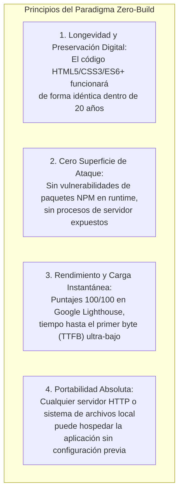

# Dominio II: Tecnología y Arquitectura — Arquitectura Zero-Build y Despliegue Estático

## 1. Filosofía Arquitectónica: El Paradigma Zero-Build

La aplicación web **Anatomía de la Libertad** está construida bajo una estricta filosofía **Zero-Build Client** (cliente estático sin paso de compilación o empaquetado en tiempo de ejecución).

En una era donde el desarrollo frontend suele depender de cadenas complejas de herramientas (Webpack, Vite, Babel, frameworks reactivos pesados con miles de dependencias transitorias), este proyecto optó de forma deliberada por los **estándares abiertos y nativos de la plataforma web**:



---

## 2. Estructura del Repositorio y Separación de Entornos

El repositorio implementa una estricta separación de responsabilidades entre el entorno de desarrollo/auditoría y la distribución estática de producción:

```
c:\Dev\Libertad Conceptos- Isaih Berlin/
├── openwiki/                 # [DOCUMENTACIÓN] Fuente de verdad documental unificada
│   ├── README.md             # Portal de navegación y visualizador interactivo
│   ├── index.html            # Visor web de documentación cliente (Docsify)
│   ├── 01-marco-teorico/     # Dominio 1: Fundamentos filosóficos, Sen, Hayek, Colombia
│   ├── 02-tecnologia-y-arquitectura/ # Dominio 2: Zero-build, componentes, CSS, i18n, SVG
│   └── 03-contratos-y-tests/ # Dominio 3: Contratos DOM/CSS, tests E2E, guardrails
├── files/                    # [PRODUCCIÓN] Artefactos estáticos servidos en GitHub Pages
│   ├── .nojekyll             # Indicador para evitar procesamiento destructivo de Jekyll
│   ├── index.html            # Markup semántico principal de la infografía
│   ├── styles.css            # Hoja de estilos globales, layout responsive y temas
│   ├── app.js                # Lógica de interacción, estado global y scrollytelling
│   ├── i18n.js               # Diccionario y motor de traducción bilingüe sincrónico
│   └── README.md             # Resumen público del sitio
├── tests/                    # [AUDITORÍA Y CALIDAD] Suites de verificación automatizadas
│   ├── setup.js              # Entorno JSDOM y mocks de APIs del navegador
│   ├── accessibility.test.js # Auditoría automatizada axe-core (WCAG 2.1 AA)
│   ├── property*.test.js     # Pruebas basadas en propiedades con fast-check
│   ├── playwright/           # Pruebas E2E en navegadores reales (Playwright)
│   └── vibium/               # Pruebas de regresión visual de layout
├── .github/workflows/        # [CI/CD] Workflow de despliegue automatizado
│   └── deploy.yml            # Despliegue de ./files hacia GitHub Pages en cada push a main
├── index.html                # Redirección canónica a files/ para entornos locales
├── package.json              # Dependencias de prueba y herramientas de documentación
└── package-lock.json         # Lockfile determinista de herramientas
```

---

## 3. Restricciones y Reglas Operativas de Despliegue

### 3.1. Servidor Estático Puro (GitHub Pages)
1. **Ausencia de Backend:** No existe Node.js, Python, bases de datos SQL/NoSQL ni funciones serverless en producción. Toda la interactividad (cambio de lentes, cálculo de indicadores, cambio de tema e idioma) se ejecuta en el navegador del cliente.
2. **Rutas Relativas Obligatorias:** Todas las referencias a scripts, hojas de estilo, imágenes y anclas deben ser estrictamente relativas (`styles.css`, `app.js`, `i18n.js`, `#seccion`). Queda terminantemente prohibido utilizar barras iniciales como `/styles.css` o `/app.js`, ya que rompen al servirse bajo subdirectorios de proyectos en GitHub Pages (`https://willkwolf.github.io/isaiah-berlin-liberty-infographic/`).
3. **El archivo `.nojekyll`:** Debe permanecer siempre en la raíz de despliegue (`files/`) para asegurar que GitHub Pages sirva todos los recursos sin aplicar filtros destructivos de Jekyll.
4. **Control de Caché y Versionamiento:** En `index.html`, los scripts y estilos se importan con parámetros de control de versión (ejemplo: `styles.css?v=20261104`, `app.js?v=20261104`), garantizando que los usuarios reciban de inmediato los cambios desplegados sin colisiones de caché HTTP local.

---

## 4. Pipeline de CI/CD en GitHub Actions

El archivo `.github/workflows/deploy.yml` gestiona el despliegue automático con permisos mínimos y trazabilidad:
1. Se dispara en cada `push` a la rama `main` o vía `workflow_dispatch`.
2. Emplea las acciones oficiales de GitHub (`actions/checkout@v4`, `actions/configure-pages@v5`, `actions/upload-pages-artifact@v3` y `actions/deploy-pages@v4`).
3. Empaqueta exclusivamente el directorio `./files`, publicándolo en el entorno seguro de GitHub Pages.
