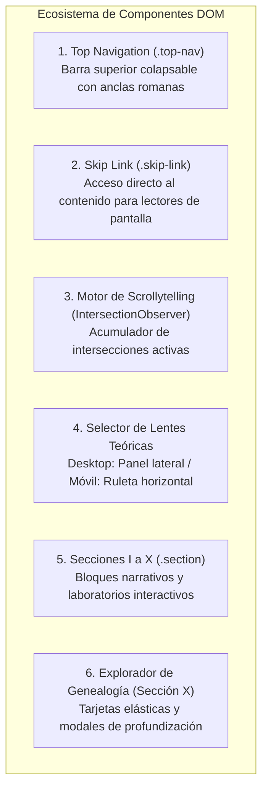

# Dominio II: Tecnología y Arquitectura — Componentes DOM y Motor de Scrollytelling

## 1. Visión General de la Interfaz

La interfaz de usuario de **Anatomía de la Libertad** está concebida como un **ensayo hipertextual y scrollytelling** donde la narración filosófica guía al lector a través de diez secciones numeradas (I a X). A medida que el usuario se desplaza verticalmente, el sistema detecta la posición de lectura y reconfigura los componentes interactivos.



---

## 2. Barra de Navegación Superior (`.top-nav`)

* **Markup Canónico:** `<nav class="top-nav" aria-label="Secciones" id="topNav">`
* **Controles y Enlaces:**
  * Enlaces numerados en numeración romana (`I` a `X`), cada uno con atributo `title` descriptivo del tema de la sección.
  * Selector bilingüe de idioma (`#langToggleBtn`: `ES` / `EN`).
  * Conmutador de tema de color (`#themeToggleBtn`: icono sol/luna).
* **Comportamiento Inteligente al Desplazamiento (`Scroll Collapse`):**
  * Para maximizar el área de lectura en pantallas pequeñas, la barra superior detecta la dirección del desplazamiento:
    * **Desplazamiento descendente:** Añade la clase `.top-nav--collapsed` (`transform: translateY(-100%)`), ocultando la barra suavemente.
    * **Desplazamiento ascendente:** Retira la clase `.top-nav--collapsed`, desplegando de inmediato la barra para facilitar el salto entre secciones.

---

## 3. El Motor de Scrollytelling y el Acumulador de Intersección

El motor de scrollytelling se implementa mediante la API nativa `IntersectionObserver` en `app.js`.

### 3.1. Corrección del Defecto Histórico de Lote
En versiones preliminares del sistema, el observador utilizaba una comprobación simple del tipo `entries.some(e => e.isIntersecting)`. Esto causaba un defecto visual crítico: cuando el navegador despachaba múltiples entradas en un mismo ciclo de animación (por ejemplo, al desplazarse rápido entre dos secciones), una entrada saliente con `isIntersecting: false` podía sobreescribir la entrada entrante con `isIntersecting: true`, haciendo que el panel de lentes desapareciera intempestivamente.

### 3.2. Arquitectura de Conjunto Activo (`Active Intersection Set`)
El código actual resuelve este problema mediante un acumulador determinista en memoria:

```javascript
// app.js — Arquitectura del acumulador
const activeIntersectingSections = new Set();

const scrollytellingObserver = new IntersectionObserver((entries) => {
  entries.forEach((entry) => {
    const sectionId = entry.target.id;
    if (entry.isIntersecting) {
      activeIntersectingSections.add(sectionId);
    } else {
      activeIntersectingSections.delete(sectionId);
    }
  });

  // El panel permanece visible y activo si al menos una sección relevante intersecta
  const shouldBeVisible = activeIntersectingSections.size > 0;
  updateLensVisibility(shouldBeVisible);
}, {
  root: null,
  threshold: 0.2 // Umbral del 20% de visibilidad del contenedor
});
```

---

## 4. Selector de Lentes: Panel Lateral vs. Ruleta Horizontal

El componente de cambio de marco teórico cuenta con dos implementaciones acopladas al estado global `state.currentLens`:

### 4.1. Versión de Escritorio (> 768 px): `Lens_Panel`
* **Elemento DOM:** `<aside class="lens-panel" id="lensPanel" role="navigation" aria-label="Selector de marco teórico">`
* **Comportamiento:**
  * Barra lateral fija a la derecha (ancho: `220px`), alineada con la grilla del contenido principal.
  * Botón colapsable con accesibilidad ARIA (`#lensToggleBtn` con `aria-expanded="true"` y `aria-controls="lensPanelBody"`).
  * Cuatro botones con roles de radio (`role="radio"` dentro de `role="radiogroup"`).
  * Indicadores visuales de color:
    * `negativa`: `#4a9eff` (Azul)
    * `positiva`: `#ff7a35` (Naranja)
    * `capacidades`: `#3dbe8a` (Verde esmeralda)
    * `libertario`: `#b0b0aa` (Gris platino)

### 4.2. Versión Móvil (≤ 768 px / ≤ 500 px): `Horizontal Lens Wheel`
* **Elemento DOM:** `<div class="lens-wheel-container" id="lensWheelContainer">`
* **Innovaciones Ergonómicas:**
  * **Difusión en Bordes (Edge Diffusion):** Emplea máscaras CSS de gradiente lineal (`mask-image: linear-gradient(...)`) a izquierda y derecha, indicando visualmente que hay más opciones disponibles al deslizar.
  * **Enfoque Cero-Tap (Zero-Tap Focus):** Al desplazarse por el carrusel táctil, el elemento central se selecciona automáticamente con debouncing sin requerir que el usuario pulse la pantalla de forma repetitiva.
  * **Ancho Expandido a 260 px:** Garantiza que los nombres de los autores y conceptos («Libertad Negativa», «Amartya Sen», etc.) no sufran truncamientos antiestéticos en pantallas de 320 px o 375 px.
  * **Ajuste a Zonas Seguras:** Incorpora `padding-bottom: max(0.75rem, env(safe-area-inset-bottom))` para evitar colisiones con las barras de navegación por gestos de iOS y Android.

---

## 5. Sección X: Genealogía del Poder (`.genealogia-explorer`)

La Sección X (`#genealogia`, «Genealogía del poder: cómo organizamos la libertad») fue completamente rediseñada para reemplazar la antigua tabla de coordenadas rígidas por **cuatro tarjetas modulares de exploración**:

1. **Card 1: El Poder Coercitivo y la Ley (Hobbes / Locke):** El monopolio legítimo de la fuerza, límites constitucionales y la frontera entre orden y tiranía.
2. **Card 2: El Poder Disperso y el Mercado (Smith / Hayek):** Coordinación descentralizada, formación de precios y prevención de la planificación monolítica.
3. **Card 3: El Poder como Habilitación Social (Sen / Nussbaum):** Infraestructura pública, salud, educación y desarrollo de capacidades individuales.
4. **Card 4: El Poder Simbólico y la Ideología (Berlin / Foucault):** Hegemonía cultural, la fabricación del consentimiento y la perversión del «yo superior».

Cada tarjeta incluye controles de expansión progresiva y diálogos modales accesibles con trampa de foco (`focus trap`) y cierre mediante tecla `Escape`.
