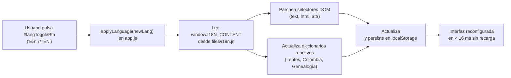

# Dominio II: Tecnología y Arquitectura — Motor de Internacionalización (`i18n.js`)

## 1. Filosofía del Sistema Bilingüe Sincrónico

El proyecto **Anatomía de la Libertad** está diseñado desde sus cimientos para ser una experiencia completamente bilingüe e internacionalizada en **Español** e **Inglés**.

A diferencia de las soluciones web convencionales que requieren recargar la página o mantener dos árboles DOM independientes (uno para cada idioma), este proyecto implementa un **motor de parcheo semántico sincrónico en memoria** alojado en `files/i18n.js`.



---

## 2. Estructura y Esquema de Datos (`window.I18N_CONTENT`)

El objeto global `window.I18N_CONTENT` expone la siguiente firma canónica:

```javascript
window.I18N_CONTENT = {
  defaultLanguage: 'es',
  supportedLanguages: ['es', 'en'],
  locales: {
    en: {
      meta: {
        title: "Anatomy of Liberty — An Interactive Essay on Political Freedom",
        description: "An interactive pedagogical infographic on Isaiah Berlin's two concepts of liberty, Amartya Sen's capabilities, and economic freedom."
      },
      ui: {
        skipLink: "Skip to main content",
        lensSelectorAria: "Theoretical framework selector",
        themeToggleLightAria: "Switch to light theme",
        themeToggleDarkAria: "Switch to dark theme",
        langToggleAria: "Cambiar idioma a Español"
        /* ... etiquetas de botones, diálogos y tooltips */
      },
      staticContent: [
        /* Array de transformaciones declarativas directas */
        { selector: "#heroTitle", type: "text", value: "Anatomy of Liberty" },
        { selector: "#heroSubtitle", type: "html", value: "An interactive exploration of <em>negative and positive freedom</em>..." }
      ],
      lenses: {
        negativa: { name: "Negative Liberty", author: "Isaiah Berlin", interpretation: "..." },
        positiva: { name: "Positive Liberty", author: "Isaiah Berlin", interpretation: "..." },
        capacidades: { name: "Capabilities Approach", author: "Amartya Sen", interpretation: "..." },
        libertario: { name: "Libertarian Market View", author: "Hayek / Friedman", interpretation: "..." }
      },
      colombia: {
        /* Textos analíticos para la matriz empírica colombiana */
      },
      limitsLabCases: {
        /* Casos de estudio y dilemas del laboratorio de límites del poder */
      }
    }
  }
};
```

---

## 3. Mecanismo de Parcheo del DOM

La función `applyLanguage(lang)` opera en tres pasos fundamentales:

1. **Parcheo Declarativo (`staticContent`):** Itera sobre el array de elementos estáticos, localizando cada nodo mediante `document.querySelector(item.selector)`. Según la propiedad `type`, actualiza:
   * `'text'`: `element.textContent = item.value;`
   * `'html'`: `element.innerHTML = item.value;`
   * `'attr'`: `element.setAttribute(item.attr, item.value);`
2. **Re-renderizado de Bloques Interpretativos Activos:** Actualiza dinámicamente el texto del marco teórico visible en las secciones activas (`.lens-interpretation__text`) consultando el diccionario de la lente seleccionada en el idioma actual.
3. **Persistencia y Accesibilidad:**
   * Actualiza el atributo de idioma raíz: `document.documentElement.setAttribute('lang', lang)`.
   * Actualiza el título del documento: `document.title = ...`.
   * Persiste la selección en el almacenamiento local: `localStorage.setItem('site-lang', lang)`.

---

## 4. Regla de Paridad Lingüística Estricta

Para garantizar que los investigadores angloparlantes e hispanohablantes reciban exactamente el mismo nivel de profundidad académica:

* **Paridad 1:1 [VIGENTE]:** Todo contenido textual, nota al pie, etiqueta accesible ARIA, tooltip de orientación y gráfico explicativo presente en la versión en español DEBE tener su traducción fiel y completa en el diccionario en inglés de `i18n.js`.
* **Verificación Automatizada:** Las suites de pruebas en `tests/examples-feature3.test.js` y las pruebas de propiedades validan que no existan selectores huérfanos o cadenas sin traducir en ninguno de los dos idiomas soportados.
