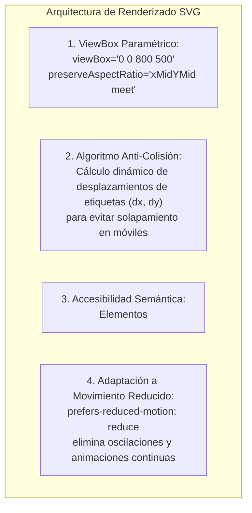

# Dominio II: Tecnología y Arquitectura — Visualización Gráfica, Canvas y SVG

## 1. Principios de Visualización Matemática y Pedagógica

La transmisión de ideas filosóficas abstractas en **Anatomía de la Libertad** se apoya en diagramas vectoriales interactivos y gráficos matemáticos renderizados en el cliente.

Para preservar la pureza del paradigma Zero-Build y evitar sobrecargas de rendimiento, el proyecto establece una regla operativa tajante:
> **Prohibición de bibliotecas externas pesadas:** No se permite el uso de D3.js, Chart.js, Three.js ni bibliotecas similares. Todas las visualizaciones se construyen directamente sobre las APIs nativas del navegador: **SVG inline** y **Canvas 2D nativo**.

---

## 2. Arquitectura de Gráficos SVG Responsivos

Los diagramas conceptuales (árboles de divergencia, diagramas de Venn de valores y el mapa de genealogía) utilizan gráficos SVG estructurados con semántica accesible:



### 2.1. Proporciones Responsivas y Anti-Colisión de Etiquetas
Uno de los hitos técnicos del proyecto (registrado en el commit `f61ba8c`) consistió en resolver el solapamiento de etiquetas de texto en pantallas estrechas:
* **Problema:** En viewports móviles (< 500 px), los diagramas SVG escalados reducían las fuentes a tamaños ilegibles o hacían colisionar los nombres de los autores (ejemplo: «Isaiah Berlin» vs «Milton Friedman») en los nodos de decisión.
* **Solución Técnica:** Se implementó un algoritmo de espaciado dinámico basado en coordenadas polares relativas, permitiendo que las etiquetas mantengan un margen de seguridad mínimo de $16 \text{ px}$ y un tamaño de fuente de al menos $12 \text{ px}$ efectivo en cualquier resolución.

---

## 3. El Motor de Canvas 2D: Gráficos de Tensión y Divergencia

En la Sección I (Hero) y en los laboratorios interactivos, la aplicación utiliza elementos `<canvas>` para ilustrar la tensión dinámica entre libertad negativa y positiva:

1. **Escalado por Densidad de Píxeles (`window.devicePixelRatio`):**
   Para garantizar nitidez cristalina en pantallas Retina y pantallas móviles de alta densidad, el canvas escala internamente sus dimensiones físicas multiplicando por el DPR del dispositivo:
   ```javascript
   const dpr = window.devicePixelRatio || 1;
   canvas.width = rect.width * dpr;
   canvas.height = rect.height * dpr;
   ctx.scale(dpr, dpr);
   ```
2. **Ciclo de Animación Optimizado (`requestAnimationFrame`):**
   Los cálculos trigonométricos de las curvas de tensión se ejecutan en sincronía con el refresco de pantalla del monitor (60 fps / 120 fps), deteniéndose automáticamente cuando el canvas sale del viewport visible gracias al `IntersectionObserver`.

---

## 4. Accesibilidad Visual y Movimiento Reducido (`prefers-reduced-motion`)

El sistema respeta plenamente las preferencias del sistema operativo de los usuarios:
* **Contraste de Color:** Todos los trazos SVG y rellenos de canvas superan la relación de contraste de **4.5:1** requerida por WCAG 2.1 AA frente al color de fondo activo.
* **Diferenciación por Formas y No Solo por Color:** Cada marco teórico no se distingue únicamente por su tono cromático, sino por glifos geométricos específicos:
  * Negativa: Círculo y línea de frontera ($\odot$).
  * Positiva: Flecha ascendente y vector de autodeterminación ($\uparrow$).
  * Capacidades: Red hexagonal de oportunidades ($\hexagon$).
  * Libertario: Balanza de intercambio libre y contratos ($\rightleftharpoons$).
* **Reducción de Movimiento:** Cuando el usuario tiene activada la preferencia `prefers-reduced-motion: reduce`, las transiciones de CSS se reducen a cero milisegundos (`transition: none;`) y las animaciones continuas del canvas se congelan en un estado estático nítido.
