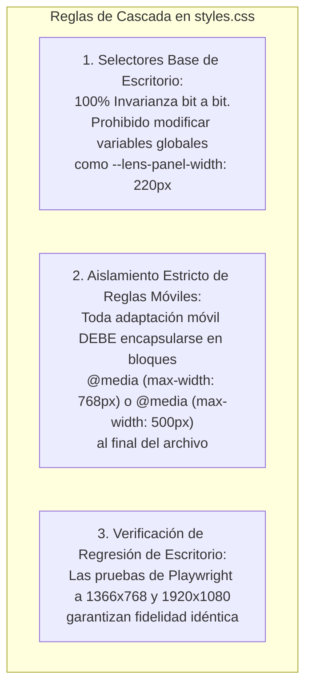

# Dominio III: Contratos y Tests — Contratos de Interfaz, DOM y Estado

## 1. Propósito de los Contratos de Interfaz

Los contratos de interfaz formalizan las invariantes arquitectónicas que desarrolladores, auditores y agentes de IA deben respetar de manera estricta al interactuar con el código de producción en `files/`.

Cualquier cambio de código que viole una invariante contractual es considerado un defecto crítico y causa el rechazo inmediato del cambio en las suites de prueba.

---

## 2. Contrato de Aislamiento de Cascada CSS (Desktop Protection Contract)

El sitio fue diseñado bajo un enfoque de **escritorio permanente con adaptación móvil selectiva**. Para evitar regresiones visuales en pantallas grandes:



### Reglas No Negociables:
1. **Invarianza de Escritorio [VIGENTE]:** Ningún selector de la versión de escritorio (> 768 px) puede ser modificado para solucionar un problema móvil.
2. **Encapsulamiento en Media Queries [VIGENTE]:** Todas las reglas de diseño elástico, apilamiento de tarjetas o ruleta horizontal deben estar contenidas dentro de:
   * `@media (max-width: 768px)` para tabletas y dispositivos medianos.
   * `@media (max-width: 500px)` para teléfonos inteligentes.
3. **Ancho del Contenedor de Lectura [VIGENTE]:** La propiedad `.section__inner` debe mantener su cálculo de ancho:
   $$\text{min}(900\text{px}, \text{calc}(100\text{vw} - 220\text{px} - 2.5\text{rem}))$$

---

## 3. Contrato de Ámbito de Ejecución JavaScript en Móviles

1. **Guardas de Viewport [VIGENTE]:** Cualquier comportamiento interactivo exclusivo de móviles (por ejemplo, el carrusel de ruleta o el colapso de la barra superior) debe protegerse mediante la comprobación de medios:
   ```javascript
   const isMobile = window.matchMedia('(max-width: 768px)').matches;
   ```
2. **Preservación de Eventos de Escritorio [VIGENTE]:** Los escuchadores de eventos para teclado (`ArrowUp`, `ArrowDown`, `Home`, `End`), el panel de lentes lateral y los atajos de accesibilidad deben funcionar de forma idéntica en modo de escritorio sin verse afectados por la lógica táctil móvil.

---

## 4. Contrato de Restauración de Desplazamiento y Estabilidad de Render (CLS = 0)

1. **Restauración Manual Obligatoria [VIGENTE]:**
   Inmediatamente al cargar `app.js`, se debe ejecutar:
   ```javascript
   if ('scrollRestoration' in history) {
     history.scrollRestoration = 'manual';
   }
   ```
2. **Entrada Determinista en (0, 0) [VIGENTE]:**
   Si la URL no contiene un hash de ancla (`window.location.hash === ''`), la página debe posicionarse de manera determinista en `(0, 0)` tanto en la carga inicial como en recargas directas, evitando saltos de scroll involuntarios.
3. **Cero Desplazamiento Acumulativo de Diseño (CLS = 0) [VIGENTE]:**
   Cualquier elemento de bienvenida o diálogo explicativo (como el coach banner `#heroOnboarding`) debe inyectarse sin empujar verticalmente el título de la Sección I ni desestabilizar la geometría visual mientras el usuario lee.

---

## 5. Contratos de Nomenclatura DOM y Accesibilidad ARIA

| Identificador / Clase | Rol Semántico | Restricción Contractual |
| :--- | :--- | :--- |
| `#lensPanel` | `role="navigation" aria-label="Selector de marco teórico"` | Elemento contenedor del panel lateral de lentes. Debe permanecer en el DOM. |
| `#lensToggleBtn` | `aria-expanded="true" aria-controls="lensPanelBody"` | Botón de colapso accesible. Debe alternar `aria-expanded` entre `"true"` y `"false"`. |
| `.lens-btn` | `role="radio" aria-checked="{true|false}"` | Botones de marco teórico. Solo uno puede tener `aria-checked="true"` simultáneamente. |
| `#themeToggleBtn` | `aria-label="Cambiar tema de color"` | Botón conmutador claro/oscuro. Debe actualizar su etiqueta al cambiar de tema. |
| `#langToggleBtn` | `aria-label="Switch language to English"` | Botón bilingüe. Debe reflejar la acción del siguiente idioma a activar. |
| `.skip-link` | `href="#main"` | Primer elemento interactivo del `<body>`. Permite saltar directamente al contenido principal. |
| `.lens-interpretation` | `aria-live="polite"` | Región viva que anuncia el cambio de interpretación a lectores de pantalla. |
