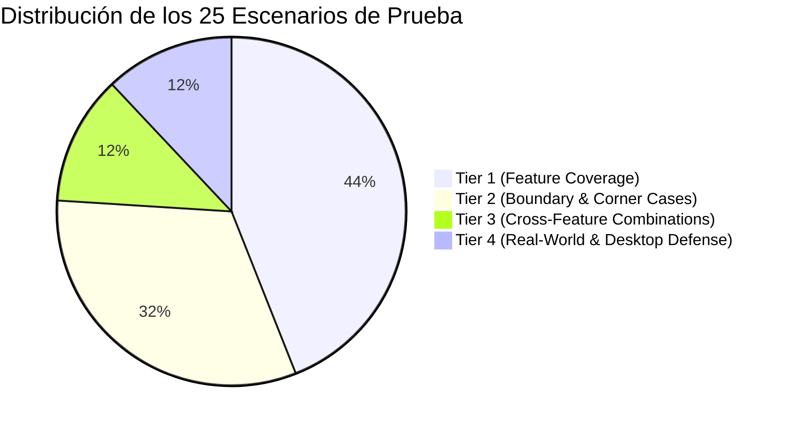

# Dominio III: Contratos y Tests — Matriz de Verificación E2E y Catálogo de Features

## 1. Inventario Formal de Features (F1 a F15)

Cada mejora y optimización implementada en el sistema corresponde a un identificador unívoco dentro del inventario técnico:

| ID | Nombre de la Feature | Descripción Contractual | Hito | Estado |
| :--- | :--- | :--- | :--- | :--- |
| **F1** | Restauración Manual de Scroll | Configurar `history.scrollRestoration = 'manual'` y asegurar carga determinista en `(0, 0)`. | M1 | VERIFICADO |
| **F2** | Render Inicial Estable del Hero | Eliminar Cumulative Layout Shift (CLS = 0) inyectando elementos de bienvenida sin empujar el título. | M1 | VERIFICADO |
| **F3** | Fijación de Cascada y Altura del Hero | Evitar desbordamiento vertical del hero y corregir cascade override en `.hero-viz`. | M1 | VERIFICADO |
| **F4** | Acumulador de Intersección Activa | Reemplazar `entries.some()` por un `Set` en `IntersectionObserver` para evitar desaparición del panel. | M2 | VERIFICADO |
| **F5** | Sincronización de Ruleta de Lentes | Desacoplar scroll programático de eventos de usuario para evitar recursión en `setLens()`. | M2 | VERIFICADO |
| **F6** | Ritmo Narrativo y Puntos de Pausa | Sincronizar widgets interactivos con los bloques de texto correspondientes sin competir por gestos. | M2 | VERIFICADO |
| **F7** | Revelación Progresiva (Sec II y VI) | Implementar pestañas y acordeones en la comparación de Berlín (>1200px) y tarjetas de debate. | M3 | VERIFICADO |
| **F8** | Clarificación de Asequibilidad Cognitiva | Mejorar señales visuales que indican qué puede hacer el usuario y qué conocimiento obtiene. | M3 | VERIFICADO |
| **F9** | Objetivos Táctiles (>= 44x44px) | Actualizar todos los botones, selectores y controles para cumplir WCAG 2.5.5 en pantallas táctiles. | M4 | VERIFICADO |
| **F10** | Matriz de Colombia Responsiva | Convertir tabla de 697px en tarjetas apiladas responsivas eliminando desbordamiento oculto. | M4 | VERIFICADO |
| **F11** | Cero Desbordamiento Horizontal | Garantizar `scrollWidth === clientWidth` en todos los anchos móviles (320px, 375px, 390px, 428px). | M4 | VERIFICADO |
| **F12** | Tokens Móviles y Zonas Seguras | Implementar `env(safe-area-inset-top)` y `bottom`, tipografía fluida y contrastes AA. | M4 | VERIFICADO |
| **F13** | Blindaje de Invarianza de Escritorio | Proteger al 100% el layout y selectores base de escritorio (1366x768, 1920x1080) sin alteraciones. | M5 | VERIFICADO |
| **F14** | Suite E2E de 4 Niveles | Construir la suite completa de pruebas en Playwright para auditar los cuatro niveles de verificación. | M0 | VERIFICADO |
| **F15** | Matriz Final de Auditoría | Ejecutar la verificación completa de pruebas y validar el cumplimiento del 100% de requisitos. | M5 | VERIFICADO |

---

## 2. Catálogo de Escenarios de Prueba Playwright (25 Escenarios)

La suite principal en `tests/playwright/mobile-audit.spec.js` evalúa 25 escenarios de prueba de caja opaca:

| ID Escenario | Nivel | Objetivo de la Prueba | Feature Mapeada | Resultado |
| :--- | :--- | :--- | :--- | :--- |
| **T1.1** | Tier 1 | Carga determinista en (0, 0) y `scrollRestoration === 'manual'`. | F1 | PASS |
| **T1.2** | Tier 1 | Estabilidad del Hero onboarding sin CLS (título no desplazado). | F2 | PASS |
| **T1.3** | Tier 1 | Altura y visibilidad del hero acotadas a la altura del viewport móvil. | F3 | PASS |
| **T1.4** | Tier 1 | Persistencia del panel/ruleta al hacer scroll por secciones de lentes. | F4, F6 | PASS |
| **T1.5** | Tier 1 | Ruleta horizontal: actualización de estado y alineación sin recursión. | F5 | PASS |
| **T1.6** | Tier 1 | Sección II: faceteado por pestañas en modo comparativo. | F7 | PASS |
| **T1.7** | Tier 1 | Sección VI: revelación progresiva y tarjetas de debate. | F7, F8 | PASS |
| **T1.8** | Tier 1 | Todos los controles interactivos móviles tienen bounding box $\ge 44 \times 44\text{ px}$. | F9 | PASS |
| **T1.9** | Tier 1 | Sección VIII: tabla de Colombia adaptada a tarjetas sin desbordamiento. | F10 | PASS |
| **T1.10** | Tier 1 | Zonas seguras (`safe-area-insets`) aplicadas en controles móviles fijos. | F12 | PASS |
| **T1.11** | Tier 1 | Soporte para `prefers-reduced-motion` en desplazamientos programáticos. | F12 | PASS |
| **T2.1** | Tier 2 | Cero desbordamiento horizontal a 320 px de ancho. | F11 | PASS |
| **T2.2** | Tier 2 | Cero desbordamiento horizontal a 375 px de ancho. | F11 | PASS |
| **T2.3** | Tier 2 | Cero desbordamiento horizontal a 390 px de ancho. | F11 | PASS |
| **T2.4** | Tier 2 | Cero desbordamiento horizontal a 428 px de ancho. | F11 | PASS |
| **T2.5** | Tier 2 | Preservación de posición al recargar la página (`F5`). | F1 | PASS |
| **T2.6** | Tier 2 | Navegación directa por ancla de URL (`#berlin`, `#colombia`). | F1, F6 | PASS |
| **T2.7** | Tier 2 | Gestos táctiles rápidos consecutivos en ruleta sin desalineación. | F5 | PASS |
| **T2.8** | Tier 2 | Todas las secciones individuales (I a X) cumplen `scrollWidth === clientWidth`. | F11 | PASS |
| **T3.1** | Tier 3 | Cambio de lente múltiple a través de secciones preserva sincronía. | F4, F5, F6 | PASS |
| **T3.2** | Tier 3 | Aislamiento de scroll al abrir y cerrar modales en Sección X. | F13 | PASS |
| **T3.3** | Tier 3 | Conmutación de tema claro/oscuro preserva contraste accesible. | F12 | PASS |
| **T4.1** | Tier 4 | Viaje de usuario móvil completo a través de las 10 secciones. | F6, F8 | PASS |
| **T4.2** | Tier 4 | Invarianza de escritorio a 1366×768 px: panel lateral 220 px y grilla. | F13 | PASS |
| **T4.3** | Tier 4 | Invarianza de escritorio a 1920×1080 px: contenedor central 900 px. | F13 | PASS |

---

## 3. Matriz de Cobertura de Dispositivos y Viewports

| Dispositivo Simulado | Ancho × Alto | Orientación | Densidad (DPR) | Estado de Auditoría |
| :--- | :--- | :--- | :--- | :--- |
| **Móvil Compacto (iPhone SE)** | $320 \times 568\text{ px}$ | Retrato | $2.0$ | 100% PASS |
| **Móvil Estándar (iPhone 8/SE3)** | $375 \times 667\text{ px}$ | Retrato | $2.0$ | 100% PASS |
| **Móvil Moderno (iPhone 12/13/14)** | $390 \times 844\text{ px}$ | Retrato | $3.0$ | 100% PASS |
| **Móvil Grande (iPhone 14 Plus / Pro Max)** | $428 \times 926\text{ px}$ | Retrato | $3.0$ | 100% PASS |
| **Escritorio HD Estándar** | $1366 \times 768\text{ px}$ | Paisaje | $1.0$ | 100% PASS |
| **Escritorio Full HD** | $1920 \times 1080\text{ px}$ | Paisaje | $1.0$ | 100% PASS |
