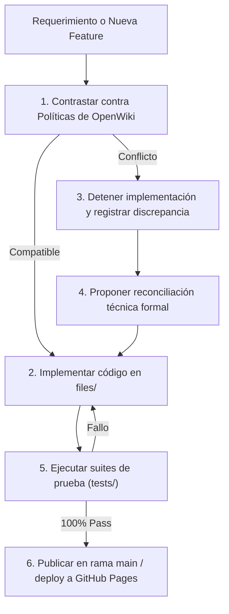

# Dominio III: Contratos y Tests — Políticas del Sistema, Guardrails y Taxonomía

## 1. Principio de Autoridad Documental y Gobernanza

El presente repositorio documental constituye la **única fuente de verdad autorizada** para desarrolladores, auditores y agentes de IA.

Ningún cambio en el código fuente debe realizarse basándose en suposiciones no declaradas o instrucciones dispersas. Toda intervención debe conciliarse con las políticas aquí formalizadas:

---

## 2. Taxonomía Normativa de las Reglas

Cada regla o política en el sistema se clasifica formalmente bajo uno de tres estados:

* **[VIGENTE]:** Disposición activa, obligatoria y respaldada por la arquitectura actual o verificada por pruebas automatizadas. Su violación bloquea la integración del código.
* **[PROPUESTA]:** Propuesta técnica o de diseño en proceso de validación o evaluación de impacto.
* **[PENDIENTE]:** Hipótesis o decisión arquitectónica que requiere pruebas adicionales de usuario, benchmarks de rendimiento o consenso previo.

---

## 3. Políticas por Capas del Sistema

### 3.1. Capa de Arquitectura
* **Zero-Build Obligatorio [VIGENTE]:** Cero procesos de empaquetado (webpack, vite) en tiempo de ejecución. Archivos HTML5/CSS3/ES6+ servidos directamente al navegador.
* **Rutas Relativas Universales [VIGENTE]:** Todos los enlaces y llamadas a scripts o estilos deben ser relativos (`styles.css`, `app.js`), sin barras iniciales absolutas.
* **Alineación con GitHub Pages [VIGENTE]:** Todo cambio funcional debe reflejarse en `files/`, manteniendo el archivo `.nojekyll` y parámetros de versionamiento (`?v=YYYYMMDD`).

### 3.2. Capa de Diseño y Accesibilidad
* **Invarianza de Escritorio [VIGENTE]:** Prohibido alterar las clases base de escritorio (> 768 px). Cualquier adaptación móvil debe estar contenida en `@media (max-width: 768px)` o `@media (max-width: 500px)`.
* **WCAG 2.1 Nivel AA [VIGENTE]:** Toda combinación de texto y fondo debe superar una relación de contraste mínima de 4.5:1. Todos los elementos interactivos deben contar con etiquetas accesibles (`aria-label` o `aria-labelledby`).
* **Objetivos Táctiles [VIGENTE]:** En dispositivos móviles, ningún botón, enlace o control puede tener dimensiones efectivas inferiores a $44 \times 44 \text{ px}$.

### 3.3. Capa de Interacción y Scrollytelling
* **Acumulador de Intersección Activa [VIGENTE]:** La visibilidad del panel/ruleta de lentes debe regirse por un `Set` en memoria y no por comprobaciones puntuales de lote en el observador.
* **Cero Desbordamiento Horizontal [VIGENTE]:** En cualquier sección y en cualquier resolución entre 320 px y 1920 px, debe cumplirse $\text{scrollWidth} \equiv \text{clientWidth}$.
* **Restauración Manual de Scroll [VIGENTE]:** `history.scrollRestoration = 'manual'` activo de forma sincrónica, garantizando entrada estable en `(0, 0)`.

### 3.4. Capa de Calidad y Pruebas
* **Aprobación al 100% [VIGENTE]:** Ningún cambio puede ser promovido a producción si genera una sola falla en `npm test`, `npm run test:playwright` o `npm run test:vibium`.
* **Caja Opaca [VIGENTE]:** Las pruebas auditan el comportamiento observable del DOM sin modificar el código de producción con fines instrumentales.

### 3.5. Capa de Gobernanza y Limpieza del Historial Git
* **Commits Generales y Descriptivos [VIGENTE]:** Los commits públicos deben seguir el estándar de Conventional Commits (`feat:`, `fix:`, `docs:`, `test:`, `chore:`) con descripciones técnicas profesionales.
* **Commits Profesionales y Trazabilidad Limpia [VIGENTE]:** El historial del repositorio refleja exclusivamente commits profesionales basados en Conventional Commits y código final de producción verificado.
