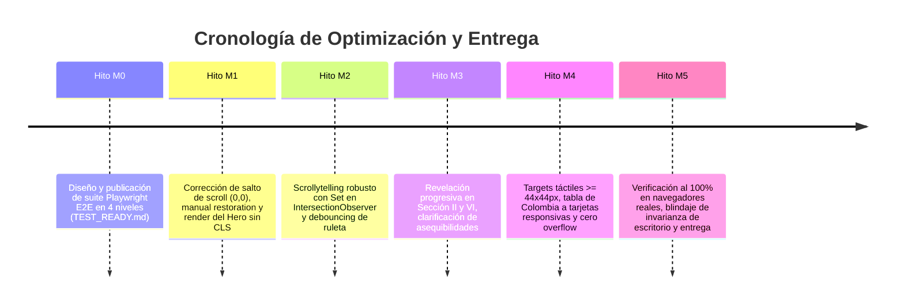

# Dominio III: Contratos y Tests — Especificaciones Técnicas y Registro de Tareas

## 1. Alcance de las Especificaciones Técnicas

Este documento consolida las especificaciones formales de diseño, requerimientos y tareas técnicas que guiaron la evolución del sistema, integrando y formalizando las especificaciones históricas previas.

---

## 2. Especificación: Chip Selector de Lentes y Ruleta Accesible

### 2.1. Requerimientos Funcionales (FR)
* **FR1 (Disponibilidad en Escritorio):** El selector de marco teórico debe permanecer visible de forma persistente como un panel lateral derecho en pantallas mayores a 768 px.
* **FR2 (Adaptación a Móviles):** En pantallas menores o iguales a 768 px, el selector se transforma en una ruleta horizontal docked en la parte inferior de la pantalla.
* **FR3 (Difusión en Bordes):** La ruleta móvil debe implementar máscaras CSS de gradiente en los extremos izquierdo y derecho para comunicar visualmente la continuidad del carrusel.
* **FR4 (Enfoque Cero-Tap):** El desplazamiento por la ruleta centra y activa automáticamente la lente teórica sin requerir toques adicionales.
* **FR5 (Ancho de 260 px sin Truncamiento):** El contenedor de la ruleta debe garantizar un ancho mínimo de 260 px para evitar que los nombres de los conceptos se corten en viewports compactos (320 px y 375 px).
* **FR6 (Compatibilidad con Zonas Seguras):** Se debe aplicar `env(safe-area-inset-bottom)` para evitar superposición con las barras de navegación por gestos en iOS y Android.
* **FR7 (Sincronización Bilingüe):** Al alternar el idioma entre Español e Inglés, las etiquetas de la ruleta y del panel lateral se actualizan de forma sincrónica.
* **FR8 (Navegación por Teclado y Gestos):** La ruleta debe responder a `ArrowLeft` / `ArrowRight` / `ArrowUp` / `ArrowDown`, y a deslizamientos táctiles con un umbral de activación de $30 \text{ px}$.

### 2.2. Requerimientos No Funcionales (NFR)
* **NFR1 (Rendimiento):** Las animaciones de desplazamiento deben mantenerse a 60 fps constantes sin saltos de fotogramas ni recalculos forzados de layout (evitar layout thrashing).
* **NFR2 (Accesibilidad WCAG 2.1 AA):** Relación de contraste mínima de 4.5:1 en texto y 3.0:1 en componentes de interfaz frente a cualquier color de fondo activo.
* **NFR3 (Cero Dependencias):** Implementación 100% vanilla en CSS3 y ES6+ sin librerías externas de carrusel (Swiper, Slick, etc.).
* **NFR4 (Invarianza de Cascada):** Ninguna regla de la ruleta móvil puede sobrescribir o alterar los selectores del panel de escritorio.

---

## 3. Especificación: Reconciliación de la Sección X (Genealogía del Poder)

La Sección X (`#genealogia`) fue reconciliada formalmente para eliminar la tabla cartesiana bidimensional que generaba desbordamiento horizontal:

### Componentes de la Arquitectura de Tarjetas Elásticas
1. **Contenedor Elástico (`.genealogia-explorer`):** Reemplaza la tabla rígida por un layout responsivo con CSS Grid y Flexbox que se adapta fluidamente desde 320 px hasta 1920 px.
2. **Las Cuatro Tarjetas Modulares (`Power_Category_Card`):**
   * Coerción y Ley (Hobbes / Locke)
   * Dispersión y Mercado (Smith / Hayek)
   * Habilitación Social (Sen / Nussbaum)
   * Poder Simbólico (Berlin / Foucault)
3. **Diálogos de Profundización Modal:**
   * Botón de apertura con `aria-haspopup="dialog"`.
   * Diálogo modal con `role="dialog"`, `aria-modal="true"` y encabezado accesible.
   * Trampa de foco que mantiene el foco del teclado dentro del modal mientras esté abierto.
   * Cierre mediante botón explícito, clic fuera del contenedor o pulsación de la tecla `Escape`.
   * Restauración del foco al botón disparador original al cerrarse el diálogo.

---

## 4. Trazabilidad de Hitos y Tareas Completadas

