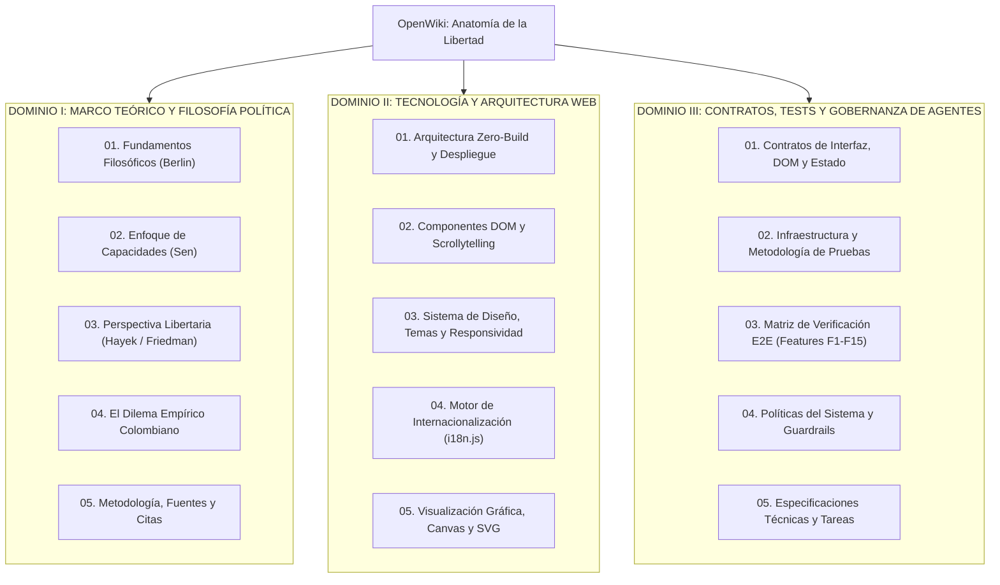

# OpenWiki — Anatomía de la Libertad
## Centro de Conocimiento, Investigación y Fuente de Verdad Operativa

Bienvenido al portal central de **OpenWiki** para el proyecto **Anatomía de la Libertad** (*Anatomy of Liberty*).

Este repositorio documental unificado constituye la **única fuente de verdad autorizada** para investigadores académicos, filósofos, desarrolladores de software, auditores de accesibilidad y agentes de IA.

---

## 1. Mapa de Navegación por Dominios de Conocimiento

La documentación del sistema está estrictamente estructurada en **dos dominios principales de investigación**, acompañados de un **tercer dominio técnico dedicado a contratos, pruebas y gobernanza de agentes**:



---

## 2. Índice Detallado de Módulos

### 📚 Dominio I: Marco Teórico y Filosofía Política
*Para investigadores, filósofos, docentes, estudiantes y divulgadores científicos.*

| Documento | Alcance y Contenido Clave | Enlace Directo |
| :--- | :--- | :--- |
| **Fundamentos Filosóficos** | Lección inaugural de Isaiah Berlin (1958), distinción analítica entre libertad negativa y positiva, la paradoja del «yo superior» y la teoría del pluralismo de valores. | [Ver Documento](./01-marco-teorico/01-fundamentos-filosoficos.md) |
| **Enfoque de Capacidades** | Amartya Sen y Martha Nussbaum: de la libertad formal a la sustantiva. Recursos vs. funcionamientos y factores de conversión en el desarrollo humano. | [Ver Documento](./01-marco-teorico/02-enfoque-de-capacidades.md) |
| **Perspectiva Libertaria** | Friedrich Hayek y Milton Friedman: orden espontáneo (*catalaxia*), conocimiento disperso, derechos de propiedad y el rol del mercado libre en la preservación de la libertad política. | [Ver Documento](./01-marco-teorico/03-perspectiva-libertaria-mercado.md) |
| **El Dilema Empírico Colombiano** | El caso de estudio de Colombia: cómo métricas idénticas (IPM del DANE, IDH del PNUD, libertad económica) arrojan diagnósticos éticos incompatibles según la lente activa. | [Ver Documento](./01-marco-teorico/04-dilema-empirico-colombia.md) |
| **Metodología, Fuentes y Citas** | Metodología de divulgación computacional, bibliografía primaria y secundaria completa, cuaderno de fuentes en NotebookLM, podcast en Spotify y formatos de citación (APA 7, BibTeX). | [Ver Documento](./01-marco-teorico/05-metodologia-fuentes-y-citas.md) |

---

### 💻 Dominio II: Tecnología, Arquitectura y Frontend
*Para ingenieros de software, diseñadores web y arquitectos de sistemas.*

| Documento | Alcance y Contenido Clave | Enlace Directo |
| :--- | :--- | :--- |
| **Arquitectura Zero-Build** | Filosofía técnica de preservación: estándares web nativos (HTML5/CSS3/ES6+), cero dependencias de compilación en runtime, despliegue estático desacoplado en GitHub Pages. | [Ver Documento](./02-tecnologia-y-arquitectura/01-arquitectura-zero-build.md) |
| **Componentes y Scrollytelling** | Arquitectura DOM, navegación colapsable, acumulador de intersección con `Set` en `IntersectionObserver`, Ruleta Horizontal de Lentes y tarjetas de Genealogía. | [Ver Documento](./02-tecnologia-y-arquitectura/02-componentes-y-scrollytelling.md) |
| **Sistema de Diseño y Responsividad** | Tokens CSS, cambio de tema claro/oscuro con script sincrónico anti-flicker, WCAG 2.1 AA, objetivos táctiles $\ge 44 \times 44\text{ px}$ y cero overflow horizontal. | [Ver Documento](./02-tecnologia-y-arquitectura/03-sistema-diseno-y-responsividad.md) |
| **Motor de Internacionalización** | Arquitectura de `files/i18n.js`: motor de parcheo reactivo en memoria, paridad lingüística estricta 1:1 (ES/EN) y alternancia instantánea sin recarga. | [Ver Documento](./02-tecnologia-y-arquitectura/04-motor-internacionalizacion.md) |
| **Visualización Gráfica y SVG** | Renderizado vectorial nativo con Canvas 2D y SVG inline, algoritmos anti-colisión de etiquetas, `devicePixelRatio` y soporte para `prefers-reduced-motion`. | [Ver Documento](./02-tecnologia-y-arquitectura/05-visualizacion-grafica-y-svg.md) |

---

### 🛡️ Dominio III: Contratos, Tests y Gobernanza de Agentes
*Para agentes de IA, auditores de calidad y pipelines de integración continua (CI/CD).*

| Documento | Alcance y Contenido Clave | Enlace Directo |
| :--- | :--- | :--- |
| **Contratos de Interfaz y DOM** | Invariantes no negociables: contrato de aislamiento de cascada CSS (blindaje de escritorio), ámbito JS en móviles, restauración manual de scroll y CLS = 0. | [Ver Documento](./03-contratos-y-tests/01-contratos-de-interfaz.md) |
| **Infraestructura de Pruebas** | Metodología de verificación en 4 niveles de caja opaca, suites unitarias (Jest + Axe + Fast-Check), Playwright E2E y pruebas visuales (Vibium). | [Ver Documento](./03-contratos-y-tests/02-infraestructura-y-metodologia-de-tests.md) |
| **Matriz de Verificación E2E** | Catálogo de features (F1 a F15), 25 escenarios de prueba de Playwright y cobertura en 6 resoluciones de hardware (320px a 1920px). | [Ver Documento](./03-contratos-y-tests/03-matriz-de-verificacion-e2e.md) |
| **Políticas y Guardrails** | Políticas normativas por capas (Arquitectura, Diseño, Interacción, Calidad, Gobernanza), taxonomía `[VIGENTE]` y protocolo de reconciliación ante conflictos. | [Ver Documento](./03-contratos-y-tests/04-politicas-y-guardrails.md) |
| **Especificaciones y Tareas** | Especificaciones funcionales y no funcionales del chip de lentes, ruleta móvil, tarjetas elásticas de la Sección X y cronología de hitos completados. | [Ver Documento](./03-contratos-y-tests/05-especificaciones-y-tareas.md) |

---

## 3. Guía Rápida de Herramientas OpenWiki

OpenWiki está integrado formalmente como herramienta CLI en el repositorio. Permite consultar, mantener y visualizar la base de conocimiento:

```bash
# 1. Abrir el visualizador interactivo local de OpenWiki
npm run wiki:visualize

# 2. Actualizar la base de conocimiento tras cambios de código
npm run wiki:update

# 3. Ejecutar la suite completa de pruebas de regresión
npm run test:all
```

### Visualizador Web Standalone
Para explorar la documentación de forma visual e interactiva sin necesidad de Node.js, abra directamente en cualquier navegador el archivo:
[`openwiki/index.html`](./index.html)
